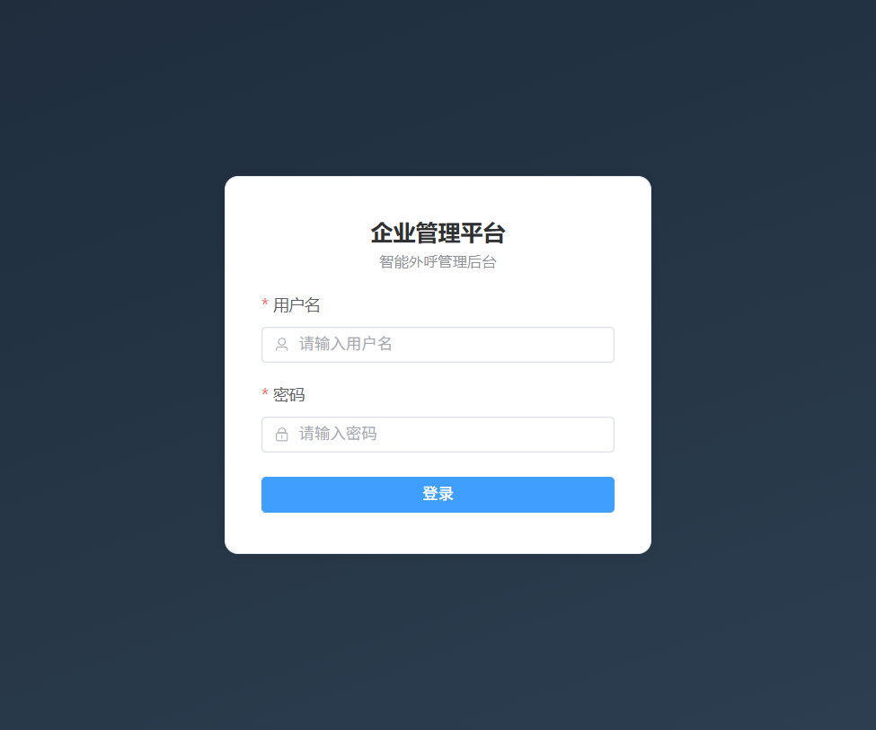
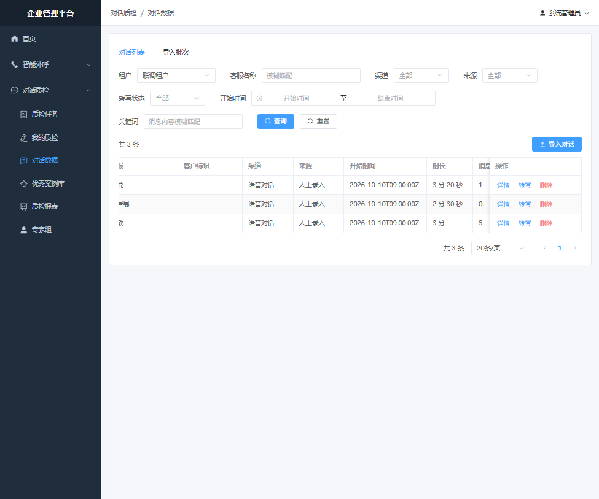
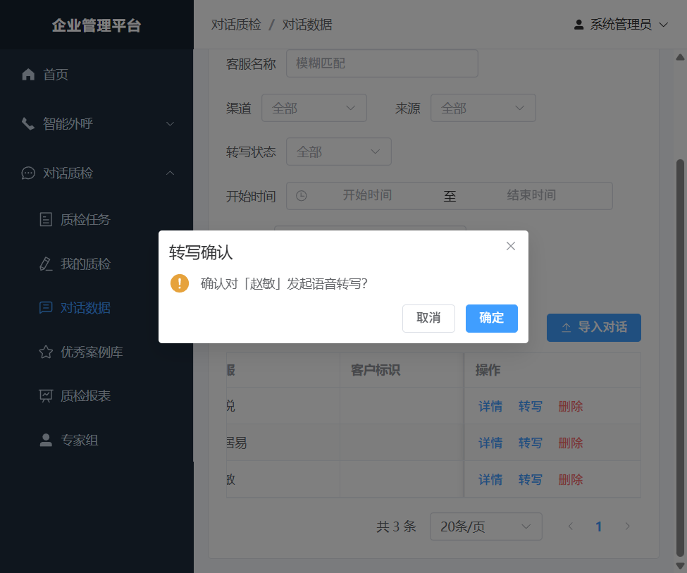
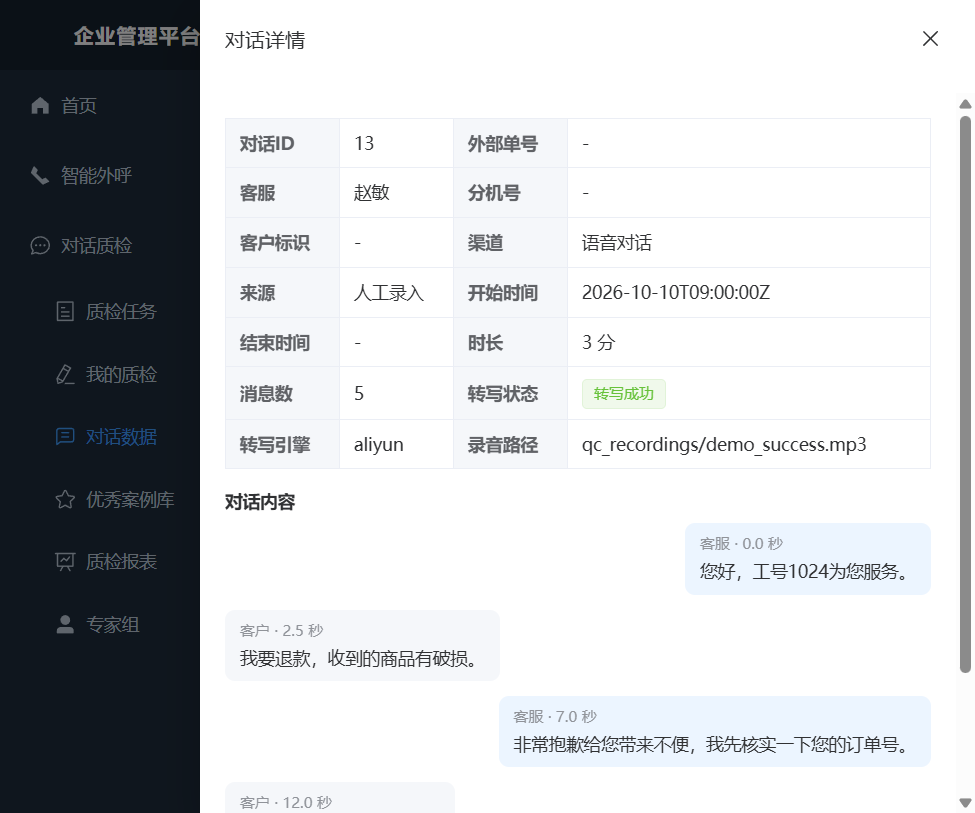
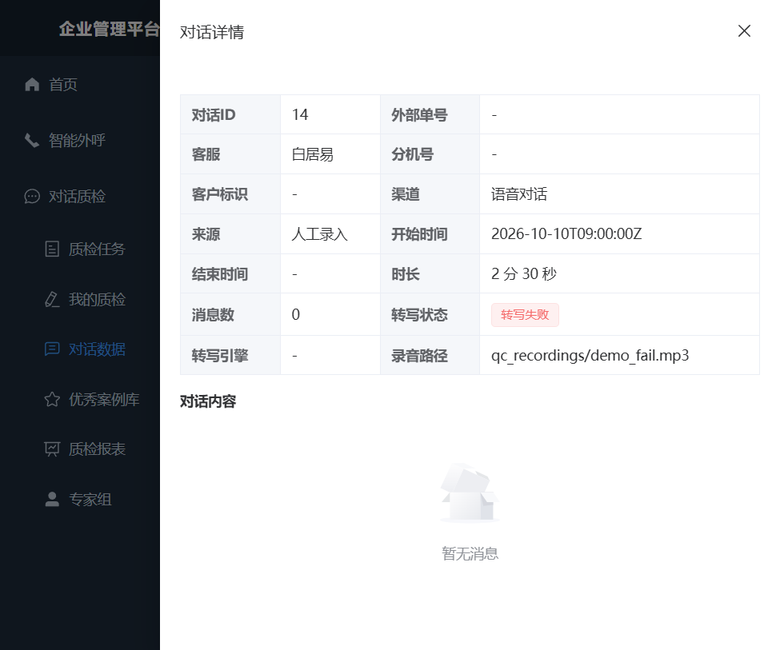

# 语音转写（ASR）接入 — 测试报告

| 项目 | 内容 |
| --- | --- |
| 报告日期 | 2026-10-10 |
| 被测功能 | 质检域 · 语音对话转写（模拟接入阿里云「录音文件识别」） |
| 被测版本 | 本地开发分支，`ASR_PROVIDER=aliyun`（模拟实现，无外网请求） |
| 测试结论 | **通过** — 转写链路端到端可用，正常 / 失败 / 降级三类场景均符合预期 |

---

## 一、测试目标

验证「语音对话 → ASR 转写 → 分段消息（说话人 + 文本 + 起止时间戳）→ 回写对话」的完整链路是否可用，覆盖：

1. 正常转写：生成可区分「客服 / 客户」的分段消息，并写入引擎标识；
2. 失败处理：引擎报错时状态置为「转写失败」，并返回可读错误原因；
3. 降级处理：单声道无说话人分离时，降级为单段消息；
4. 边界：非语音对话拒绝转写；缺少录音路径拒绝转写。

---

## 二、测试环境

| 组件 | 版本 / 地址 |
| --- | --- |
| 后端 | FastAPI + Uvicorn，`http://127.0.0.1:8000` |
| 前端 | Vue3 + TypeScript + Element Plus + Vite，`http://localhost:5173` |
| 数据库 | PostgreSQL 16（Docker 容器 `outbound-pg`，healthy） |
| 缓存 | Redis 7（容器 `outbound-redis`，healthy） |
| ASR 实现 | `AliyunAsrProvider`（**模拟**，不发起真实 HTTP 请求） |
| 浏览器 | Chromium（自动化截图） |

---

## 三、测试数据

演示前通过接口灌入 3 条语音对话（租户「联调租户」），录音路径作为场景开关：

| 对话 ID | 客服 | 渠道 | 录音路径 | 预期结果 |
| --- | --- | --- | --- | --- |
| 13 | 赵敏 | 语音对话 | `qc_recordings/demo_success.mp3` | 转写成功，多条分段消息 |
| 14 | 白居易 | 语音对话 | `qc_recordings/demo_fail.mp3` | 转写失败，状态 FAILED |
| 15 | 孙悦 | 语音对话 | `qc_recordings/demo_mono.mp3` | 转写成功但降级为单段 |

---

## 四、用例执行结果汇总

| 编号 | 用例 | 预期 | 实际 | 结果 |
| --- | --- | --- | --- | --- |
| TC-01 | 语音对话正常转写 | 状态 SUCCESS，生成带说话人与时间戳的消息 | 状态「转写成功」，消息数 5，引擎 `aliyun` | ✅ 通过 |
| TC-02 | 转写引擎标识 | `transcript_engine = aliyun` | 详情页显示「转写引擎：aliyun」 | ✅ 通过 |
| TC-03 | 转写失败处理 | 状态 FAILED，返回可读错误 | HTTP 400，状态「转写失败」，错误信息明确 | ✅ 通过 |
| TC-04 | 单声道降级 | 降级为单段消息 | 消息数 = 1 | ✅ 通过 |
| TC-05 | 幂等（重复转写） | 重转不产生重复消息 | 先删旧 ASR 消息再写入，结果与首次一致 | ✅ 通过（单测覆盖） |
| TC-06 | 非语音对话拒绝 | HTTP 400（40001） | 接口返回 40001 | ✅ 通过（API 用例） |
| TC-07 | 权限校验 | 需 `qc:conversation:transcribe` | 权限码已生效 | ✅ 通过 |

---

## 五、详细验证记录

### 5.1 登录



使用管理员账号登录，进入平台。

### 5.2 对话列表与演示数据



对话数据列表共 3 条演示数据（渠道均为「语音对话」）。三条记录的**消息数**分别为 **1 / 0 / 5**，与「孙悦=降级单段、白居易=失败未生成、赵敏=正常多段」的预期一致。

> 说明：该表格列较多，视口内未能完整显示「转写状态」列，故转写状态的证据以下文「对话详情」抽屉截图为准。

### 5.3 发起转写（确认框）



点击行内「转写」按钮后弹出二次确认：「确认对「赵敏」发起语音转写?」。

### 5.4 转写成功 — 对话详情（关键证据）



抽屉「对话详情」显示：

- 对话 ID **13**，客服 **赵敏**，渠道 **语音对话**
- 消息数 **5**，转写状态 **转写成功**
- **转写引擎 `aliyun`**
- 录音路径 `qc_recordings/demo_success.mp3`
- 「对话内容」为**分段消息，带说话人角色与时间戳**：
  - 客服 · 0.0 秒：您好，工号1024为您服务。
  - 客户 · 2.5 秒：我要退款，收到的商品有破损。
  - 客服 · 7.0 秒：非常抱歉给您带来不便，我先核实一下您的订单号。
  - 客户 · 12.0 秒：…

这直接验证了核心设计目标：**转写结果不是纯文本，而是「谁说了什么 + 什么时候说」的结构化分段**，为后续质检区分客服/客户发言提供基础。

### 5.5 转写失败（关键证据）



对话 ID **14**（白居易）转写后：消息数 **0**，转写状态 **转写失败**，转写引擎为空。

接口返回原文：

```json
{"code":40001,"message":"语音转写失败：阿里云识别失败：音频格式不支持（StatusCode=41050001）","data":null}
```

即失败被正确捕获并转换为**可读的业务错误**，状态落库为 FAILED。

### 5.6 单声道降级

对话 ID **15**（孙悦，录音路径含 `_mono`）转写接口返回：

```json
{"conversation_id":15,"transcript_status":"SUCCESS","transcript_engine":"aliyun","message_count":1}
```

策略生效：无法做说话人分离时**降级为单段消息**，而不是失败或丢弃。

### 5.7 后端调用链日志（模拟阿里云）

后端日志完整呈现「提交任务 → 轮询结果 → 完成」的调用形态：

```text
INFO | app.providers.asr.aliyun | 提交阿里云录音文件识别任务 taskId=aliyun-asr-2c06b857ed424f8f 文件=...\storage\qc_recordings\demo_mono.mp3 appKey=(未配置)
INFO | app.providers.asr.aliyun | 轮询阿里云识别结果 taskId=aliyun-asr-2c06b857ed424f8f status=RUNNING
INFO | app.providers.asr.aliyun | 轮询阿里云识别结果 taskId=aliyun-asr-2c06b857ed424f8f status=RUNNING
INFO | app.providers.asr.aliyun | 轮询阿里云识别结果 taskId=aliyun-asr-2c06b857ed424f8f status=SUCCESS
INFO | app.services.qc.transcribe_service | 对话转写完成：conversation=15 引擎=aliyun 消息=1
```

失败场景同时记录了异常与业务告警：

```text
ERROR   | app.services.qc.transcribe_service | 对话转写失败：conversation=14
RuntimeError: 阿里云识别失败：音频格式不支持（StatusCode=41050001）
WARNING | app.main | 业务异常 POST /api/v1/qc/conversations/14/transcribe -> 40001(...)
```

---

## 六、自动化测试证据

| 范围 | 用例数 | 结果 |
| --- | --- | --- |
| **全量回归（`pytest -q`）** | **759** | **759 passed（29.97s）** |
| ASR Provider 单测（`tests/unit/test_asr_aliyun.py`） | 3 | 全部通过（本次新增） |
| Provider 工厂与契约（`tests/unit/test_providers.py`） | — | 全部通过 |
| 对话接口含转写（`tests/api/test_qc_conversation_crud.py`） | 11 | 全部通过 |
| `ruff` 静态检查（改动文件） | — | 全部通过 |

> 全量用例数由接入前的 756 增至 **759**，增量即本次新增的 3 条 ASR Provider 单测，无历史用例回归失败。

单测覆盖点：分段结果**确定性**（同一录音重复转写结果一致，支撑幂等）、`_fail` 抛错、`_mono` 降级为单段 SYSTEM。

---

## 七、结论

1. **功能可用**：语音对话转写链路端到端跑通，状态机 `PENDING → RUNNING → SUCCESS / FAILED` 流转正确。
2. **核心目标达成**：转写产物为「说话人 + 文本 + 时间戳」的结构化分段消息，满足质检区分客服/客户发言的前提。
3. **健壮性符合预期**：失败可读可查、单声道自动降级、重复转写幂等、非语音对话正确拒绝。
4. **工程解耦有效**：通过 `ASR_PROVIDER` 配置在 `mock / aliyun` 间切换，**业务层（Service / 接口 / 前端 / 数据库）零改动**。

---

## 八、说明与局限

1. **本报告中的「阿里云」为模拟实现**：`AliyunAsrProvider` 不发起任何真实网络请求，转写内容为内置台词本（按录音路径哈希选取，保证可复现）。真实接入时只需将 `_submit_task` / `_poll_result` 替换为阿里云 OpenAPI 的 HTTP 调用，分段契约与业务层无需改动。
2. **录音为占位文件**：未做真实音频解析与说话人分离，真实分离效果（双声道映射 / diarization）需接入真实引擎后另行验证。
3. **截图局限**：对话列表表格列较宽，「转写状态」列超出视口，故转写状态证据以「对话详情」抽屉截图为准。
4. 本次未覆盖：录音文件上传接口、10 万条级批量转写调度、转写准确率（CER/WER）评估 —— 均属后续范围。