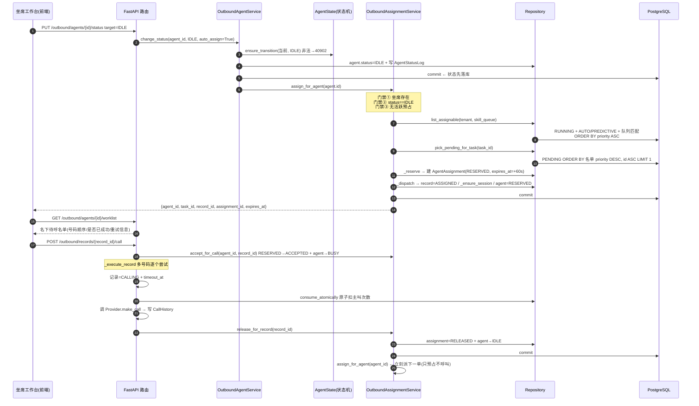

# 坐席接单与派单处理流程说明

> 本文只讲一条链路：**坐席从"示闲"到"打完一单、被塞下一单"的完整处理流程**，以及三条异常兜底路径。
>
> 事实来源（均为仓库实际代码，可逐行核对）：`backend/app/services/outbound/assignment_service.py`、`backend/app/services/outbound/agent_state.py`、`backend/app/services/outbound/agent_service.py`、`backend/app/services/outbound/execution_service.py`、`backend/app/api/v1/outbound/agents.py`、`backend/app/api/v1/outbound/records.py`、`backend/app/api/v1/outbound/sessions.py`、`backend/app/models/outbound/execution.py`、`backend/app/repositories/outbound/{agent,record,task}_repository.py`、`backend/app/core/config.py`。
>
> 相关文档：`docs/系统主要流程说明.md`（外呼域全量）、`docs/状态机与并发控制说明.md`（状态机与并发底座）、`docs/项目全景与面试题库.md`（面试题库）。

---

## 0. 一分钟速览

| 项 | 结论 |
|---|---|
| 触发点 | **坐席状态变为 `IDLE`（示闲）**——不是坐席去抢单 |
| 派单服务 | `OutboundAssignmentService`（[assignment_service.py](file:///e:/company%20project/backend/app/services/outbound/assignment_service.py)） |
| 挑单顺序 | 技能队列匹配 → 任务优先级升序 → 名单优先级降序（§34，排序规则全部集中在该服务） |
| 预占 | `agent_assignments` 一条记录，`status=RESERVED`，`expires_at = now + RESERVATION_TIMEOUT_SECONDS`（默认 **60s**） |
| 派单动作 | 记录置 `ASSIGNED` + 坐席置 `RESERVED` + 复用/新建会话（一次事务提交，写三张表） |
| 接单 | `RESERVED → ACCEPTED`，坐席 `→ BUSY`；**也可不接单直接呼叫**（呼叫内部隐式接单） |
| 打完回环 | `release_for_record` 释放预占 → 坐席回 `IDLE` → **立刻 `assign_for_agent` 派下一单** |
| 一致性三层 | 状态机守卫（`AGENT_TRANSITIONS`）→ 数据库部分唯一索引（一坐席一活跃预占）→ 定时任务幂等兜底 |
| 异常兜底 | 预占 60s 未接自动释放（30s 轮询）；记录超时回收（30s 轮询）；呼叫失败走重试阶梯 |
| 权限码 | `agent:update`（改状态/接单）、`assignment:dispatch`（批量派单/释放超时）、`assignment:release`、`assignment:list`、`session:list`（工作台）、`session:call`（呼叫） |

### 一句话总览

> **坐席不是"接到"任务，而是"示闲那一刻被系统预占一单"**：`IDLE → 挑任务 → 建 60 秒预占 + 记录 ASSIGNED + 建会话 + 坐席 RESERVED → 接单（或直接开打时隐式接单）→ 多号码逐个拨 → 打完释放 → 立刻被塞下一单`。

---

## 第一部分 · 端到端时序图



---

## 第二部分 · 阶段详解

### 阶段一：坐席"示闲"——唯一的触发开关

入口：`PUT /outbound/agents/{agent_id}/status`（[agents.py](file:///e:/company%20project/backend/app/api/v1/outbound/agents.py#L147-L171)），带 `auto_assign=true`（默认）。

```
change_status(agent_id, target, reason, operator_id, auto_assign)
  ① ensure_transition(当前状态, 目标状态)          # 状态机集中校验，非法抛 40902
  ② 置新状态；IDLE 记 last_idle_at，BUSY 记 last_busy_at
  ③ 写 AgentStatusLog（§11 所有状态变化必须留痕）
  ④ commit                                        # 状态先落库
  ⑤ if target == IDLE and auto_assign:
        OutboundAssignmentService.assign_for_agent(agent.id)
```

对应 [agent_service.py](file:///e:/company%20project/backend/app/services/outbound/agent_service.py#L170-L213)。两个关键点：

1. **状态先 commit，再派单**——即使派单失败，"坐席已示闲"这件事不会回滚。
2. **`auto_assign` 是查询参数，可关**——关掉就只改状态不派单，给运维保留手动控制口子。

坐席状态机（[agent_state.py](file:///e:/company%20project/backend/app/services/outbound/agent_state.py#L12-L22)）：

| 当前状态 | 可流转到 |
|---|---|
| `OFFLINE` | `IDLE` |
| `IDLE` | `RESERVED`、`BUSY`、`PAUSED`、`OFFLINE` |
| `RESERVED` | `BUSY`、`IDLE`、`OFFLINE` |
| `BUSY` | `IDLE`、`PAUSED` |
| `PAUSED` | `IDLE` |

`OFFLINE → BUSY` 会被 `ensure_transition` 拒绝（40902）——**必须先经过 `IDLE`，也就是必须"可被派单"才算上岗**。

---

### 阶段二：门禁与挑单

`assign_for_agent`（[assignment_service.py](file:///e:/company%20project/backend/app/services/outbound/assignment_service.py#L44-L80)）三道门禁，任一不满足就返回 `None`（**静默跳过，不报错**）：

| # | 门禁 | 不满足时 |
|---|---|---|
| ① | 坐席存在 | `NotFound("坐席不存在")` |
| ② | `agent.status == IDLE` | `return None` |
| ③ | 无活跃预占（`RESERVED`/`ACCEPTED`） | 记 `logger.info` + `return None` |

第③条有**两层保险**：应用层先查（[agent_repository.py](file:///e:/company%20project/backend/app/repositories/outbound/agent_repository.py#L167-L180)），数据库层再用**部分唯一索引**兜底：

```python
Index("uq_agent_assignments_active_agent", "agent_id", unique=True,
      postgresql_where=text("is_deleted = false AND status IN ('RESERVED', 'ACCEPTED')"))
```

见 [execution.py](file:///e:/company%20project/backend/app/models/outbound/execution.py#L229-L236)。语义是：**只要这条预占还是活的，同一坐席插不进第二条**——并发场景下即使应用层先查漏了，数据库也会拦。

#### 挑任务：`list_assignable`（[task_repository.py](file:///e:/company%20project/backend/app/repositories/outbound/task_repository.py#L108-L130)）

```sql
WHERE is_deleted = false
  AND tenant_id = :坐席租户
  AND status = 'RUNNING'                          -- 只有运行中任务能派
  AND dispatch_mode IN ('AUTO','PREDICTIVE')      -- MANUAL 任务不参与自动派单
  AND (skill_queue_id = :坐席队列 OR skill_queue_id IS NULL)   -- NULL = 通用任务，任意队列可接
ORDER BY priority ASC, id ASC                     -- 任务优先级：数值越小越先派
LIMIT 20
```

#### 挑名单行：`pick_pending_for_task`（[record_repository.py](file:///e:/company%20project/backend/app/repositories/outbound/record_repository.py#L132-L145)）

```sql
WHERE task_id = :task AND is_deleted = false AND status = 'PENDING'
ORDER BY OutboundList.priority DESC, OutboundRecord.id ASC   -- 名单优先级：数值越大越先派
LIMIT 1
```

两级是**循环**关系：第一个任务没有可派记录就试下一个任务；20 个任务全都试完仍没捞到，返回 `None`（本次不派）。

---

### 阶段三：预占 + 派单（一次事务写三张表）

`_reserve` → `_dispatch`（[assignment_service.py](file:///e:/company%20project/backend/app/services/outbound/assignment_service.py#L234-L270)），末尾一次 `commit`：

**① `agent_assignments` 建预占**

```python
status      = RESERVED
reserved_at = now
expires_at  = now + RESERVATION_TIMEOUT_SECONDS     # 默认 60 秒
```

§35 要求"预占必须带过期时间"——防止坐席挂着单不处理、任务被永久占用。

**② `outbound_records` 派单**

```python
record.status      = ASSIGNED        # PENDING → ASSIGNED
record.agent_id    = agent.id
record.assigned_at = now
record.timeout_at  = now + task.call_timeout_seconds   # 注意：这是"呼叫超时"，不是"预占超时"
```

> **两个 timeout 是两回事**：`agent_assignments.expires_at`（60s）管"坐席多久没接单就撤单"，`outbound_records.timeout_at`（任务级 `call_timeout_seconds`）管"派出去多久没打完就回收"，由两个不同的定时任务分别盯。

**③ `outbound_sessions` 复用或新建**

`_ensure_session`：`record.session_id` 已存在就**复用**（只刷 `agent_id`），否则新建 `SessionStatus.ASSIGNED`、`current_attempt=0`、`started_at=now`。

**④ 坐席置 `RESERVED`**

`_switch_agent_status(agent, RESERVED, reason=f"自动派单：任务#{task.id}")` → 写 `AgentStatusLog`。

#### ⚠️ 一个真实的行为差异

`_switch_agent_status` 内部用的是 `can_transition` + `logger.warning` **跳过非法流转**（[assignment_service.py](file:///e:/company%20project/backend/app/services/outbound/assignment_service.py#L308-L321)）：

```python
if not can_transition(current, target):
    logger.warning("跳过非法状态流转：agent=%s %s→%s", ...)
    return                       # 只告警，不抛异常
```

而 `agent_service.change_status`（用户手动改状态）用的是 `ensure_transition` **直接抛 40902**。

**结论：用户手动改状态非法 → 报错；系统内部派单时状态不对 → 只记警告、不中断批次。** 这是刻意选择（派单是后台兜底链路，不该因单个状态守卫把整批打断），代价是"状态流转被跳过"只留 warning 日志、没有错误码，排查时要翻日志。

---

### 阶段四：坐席接单

坐席只有两条路进工作态：

**方式 A：显式接单** `POST /outbound/assignments/{assignment_id}/accept`（[agents.py](file:///e:/company%20project/backend/app/api/v1/outbound/agents.py#L236-L244)）

```
accept(assignment_id)
  ① status 必须是 RESERVED，否则 StateNotAllowed（40902）
  ② assignment.status = ACCEPTED
  ③ 坐席 → BUSY（reason="坐席接单"）
  ④ commit
```

**方式 B：不接单，直接开打**——`accept_for_call(agent_id, record_id)`（[assignment_service.py](file:///e:/company%20project/backend/app/services/outbound/assignment_service.py#L123-L138)）：

```
① 按 record_id 找活跃预占；若属于本人且是 RESERVED → 隐式置 ACCEPTED
② 坐席 → BUSY（reason="坐席开始呼叫"）
③ commit
```

**注意：没有"拒单"接口。** 坐席不能拒绝被派的单，只能 `release`（释放）。`release` 的语义是"我不要这一单/我处理不了"，对应 `assignment → RELEASED` + 坐席回 `IDLE`。

---

### 阶段五：坐席看自己要打谁（工作台）

`GET /outbound/agents/{agent_id}/worklist`（[sessions.py](file:///e:/company%20project/backend/app/api/v1/outbound/sessions.py#L107-L126)），权限 `outbound:session:list`，参数 `include_finished`（是否含已结束名单）。

返回（OB-021-1）：**按任务配置解析出的号码数量与来源顺序**（OrderID / UserID / 收件人号码的顺序是任务级配置）、**是否已呼叫成功**、**重试次数与下次可重试时间**。

配套接口：

| 接口 | 作用 |
|---|---|
| `GET /outbound/lists/{list_id}/phones` | 号码解析明细（含第三方电话簿结果、是否已成功、重试信息） |
| `GET /outbound/lists/{list_id}/histories` | 该名单的全部拨打历史 |
| `GET /outbound/lists/{list_id}/board` | 名单看板 |

---

### 阶段六：发起呼叫

`POST /outbound/records/{record_id}/call`，body 可带 `agent_id`（[records.py](file:///e:/company%20project/backend/app/api/v1/outbound/records.py#L95-L110)），权限 `outbound:session:call`。

`execute_record(record_id, agent_id)` 顺序：

```
① 取记录 → 任务必须 RUNNING（否则拒绝）
② 传了 agent_id → accept_for_call(agent_id, record_id)   # 隐式接单 + 坐席 BUSY
③ _execute_record(...)                                    # 核心执行（多条号码）
④ release_for_record(record_id)                           # 释放坐席 + 回 IDLE + 尝试下一单
⑤ maybe_complete_task(...)                                # 条件完成整单
```

`_execute_record` 对**被叫号码逐个尝试**（来源与顺序由任务配置决定：名单自带号码 → 按 `order_id → user_id → recipient_number` 取值，`is_valid_phone` 过滤 + 去重）：

```
for 每个号码:
    记录置 CALLING、写 timeout_at                      # 交给超时回收盯
    选主叫号码并原子扣次(consume_atomically，rowcount==1 才算选中)
    建 CallHistory(INITIATED)
    调 Provider.make_call(phone, agent_id, session_id) # 同步经 run_sync 桥接 async
    回写 CallHistory(call_status / duration / recording_path)
    成功 → 记录 SUCCESS、会话 ENDED、名单 SUCCESS，跳出
    失败 → 继续试下一个号码
全部失败 → 走重试阶梯(apply_failure_ladder)
```

**两个设计要点**：

- 记录在开打前**先置 `CALLING` 并写 `timeout_at`**——即使呼叫过程中进程崩了，也有超时回收兜底。
- 主叫号码是**原子扣次**（带条件 UPDATE，`rowcount==1` 才选中）——不会出现两个坐席把同一号码次数用超。

---

### 阶段七：打完立刻被塞下一单（闭环）

`release_for_record(record_id)`（[assignment_service.py](file:///e:/company%20project/backend/app/services/outbound/assignment_service.py#L140-L172)）是链路回环：

```
① 按 record_id 找活跃预占 → _release_assignment：
     assignment.status = RELEASED，写 released_at / release_reason
     坐席若在 RESERVED/BUSY → 置 IDLE
② 若无预占（纯人工呼叫）→ 把 BUSY 的坐席直接放回 IDLE
③ commit
④ if agent_id and trigger_assign: return assign_for_agent(agent_id)   # 立刻派下一单
```

源码 docstring 专门解释：**`trigger_assign` 只会"预占"下一单而不会立即呼叫，因此不存在递归风险**——链路到"预占"为止，不会自己再触发呼叫。

**这就是"坐席打完一单立刻接到下一单"的机制**：不是前端轮询，而是"释放坐席"这个动作本身就去要下一单。

---

## 第三部分 · 三条异常兜底路径

| 异常 | 谁处理 | 处理逻辑 |
|---|---|---|
| **预占 60 秒没接** | `reservation_expire` 定时任务（30s 轮询）；`POST /outbound/assignments/expire` 为手动入口 | `list_expired_reservations` 捞候选 → **复核三条件**（状态仍是 `RESERVED`、`expires_at` 有值、确实已过期）→ 置 `EXPIRED` + `release_reason="预占超时，系统自动释放"` + 坐席回 `IDLE`；**每条独立 commit** |
| **派单后一直没打完**（record 已 `ASSIGNED`/`CALLING` 且过 `timeout_at`） | `timeout_recycle` 定时任务（30s 轮询） | `SELECT … FOR UPDATE` 行锁 + 锁内复核 → 置 `TIMEOUT` + 写 `CallHistory(TIMEOUT)` + **释放坐席预占** + 会话收尾 → 走重试阶梯 |
| **呼叫失败** | 执行 / 回调 / 回收三处共用 `apply_failure_ladder` | 不可重试 → `FAILED`；还能重试 → `RETRY_WAITING` + `next_retry_at`；次数用完 → `EXHAUSTED`。名单状态同步（终态失败 → `EXHAUSTED`） |

三条路径共同点：**宽松扫描 + 加锁复核 + 动作提交**——所以定时任务重复触发（多实例部署时每个实例都会跑同一任务）不会产生脏数据。`expire_reservations` 里那个"复核三条件"就是幂等的关键：第二个执行者拿到锁后发现状态已不是 `RESERVED`，于是计入 `skipped` 跳过。

---

## 第四部分 · 数据模型与接口清单

### 涉及的表

| 表 | 作用 | 关键字段 |
|---|---|---|
| `agents` | 坐席（关联 `users`，一个用户最多一个坐席） | `status` / `skill_queue_id` / `site_id` / `last_idle_at` / `last_busy_at` |
| `agent_status_logs` | 每次状态变化的痕迹（§11） | `from_status` / `to_status` / `reason` / `operator_id` |
| `agent_assignments` | 预占记录（§35） | `status` / `reserved_at` / `expires_at` / `released_at` / `release_reason`；**活跃预占部分唯一索引** |
| `outbound_records` | 执行记录 | `status` / `agent_id` / `assigned_at` / `timeout_at` / `session_id` |
| `outbound_sessions` | 会话（派单时建/复用） | `status`（`ASSIGNED`）/ `current_attempt` / `started_at` |
| `call_histories` | 每次呼叫尝试的 append-only 历史 | `call_status` / `duration` / `recording_path` / `provider_call_id` |

### 接口与权限码

| 接口 | 权限码 |
|---|---|
| `PUT /outbound/agents/{id}/status`（示闲触发派单） | `outbound:agent:update` |
| `POST /outbound/assignments/dispatch`（批量派单，`limit` 默认 50） | `outbound:assignment:dispatch` |
| `POST /outbound/assignments/{id}/accept`（接单） | `outbound:agent:update` |
| `POST /outbound/assignments/{id}/release`（释放） | `outbound:assignment:release` |
| `POST /outbound/assignments/expire`（手动释放超时预占） | `outbound:assignment:dispatch` |
| `GET /outbound/agents/{id}/worklist`（工作台待呼名单） | `outbound:session:list` |
| `POST /outbound/records/{id}/call`（发起呼叫） | `outbound:session:call` |
| `GET /outbound/assignments`（预占与派单列表） | `outbound:assignment:list` |
| `GET /outbound/agents/{id}/status-logs`（状态变更历史） | `outbound:agent:list` |

### 前端页面

| 页面 | 内容 |
|---|---|
| `views/outbound/agent/index.vue` | 坐席与分配：双 Tab（坐席管理 / 预占与派单），含状态变更留痕、自动派单按钮 |
| `views/outbound/session/index.vue` | 外呼会话：三 Tab（会话 / 坐席工作台 / 任务看板） |

---

## 第五部分 · 已知边界（如实列出）

| # | 边界 | 说明 |
|---|---|---|
| 1 | **并发同抢时抛的是数据库完整性错误** | 两个请求同时通过应用层"无活跃预占"检查时，第二个会在 `commit` 撞部分唯一索引；项目**没有为这个 `IntegrityError` 单独包装业务码**，会落到统一的 500 + 50000 兜底，而不是 409xx。也就是说"一坐席一活跃预占"这条规则是**数据库拦住的**，但报错语义不是业务友好的。 |
| 2 | **内部派单非法流转只告警不报错** | `_switch_agent_status` 用 `can_transition` + `logger.warning` 跳过（§2 阶段三）。好处是不中断批次，代价是**状态没切成功但派单照写**（预占/记录/会话都写了），排查只能翻 warning 日志。 |
| 3 | **没有"拒单"语义** | 只有 `accept`（接单）与 `release`（释放），坐席不能拒绝被派的单——只能释放，且释放原因由调用方自由填。 |
| 4 | **自动派单只处理首次待呼记录** | `pick_pending_for_task` 只取 `status = PENDING`。**重试中的记录（`RETRY_WAITING` 到期）不走坐席预占链路**，由 `retry_dispatch` 定时任务直接执行——所以"重试的电话"不会派给坐席、也不占用预占。 |
| 5 | **`MANUAL` 模式任务完全不参与自动派单** | `list_assignable` 只取 `AUTO` / `PREDICTIVE`。手工派单必须由调用方主动指定坐席。 |
| 6 | **预占阶段不锁号码** | 派单只挑任务与记录，**主叫号码要到真正呼叫时才原子扣次**。所以预占期间号码资源没有预留，极端情况下可能出现"预占了 20 个坐席、但号码次数只够 5 个"。 |
| 7 | **预占超时靠定时任务，最长延迟约 30 秒** | `reservation_expire` 每 30 秒跑一次，所以"60 秒预占"实际释放时刻可能到 60～90 秒之间。若需要精确，得走手动 `POST /assignments/expire`。 |

---

## 第六部分 · 面试问答（15 题）

> 每题给「标准回答」（可在代码里核对）+「大白话」。

### Q1. 坐席是怎么"接到"任务的？触发点是什么？
**标准回答**：触发点是**坐席状态变为 `IDLE`**——`PUT /outbound/agents/{id}/status` 带 `auto_assign=true` 时，`change_status` 提交状态后调 `OutboundAssignmentService.assign_for_agent(agent.id)`。另外批量入口 `POST /outbound/assignments/dispatch` 遍历空闲坐席逐个派单；呼叫结束 `release_for_record` 也会触发下一单。
**大白话**：坐席不抢单，是"一显示空闲，系统立刻塞一单给他"。相当于食堂打饭——你一站到窗口前（示闲），打饭阿姨就给你盛好了。

### Q2. 派单按什么顺序挑任务和名单？
**标准回答**：三级排序，全部集中在 `OutboundAssignmentService`：① 技能队列匹配（任务的 `skill_queue_id` 等于坐席队列，或任务为 `NULL` 通用任务）；② 任务优先级 `priority ASC`（越小越先派）；③ 名单优先级 `OutboundList.priority DESC`（越大越先派），同优先级按 `record.id ASC`。
**大白话**：先看"这活归不归你干"（技能队列），再看"哪个活更急"（任务优先级），最后看"这个活里先打哪个客户"（名单优先级）。三级都用 SQL 的 `ORDER BY` 表达，不用应用层排序。

### Q3. 为什么一个坐席同时只能有一个预占？怎么保证？
**标准回答**：§35 要求。应用层先查 `get_active_assignment_by_agent`（查 `RESERVED`/`ACCEPTED`），数据库层用部分唯一索引兜底：`Index("uq_agent_assignments_active_agent", "agent_id", unique=True, postgresql_where=text("is_deleted = false AND status IN ('RESERVED','ACCEPTED')"))`。
**大白话**：一个坐席同一时间只能拿一单——先由程序自己检查（"你手里是不是还有活"），再由数据库这个"铁面门卫"兜底：只要还有活着的预占记录，插入第二条直接被拒。
**加分点**：这是"应用层检查 + 数据库约束"的双保险模型，数据库是最终防线。

### Q4. 派单时一次事务写了几张表？
**标准回答**：四张。`agent_assignments`（建 `RESERVED` 预占）+ `outbound_records`（置 `ASSIGNED`、写 `agent_id`/`assigned_at`/`timeout_at`）+ `outbound_sessions`（复用或新建）+ `agents` 状态置 `RESERVED`（同时写 `agent_status_logs`）。最后 `self.db.commit()` 一次提交。
**大白话**：派单不是"改一个字段"，而是"预占记录 + 执行记录 + 会话 + 坐席状态 + 状态流水"五处数据必须一起生效——所以包在同一个事务里，要么全成要么全不成。
**加分点**：事务边界在 Service 层，Router 完全不碰事务。

### Q5. 预占的 60 秒和记录的 `timeout_at` 有什么区别？
**标准回答**：两个不同的超时、两个不同的定时任务。`agent_assignments.expires_at = now + RESERVATION_TIMEOUT_SECONDS`（默认 60s）——**坐席没接单就撤单**，由 `reservation_expire` 盯；`outbound_records.timeout_at = now + task.call_timeout_seconds`（任务级配置）——**派出去没打完就回收**，由 `timeout_recycle` 盯。
**大白话**：一个是"服务员站位超过 60 秒还不接单就换人"（预占超时），一个是"这通电话打出去超过规定时长还没结果就作废"（呼叫超时）。两个人各盯各的，粒度也不同（前者固定 60 秒，后者按任务配置）。

### Q6. 坐席接单和直接呼叫有什么区别？
**标准回答**：`accept` 走 `RESERVED → ACCEPTED` + 坐席 `BUSY`；`accept_for_call` 在呼叫接口内部被调用，若预占属于本人且仍是 `RESERVED` 就**隐式置 `ACCEPTED`**，同时坐席置 `BUSY`。两条路最终状态一致，都写 `AgentStatusLog`。
**大白话**：可以点"接单"再接，也可以不点直接打——直接打的话系统替你自动接了单。结果一样，少一步操作。

### Q7. 打完一单怎么自动拿到下一单？
**标准回答**：`release_for_record` 释放预占（`RELEASED` + 坐席回 `IDLE`）→ `commit` → 若 `trigger_assign=True` 就调 `assign_for_agent(agent_id)`。源码 docstring 说明：`trigger_assign` 只会**预占**下一单而不会立即呼叫，因此不存在递归风险。
**大白话**：打完 → 交还工位 → 立刻再领一单。但"领"只是把单子放你桌上（预占），不会自动替你拨号（不呼叫），所以不会出现"打完一单又自动打一单、无限套娃"。
**加分点**：这是"事件驱动"而不是"前端轮询"——省掉了坐席端不断问"我有新单吗"的开销。

### Q8. 坐席状态机有哪些边？为什么 `OFFLINE → BUSY` 会被拒？
**标准回答**：`AGENT_TRANSITIONS` 五条边（见 §阶段一表格）。`OFFLINE → BUSY` 拒绝是因为 §11 明确要求——`ensure_transition` 抛 40902。语义上：**必须先经过 `IDLE`（可被派单）才能忙起来**，否则就绕过了派单链路。
**大白话**：离线的人不能直接变"忙碌"——必须先从离线切成"空闲"，也就是必须先把工位交回系统、让系统能派单给他。这样"忙碌"这个状态永远来自真实的派单或接单，不会凭空出现。

### Q9. 为什么内部派单时状态非法只告警不报错？
**标准回答**：`_switch_agent_status` 用 `can_transition` + `logger.warning` 跳过；而用户手动改状态走 `ensure_transition` 抛 40902。设计意图是：派单是后台兜底链路，**不该因为单个状态守卫把整批派单打断**。
**大白话**：用户点错按钮要立刻告诉他"不行"（报错）；系统自己批量干活时遇到一条小问题，记个警告跳过继续干（不中断），否则一批 50 个坐席的派单可能被一个异常全废掉。
**加分点**：代价是"状态没切成功但派单照写"，只留 warning 日志——属于已知边界（§第五部分第 2 条）。

### Q10. 坐席能拒绝被派的单吗？
**标准回答**：**没有专门的"拒单"接口**。只有 `accept`（接单）和 `release`（释放），`release` 把 `assignment` 置 `RELEASED` + 坐席回 `IDLE`，释放原因由调用方填（默认"手动释放"）。**这是当前的功能边界。**
**大白话**：只有"接"和"退"，没有"拒"。不想打就点"释放"把单退回去，退回去之后它会重新参与派单。

### Q11. 重试的电话会派给坐席吗？
**标准回答**：**不会**。`pick_pending_for_task` 只挑 `status = PENDING` 的记录。重试中的记录（`RETRY_WAITING` 到期）由 `retry_dispatch` 定时任务走 `execute_due_retries` → `execute_task` 直接执行，**不经过坐席预占链路、不占预占**。
**大白话**：第一次打是"派给人打"（坐席接单），失败了之后的自动重试是"系统自己打"（定时任务直接执行）——所以重试不会占用坐席工位。
**加分点**：这是设计选择，不是遗漏；但它意味着"重试电话没有坐席归属"。

### Q12. 预占阶段会锁住主叫号码吗？
**标准回答**：**不会**。派单只挑任务与执行记录，主叫号码要到 `_execute_record` 真正呼叫时才 `consume_atomically` 原子扣次。所以预占期间号码资源未预留——极端情况下可能"预占了 20 个坐席，但号码次数只够 5 个"。
**大白话**：派单只占"人"（坐席），不占"电话线"（主叫号码）。号码是打出去的那一刻才扣的——省资源，但可能出现"人齐了、线不够"。
**加分点**：这是已知边界（§第五部分第 6 条）。号码扣次是原子 UPDATE，所以不会出现次数用超的并发 bug。

### Q13. 预占超时释放怎么保证幂等？
**标准回答**：`expire_reservations` 先 `list_expired_reservations` 捞候选，再对每条**复核三条件**——`status` 仍是 `RESERVED`、`expires_at` 仍有值、且确实已过期（`expires_at < now`）；不满足就计入 `skipped` 并 commit 跳过。所以定时任务重复触发（多实例）不会重复释放。
**大白话**：先"扫一遍看谁超时了"，真要动手前再确认一遍"它真的还是'待接单'、真的已经超时"——别人先处理过的话，状态已经不满足了，就跳过。所以两个值班员同时巡场也不会把同一条处理两遍。

### Q14. 呼叫过程中进程崩了怎么办？
**标准回答**：`_execute_record` 在**开打前**就把记录置 `CALLING` 并写 `timeout_at`，之后再调 Provider。所以进程崩了以后，记录停在 `CALLING`（或 `ASSIGNED`）且带 `timeout_at`，`timeout_recycle` 定时任务（30s）会 `FOR UPDATE` + 锁内复核后置 `TIMEOUT`、写 `CallHistory(TIMEOUT)`、**释放坐席预占**、走重试阶梯。
**大白话**：先把"我正在打这通电话"写在墙上（`CALLING` + 超时时间）再去打。人走了（进程崩了）没关系，值班员巡场时看到"这通电话挂太久了"就替你把工位收回、把电话标记成超时、按规矩重排。

### Q15. 这条链路的一致性靠什么保证？
**标准回答**：三层。① **状态机守卫**：`AGENT_TRANSITIONS` + `ensure_transition`（用户操作）`/ can_transition`（内部流转）；② **数据库约束**：活跃预占的部分唯一索引，一个坐席插不进两条活预占；③ **定时任务幂等兜底**：预占超时释放、记录超时回收都是"宽松扫描 + 加锁复核 + 动作提交"，重复触发不脏数据。
**大白话**：三道关卡——"规矩"（状态机告诉你能不能这么转）、"铁门"（数据库不让同一坐席有两个活单）、"值班员"（定时任务收拾漏网的超时单）。任何一道出问题，另外两道还兜着。

---

## 附录 · 复核命令

```bash
# 派单主链路
sed -n '44,100p' backend/app/services/outbound/assignment_service.py     # assign_for_agent + 门禁
sed -n '221,290p' backend/app/services/outbound/assignment_service.py    # 挑单 / 预占 / 派单
sed -n '140,206p' backend/app/services/outbound/assignment_service.py    # release_for_record + expire

# 状态机
cat backend/app/services/outbound/agent_state.py

# 示闲触发
sed -n '170,213p' backend/app/services/outbound/agent_service.py

# 活跃预占唯一索引
grep -n -A 14 "class AgentAssignment" backend/app/models/outbound/execution.py

# 挑任务 / 挑名单的排序 SQL
sed -n '108,130p' backend/app/repositories/outbound/task_repository.py
sed -n '132,145p' backend/app/repositories/outbound/record_repository.py

# 相关接口
grep -n "assignments\|worklist\|/call" backend/app/api/v1/outbound/agents.py backend/app/api/v1/outbound/records.py backend/app/api/v1/outbound/sessions.py

# 跑相关测试（需 PostgreSQL 运行）
cd backend && pytest tests/api/test_outbound_assignment.py tests/unit/test_agent_state.py -q
```

```powershell
Select-String -Path backend/app/services/outbound/assignment_service.py -Pattern "def assign_for_agent|def _pick_task_and_record|def _reserve|def release_for_record|def expire_reservations"
Select-String -Path backend/app/models/outbound/execution.py -Pattern "uq_agent_assignments_active_agent" -Context 2,8
```

> 前置条件：涉及数据库的用例需 PostgreSQL 在运行（`TEST_DATABASE_URL`，库名 `app_test`）。