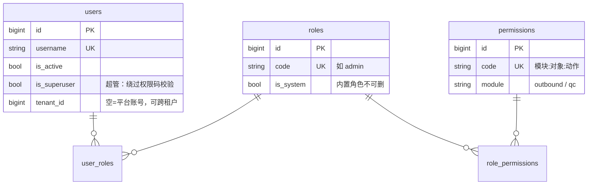

# 数据模型与 RBAC 权限说明

> 本文回答两个问题：**38 张业务表分别是什么**、**63 个权限码构成的 RBAC 体系怎么运转**，并在第三部分给出**本项目中的真实案例**（真实代码位置、真实测试断言、真实约束条件）。
>
> 事实来源：`backend/app/models/**`、`backend/app/core/permissions.py`、`backend/app/api/deps.py`、`backend/scripts/init_db.py`、`backend/tests/**`、`frontend/src/router/routes.ts`。文中每个数字都可用末尾「附：自行复核」的命令重新验证。
>
> 相关文档：`docs/项目说明.md`（3W2H 总览）、`docs/系统主要流程说明.md`（外呼全量细节）、`.trae/documents/质检模块落地方案.md`（质检一期方案）。

---

## 0. 一分钟速览

| 项目 | 结论 |
|---|---|
| 业务表总数 | **38** 张（另有 `alembic_version`），分 9 组 |
| RBAC 基线表 | **5** 张：`users` / `roles` / `permissions` / `user_roles` / `role_permissions` |
| 权限码总数 | **63** = 外呼 **40** + 质检 **23** |
| 权限码命名规范 | `模块:对象:动作`，如 `qc:task:dispatch` |
| 权限校验入口 | `backend/app/api/deps.py` 的 `require_permission() → 40301`；超管 `is_superuser` 直接放行 |
| 部分唯一索引 | **24** 个（软删除后编码/名称可复用的关键机制） |
| 三层落地 | 后端强制（403）→ 页面级 `meta.permission`（18 条路由）→ 按钮级 `v-permission`（移除 DOM） |
| 另一条正交维度 | **数据范围**：`tenant_scope_optional / tenant_scope_required` 控制"能看哪个租户的数据" |

---

# 第一部分：38 张业务表

## 1.1 公共约定（先看这 5 条，后面表格不再重复）

1. **公共列**：所有表继承 `backend/app/db/base.py` 的 `Base + BigIntPK + TimestampMixin + SoftDeleteMixin`，因此默认都有 `id:BIGINT PK`、`created_at`、`updated_at`（`timestamptz`）；带软删除的表另有 `is_deleted:BOOLEAN`、`deleted_at`。
2. **软删除 + 部分唯一索引**：需要唯一性的列一律写成 `UNIQUE ... WHERE is_deleted = false`（PG 部分唯一索引），这样"删除后同名可重建"。全库共 **24** 个。
3. **枚举不用 PG 原生 ENUM**：所有枚举列都是 `VARCHAR(32)` + Python 侧校验（`models/outbound/enums.py` 的 `enum_type()`），避免枚举值变更带来的迁移负担。
4. **时间统一 UTC**（`timestamptz`），报表按天分桶时才换算时区（`QC_REPORT_TIMEZONE`）。
5. **多租户**：绝大多数业务表带 `tenant_id`，查询入口通过 `tenant_scope_*` 依赖收敛（见第二部分 2.5）。

## 1.2 分组统计

| 分组 | 张数 | 表 |
|---|---|---|
| RBAC 基线 | 5 | users、roles、permissions、user_roles、role_permissions |
| 审计 | 2 | login_logs、operation_logs |
| 租户与资源 | 3 | tenants、sites、skill_queues |
| 外呼基础配置 | 5 | agents、agent_status_logs、outbound_types、outbound_scenes、outbound_numbers |
| 任务与名单 | 4 | outbound_tasks、outbound_task_numbers、outbound_import_batches、outbound_lists |
| 执行与会话 | 5 | outbound_records、outbound_sessions、call_histories、service_summaries、agent_assignments |
| IVR | 3 | ivr_flows、ivr_nodes、ivr_transitions |
| 回呼 | 2 | callback_flows、callback_tasks |
| 对话质检 | 9 | qc_conversations、qc_messages、qc_import_batches、qc_reviewer_groups、qc_reviewer_group_members、qc_tasks、qc_task_items、qc_review_results、qc_case_library |
| **合计** | **38** | 5+2+3+5+4+5+3+2+9 = 38 |

> 注：租户/站点/队列/坐席在源码里同属 `models/outbound/config.py`，本文按业务语义拆成"租户与资源（tenants/sites/skill_queues）"与"外呼基础配置（agents/agent_status_logs/outbound_types/scenes/numbers）"两组，不重复计数。

## 1.3 逐表清单

### （1）RBAC 基线（5 张，`models/user.py`，标注"基线冻结"）

| 表名 | 类名 | 关键列 | 约束/索引 | 用途 |
|---|---|---|---|---|
| `users` | User | username:VARCHAR(64)、password_hash:VARCHAR(255)、nickname、email、phone、is_active、is_superuser、tenant_id | 部分唯一 `uq_users_username_active(username) WHERE is_deleted=false`；部分唯一 `uq_users_email_active(email) WHERE is_deleted=false AND email IS NOT NULL`；ix(tenant_id)；FK tenant_id→tenants.id **SET NULL** | 系统账号 |
| `roles` | Role | name:VARCHAR(64)、code:VARCHAR(64)、description、is_system:BOOLEAN | 部分唯一 `uq_roles_code_active(code) WHERE is_deleted=false` | 角色 |
| `permissions` | Permission | name、code:VARCHAR(64)、module:VARCHAR(64)、description | 唯一 `uq_permissions_code(code)`（**非部分**，权限点不软删） | 权限点 |
| `user_roles` | （Table） | user_id、role_id | 复合主键；FK 均 **CASCADE** | 用户-角色 |
| `role_permissions` | （Table） | role_id、permission_id | 复合主键；FK 均 **CASCADE** | 角色-权限 |

### （2）审计（2 张，`models/log.py`）

| 表名 | 类名 | 关键列 | 约束/索引 | 用途 |
|---|---|---|---|---|
| `login_logs` | LoginLog | user_id、username、ip、user_agent、success、message | ix(username, created_at) | 登录成功/失败 |
| `operation_logs` | OperationLog | user_id、username、module、action、method、path、status_code、duration_ms | ix(user_id, created_at)、ix(module, created_at) | 写操作审计 |

### （3）租户与资源（3 张，`models/outbound/config.py`）

| 表名 | 类名 | 关键列 | 约束/索引 | 用途 |
|---|---|---|---|---|
| `tenants` | Tenant | code:VARCHAR(64)、name、status、remark | 部分唯一 `uq_tenants_code_active(code) WHERE is_deleted=false` | 租户（数据权限第一层） |
| `sites` | Site | tenant_id、code、name、status | 部分唯一 `uq_sites_tenant_code(tenant_id, code) WHERE is_deleted=false`；FK tenant **RESTRICT** | 站点 |
| `skill_queues` | SkillQueue | tenant_id、site_id、code、name、status | 部分唯一 `(tenant_id, code) WHERE is_deleted=false`；FK tenant/site **RESTRICT** | 技能队列 |

### （4）外呼基础配置（5 张，`models/outbound/config.py`）

| 表名 | 类名 | 关键列 | 约束/索引 | 用途 |
|---|---|---|---|---|
| `agents` | Agent | user_id、tenant_id、site_id、skill_queue_id、status、extension、last_idle_at | 部分唯一 `uq_agents_user_active(user_id) WHERE is_deleted=false`；FK user/tenant/site/queue **RESTRICT** | 坐席（关联 users.id） |
| `agent_status_logs` | AgentStatusLog | agent_id、from_status、to_status、reason、operator_id | ix(agent_id, created_at)；FK agent **CASCADE**、operator **SET NULL**；无软删 | 坐席状态留痕 |
| `outbound_types` | OutboundType | tenant_id、parent_id、code、name、level、sort_order、status | 部分唯一 `(tenant_id, code) WHERE is_deleted=false`；FK tenant **RESTRICT**、parent_id **RESTRICT**（自关联） | 外呼类型（两级） |
| `outbound_scenes` | OutboundScene | tenant_id、type_id、parent_id、level、name、status | ix(tenant_id/type_id/parent_id/level)；FK 全部 **RESTRICT**；**无唯一约束** | 外呼场景（两级） |
| `outbound_numbers` | OutboundNumber | tenant_id、display_name、caller_number、number_type、usage_limit、used_count、status | 部分唯一 `(tenant_id, caller_number) WHERE is_deleted=false`；FK tenant **RESTRICT** | 主叫号码与使用次数 |

### （5）任务与名单（`models/outbound/task.py`、`name_list.py`）

| 表名 | 类名 | 关键列 | 约束/索引 | 用途 |
|---|---|---|---|---|
| `outbound_tasks` | OutboundTask | tenant_id、task_name、site_id、skill_queue_id、type_id、scene_id、status、dispatch_mode、ivr_flow_id、copied_from_id、max_concurrency、adjustment_factor | 部分唯一 `(tenant_id, task_name) WHERE is_deleted=false`；FK tenant/site/queue/type/scene/ivr **RESTRICT**、copied_from_id **SET NULL** | 外呼任务主表（策略集中地） |
| `outbound_task_numbers` | OutboundTaskNumber | tenant_id、task_id、number_id、order_id、user_id、recipient_number、sort_order、enabled | 部分唯一 `(task_id, number_id) WHERE is_deleted=false`；FK task **CASCADE**、number **RESTRICT** | 任务-号码绑定与拨打顺序 |
| `outbound_import_batches` | OutboundImportBatch | tenant_id、task_id、file_name、file_path、total_rows、success_rows、failed_rows、status、failed_detail:JSONB | ix(tenant_id/task_id/status)；FK task **CASCADE**、tenant **RESTRICT**、imported_by **SET NULL** | 名单导入批次 |
| `outbound_lists` | OutboundList | tenant_id、task_id、import_batch_id、user_id:VARCHAR(64)、order_id:VARCHAR(64)、recipient_name、recipient_phone、phone_numbers:JSONB、dynamic_fields:JSONB、status | ix(tenant_id/task_id/status/batch/user_id/order_id)；FK task **CASCADE**、batch **SET NULL**；**user_id/order_id 是业务字符串，不建外键** | 名单行（多号码+动态表头） |

### （6）执行与会话（`models/outbound/execution.py`）

| 表名 | 类名 | 关键列 | 约束/索引 | 用途 |
|---|---|---|---|---|
| `outbound_records` | OutboundRecord | tenant_id、task_id、list_id、agent_id、session_id、status、current_phone、retry_count、timeout_at、next_retry_at | 部分唯一 `(task_id, list_id) WHERE is_deleted=false`；复合 ix(status, timeout_at)、ix(status, next_retry_at)；FK task/list **CASCADE**、agent/session **SET NULL** | 名单行执行记录 |
| `outbound_sessions` | OutboundSession | tenant_id、task_id、list_id、agent_id、status、current_phone、started_at、timeout_at、end_reason | ix(tenant_id/task_id/list_id/agent_id/status)；FK task/list/agent **SET NULL** | 一次呼叫过程 |
| `call_histories` | CallHistory | tenant_id、session_id、record_id、task_id、list_id、agent_id、callback_task_id、phone、call_status、duration、provider_call_id、recording_path | 多列 ix（含 provider_call_id）；FK session/record/callback_task **SET NULL**；**task_id/list_id/agent_id 无 FK**；无软删 | 呼叫历史（append-only 宽表） |
| `service_summaries` | ServiceSummary | tenant_id、session_id、agent_id、summary:TEXT、result、tags:JSONB | 部分唯一 `(session_id) WHERE is_deleted=false`；FK session **CASCADE** | 服务小结（一会话一条） |
| `agent_assignments` | AgentAssignment | tenant_id、agent_id、task_id、record_id、status、reserved_at、expires_at、released_at | 部分唯一 `(agent_id) WHERE is_deleted=false AND status IN ('RESERVED','ACCEPTED')`；FK agent/task/record **CASCADE** | 坐席预占用 |

### （7）IVR（`models/outbound/ivr.py`）

| 表名 | 类名 | 关键列 | 约束/索引 | 用途 |
|---|---|---|---|---|
| `ivr_flows` | IvrFlow | tenant_id、code、name、entry_node_key、status | 部分唯一 `(tenant_id, code) WHERE is_deleted=false`；FK tenant **RESTRICT** | IVR 流程 |
| `ivr_nodes` | IvrNode | tenant_id、flow_id、node_key、name、node_type、content:TEXT、config:JSONB、max_replay、no_agent_action | 部分唯一 `(flow_id, node_key) WHERE is_deleted=false`；FK flow **CASCADE** | IVR 节点 |
| `ivr_transitions` | IvrTransition | tenant_id、flow_id、from_node_id、to_node_id、condition_type、condition_value、priority | ix(flow_id/from_node_id)；FK flow/from_node **CASCADE**、to_node **SET NULL** | IVR 流转条件 |

### （8）回呼（`models/outbound/callback.py`）

| 表名 | 类名 | 关键列 | 约束/索引 | 用途 |
|---|---|---|---|---|
| `callback_flows` | CallbackFlow | tenant_id、code、name、trigger_condition:JSONB、ivr_flow_id、status | 部分唯一 `(tenant_id, code) WHERE is_deleted=false`；FK ivr_flow **RESTRICT** | 回呼流程 |
| `callback_tasks` | CallbackTask | tenant_id、flow_id、source、task_id、list_id、origin_session_id、agent_id、phone、status、trigger_type、scheduled_at | 部分唯一 `(origin_session_id) WHERE is_deleted=false AND source='IVR' AND origin_session_id IS NOT NULL`；FK 全 **SET NULL**（除 tenant **RESTRICT**） | 回呼任务（IVR/人工） |

### （9）对话质检（9 张，`models/qc/*`）

| 表名 | 类名 | 关键列 | 约束/索引 | 用途 |
|---|---|---|---|---|
| `qc_conversations` | QcConversation | tenant_id、ext_ref_no、agent_name、agent_ext、customer_id、channel、source、started_at、transcript_status、recording_path | 部分唯一 `(tenant_id, ext_ref_no) WHERE is_deleted=false AND ext_ref_no IS NOT NULL`；ix(tenant_id, started_at)、ix(tenant_id, agent_name) | 对话主表 |
| `qc_messages` | QcMessage | tenant_id、conversation_id、seq、role、content:TEXT、start_ms、end_ms、source | ix(conversation_id, seq)；FK conversation **CASCADE**；无软删 | 对话消息（append-only） |
| `qc_import_batches` | QcImportBatch | tenant_id、file_name、file_path、format、total_rows、success_rows、failed_rows、status、error_detail:JSONB | ix(tenant_id, status)；FK tenant **RESTRICT** | 对话导入批次 |
| `qc_reviewer_groups` | QcReviewerGroup | tenant_id、name、description:TEXT | 部分唯一 `(tenant_id, name) WHERE is_deleted=false` | 质检专家组 |
| `qc_reviewer_group_members` | QcReviewerGroupMember | tenant_id、group_id、user_id、is_active、max_concurrent | 部分唯一 `(group_id, user_id) WHERE is_deleted=false`；FK group **CASCADE**、user **RESTRICT** | 专家组成员 |
| `qc_tasks` | QcTask | tenant_id、task_name、group_id、time_from、time_to、status、dispatch_mode、total_items、completed_items、created_by | ix(tenant_id, status)；FK group **RESTRICT**、created_by **SET NULL** | 质检任务 |
| `qc_task_items` | QcTaskItem | tenant_id、task_id、conversation_id、reviewer_id、status、grade、locked_at、timeout_at、submitted_at | 部分唯一 `(task_id, conversation_id) WHERE is_deleted=false`；ix(task_id,status)、ix(reviewer_id,status)、ix(status,timeout_at)、ix(task_id,grade)；FK task **CASCADE**、conversation **RESTRICT**、reviewer **RESTRICT** | 质检明细（派发幂等目标） |
| `qc_review_results` | QcReviewResult | tenant_id、item_id、conversation_id、reviewer_id、score:INT、grade、comment:TEXT、score_detail:JSONB、reviewed_at | 部分唯一 `(item_id) WHERE is_deleted=false`；ix(reviewer_id, reviewed_at)；FK item **CASCADE** | 质检评分结果 |
| `qc_case_library` | QcCaseLibrary | tenant_id、conversation_id、item_id、title、reason:TEXT、tags:JSONB、is_published、published_at、created_by | 部分唯一 `(conversation_id) WHERE is_deleted=false`；ix(tenant_id, is_published)；FK conversation **RESTRICT**、item **SET NULL** | 优秀案例库 |

## 1.4 六个非显而易见的设计点

| # | 设计点 | 为什么这么做 | 位置 |
|---|---|---|---|
| 1 | 唯一约束一律用**部分唯一索引** `WHERE is_deleted = false` | 既要保留历史行，又要让"删除后同名可重建" | `models/user.py:43-56` 等，全库 24 处 |
| 2 | `agent_assignments` 用 `WHERE is_deleted=false AND status IN ('RESERVED','ACCEPTED')` | 数据库层直接保证"**一个坐席同时只能被一个任务预占**"，应用层不必加锁 | `models/outbound/execution.py:231-236` |
| 3 | `callback_tasks` 用 `WHERE ... AND source='IVR' AND origin_session_id IS NOT NULL` | IVR 触发的回呼**同一原会话只允许一条**，天然幂等 | `models/outbound/callback.py:76-83` |
| 4 | `outbound_lists.user_id / order_id` 是业务字符串，**刻意不建外键** | 它们是外部系统带来的 UserID/OrderID，不是本库主键 | `models/outbound/name_list.py` |
| 5 | `call_histories.task_id / list_id / agent_id` 无外键 | 宽表反范式取舍：历史数据要能在业务主数据变更后仍可查 | `models/outbound/execution.py` |
| 6 | `users.tenant_id` 外键是 **SET NULL**，且质检多张表的 `tenant_id` 无外键 | 为空 = 平台账号（可跨租户，见 `ASSUMPTION-058`）；质检表用应用层保证租户一致，减少跨表强耦合 | `models/user.py:71-76`、`models/qc/review.py` |

---

# 第二部分：RBAC 权限体系（63 个权限码）

## 2.1 模型：5 张表 + 三段关系



- **用户 → 角色 → 权限码**，多对多；`User.permission_codes()` 在内存里把两层关系拍平成一个集合（`models/user.py:87-93`）。
- 权限码目录**不在数据库里维护**，而是写在代码 `core/permissions.py`，由 `scripts/init_db.py` **幂等**同步进库（不存在则建、未授权则授权），并授予内置角色 `admin`。
- `is_system=True` 的内置角色（`admin`）用于标记"不可删除"。

## 2.2 63 个权限码全清单

命名规范：`模块:对象:动作`。前 40 个属于外呼（`OUTBOUND_MODULE = "outbound"`），后 23 个属于质检（`QC_MODULE = "qc"`）。

### 外呼模块（40 个）

| # | 权限码 | 名称 |
|---|---|---|
| 1-5 | `outbound:number:list` / `create` / `update` / `delete` / `use` | 外呼号码 查看/新增/编辑/删除/使用（主叫次数扣减） |
| 6-9 | `outbound:type:list` / `create` / `update` / `delete` | 外呼类型 查看/新增/编辑/删除 |
| 10-13 | `outbound:scene:list` / `create` / `update` / `delete` | 外呼场景 查看/新增/编辑/删除 |
| 14-19 | `outbound:task:list` / `create` / `update` / `delete` / `copy` / `execute` | 外呼任务 查看/新增/编辑/删除/复制/执行 |
| 20-22 | `outbound:list:list` / `import` / `variable` | 名单 查看/导入/全场景变量查看 |
| 23-26 | `outbound:agent:list` / `create` / `update` / `delete` | 坐席 查看/新增/编辑与状态管理/删除 |
| 27-29 | `outbound:assignment:list` / `dispatch` / `release` | 预占与派单 查看/自动派单触发/预占释放 |
| 30-31 | `outbound:session:list` / `call` | 外呼会话 查看/人工外呼执行 |
| 32 | `outbound:monitor:view` | 外呼实时监控查看 |
| 33 | `outbound:report:list` | 外呼报表查看 |
| 34-37 | `outbound:ivr:list` / `create` / `update` / `delete` | IVR 流程 查看/新增/编辑/删除 |
| 38-40 | `outbound:callback:list` / `create` / `execute` | 回呼 查看/创建/执行 |

### 对话质检模块（23 个）

| # | 权限码 | 名称 |
|---|---|---|
| 41-46 | `qc:conversation:list` / `create` / `update` / `delete` / `import` / `transcribe` | 质检对话 查看/新增/编辑/删除/导入/语音转写 |
| 47-49 | `qc:reviewer:list` / `create` / `update` | 专家组 查看/新增/编辑 |
| 50-55 | `qc:task:list` / `create` / `update` / `delete` / `dispatch` / `cancel` | 质检任务 查看/新增/编辑/删除/派发/取消 |
| 56-57 | `qc:review:work` / `submit` | 我的质检工作台查看/质检结果提交 |
| 58-62 | `qc:case:list` / `create` / `update` / `delete` / `publish` | 优秀案例 查看/新增/编辑/删除/发布 |
| 63 | `qc:report:list` | 质检报表查看 |

> 定义在 `core/permissions.py`：`OUTBOUND_PERMISSIONS`（第 26-78 行，40 条）+ `QC_PERMISSIONS`（第 89-119 行，23 条），合并为 `ALL_PERMISSIONS`。
>
> **63 个码没有一个是"只定义没使用"的**：每一个都在 `backend/app/api/v1/` 的至少一个端点上被 `Depends(require_permission("码"))` 实际引用。

## 2.3 校验链路：从 Authorization 头到 40301

```
HTTP 请求
  └─ get_token_payload      # deps.py:38  HTTPBearer 取出 token → decode_token(校验类型) → 查 Redis 登出黑名单
      └─ get_current_user   # deps.py:50  按 sub 查用户 → 不存在 401 / is_active=False 403
          └─ require_permission("a","b")   # deps.py:68
              ├─ is_superuser → 直接放行（§59，但操作日志照样记录）
              ├─ 用户 permission_codes() 与入参码求交集，命中任意一个即放行
              └─ 否则 raise Forbidden → HTTP 403 / 业务码 40301 / message "缺少权限：xxx"
```

两种使用姿势（同一实现）：

```python
# 声明式：整个端点需要该权限
@router.get("/qc/tasks", dependencies=[Depends(require_permission("qc:task:list"))])

# 参数式：需要拿到当前用户时
def dispatch(task_id: int, current_user: User = Depends(require_permission("qc:task:dispatch"))): ...
```

## 2.4 三层落地：一处定义、三处生效

| 层 | 位置 | 行为 | 真实数量 |
|---|---|---|---|
| 后端强制 | `Depends(require_permission(...))` | 真正的鉴权，返回 **HTTP 403 / code 40301** | 覆盖全部 144 个端点中的业务端点 |
| 页面级 | `frontend/src/router/routes.ts` 的 `meta.permission` | 登录后按权限过滤路由再 `addRoute`，无权限则菜单与路由都不存在 | **18** 条路由（外呼 12 + 质检 6） |
| 按钮级 | `v-permission="'qc:review:submit'"` | 无权限时**移除 DOM**（仅隐藏入口，不能替代后端鉴权） | 分布在外呼与质检各页面 |

```ts
// routes.ts:155-185（质检 6 条页面级权限，节选）
meta: { title: '质检任务', permission: 'qc:task:list' },
meta: { title: '我的质检', permission: 'qc:review:work' },
meta: { title: '对话数据', permission: 'qc:conversation:list' },
meta: { title: '优秀案例库', permission: 'qc:case:list' },
meta: { title: '质检报表', permission: 'qc:report:list' },
meta: { title: '专家组',   permission: 'qc:reviewer:list' },
```

## 2.5 权限 ≠ 数据范围：两条正交的线

| | 权限码（能不能做这件事） | 数据范围（能看谁的数据） |
|---|---|---|
| 实现 | `require_permission` | `tenant_scope_optional` / `tenant_scope_required`（`deps.py:102-139`） |
| 超管 | 放行 | 不限租户 |
| 绑定租户的普通用户 | 仍需权限码 | **强制收敛到自身租户**；显式传别的租户 → 403「无权访问其他租户的数据」 |
| 未绑定租户的普通用户 | 仍需权限码 | 视为平台账号，不受租户限制（`ASSUMPTION-058`） |

> 注意 `tenant_scope_required` 用于必填租户的接口（如实时监控快照），`tenant_scope_optional` 用于列表接口。

## 2.6 权限码与端点的对应规模（按模块）

| 模块 | 权限码 | 端点（被强制覆盖的） |
|---|---|---|
| 外呼 | 40 | 编号 103 个端点中除下拉选项（`/outbound/options/*`，仅需登录）与回调（HMAC 签名）外的全部 |
| 质检 | 23 | 37 个端点全部覆盖 |
| 认证 | 0 | `/auth/*` 仅需登录（`get_current_user` / `get_token_payload`） |

## 2.7 FAQ（都是本项目的真实情况）

| 问题 | 答案 |
|---|---|
| 为什么 `/outbound/options/*` 不需要权限码？ | 它是给各页面填下拉框用的公共字典（租户/站点/队列/坐席/IVR/任务/用户），**登录即可**，但仍受 `tenant_scope` 约束。 |
| 为什么呼叫结果回调接口不用权限码？ | 调用方是外部呼叫网关，没有登录态，改用共享密钥 **HMAC 签名 + 时间戳容差** 鉴权（`core/callback_signature.py`，密钥留空则一律拒绝）。 |
| `require_superuser` 有意义吗？ | 定义在 `deps.py:92`，目前**没有任何端点使用**（超管在 `require_permission` 内部已放行）。保留它是为了给"仅超管可做"的操作预留入口。 |
| 超管是不是就没人管了？ | 不是。操作日志中间件对**所有非 GET 请求**落 `operation_logs`（含超管操作），见 `main.py:113-175`。 |

---

# 第三部分：项目中的真实案例

## 案例 1：一个新模块如何接入权限体系（质检 23 个码的落地路径）

新增质检模块时只改了三处，就完成了"目录 → 落库 → 后端强制 → 前端菜单/按钮"的闭环：

1. `core/permissions.py` 追加 `QC_MODULE` + `_q()` 工厂 + 23 条 `QC_PERMISSIONS`，并合并进 `ALL_PERMISSIONS`。
2. 运行 `python -m scripts.init_db` —— `seed_permissions()` 幂等执行：已存在的权限码不重复建，`admin` 角色缺哪条补哪条。真实日志形如：

   ```
   权限码同步完成：新增 23 个，新增授权 23 条，当前共 63 个权限
   ```

3. 路由文件里挂上 `Depends(require_permission(...))`，前端 `routes.ts` 写 `meta.permission`、按钮写 `v-permission`。

> 关键点：**权限码在代码里是唯一事实来源**，数据库只是它的投影；重复执行 init_db 不会产生脏数据。

## 案例 2：后端拦截 —— 有权限码才能调（真实测试断言）

`backend/tests/api/test_qc_permissions.py`：

```python
def test_dispatch_requires_permission(self, client: TestClient, user_token) -> None:
    """只有 qc:task:list、没有 qc:task:dispatch 的用户，派发接口 403。"""
    token = user_token("qc_task_no_dispatch", "qc:task:list")
    response = client.post(f"{PREFIX}/tasks/1/dispatch", headers=auth_headers(token))
    assert response.status_code == 403
```

对应的真实响应体（由 `Forbidden("缺少权限：qc:task:dispatch")` + 全局异常处理器生成）：

```json
{ "code": 40301, "message": "缺少权限：qc:task:dispatch", "data": null }
```

同一文件还覆盖了：对话列表/新增、专家组、任务创建、我的质检、案例库、报表等端点的 403 拦截，以及"授予权限后 200 放行"。

## 案例 3：超级管理员放行

```python
def test_superuser_bypasses_permission(self, client, user_token, tenant) -> None:
    token = user_token("qc_super", is_superuser=True)   # 注意：没有授予任何权限码
    response = client.get(f"{PREFIX}/conversations", headers=auth_headers(token))
    assert response.status_code == 200
```

`deps.py:76-77` 的第一条判断就是 `if current_user.is_superuser: return current_user`，所以超管不需要任何角色绑定。

> 真实数据侧：`scripts/init_db.py` 创建的超管 `admin` 既是 `is_superuser=True`，又被授予了内置 `admin` 角色的全部 63 个权限码——两重保险，避免误改标志位后把自己锁死。

## 案例 4：页面级过滤（前端菜单与路由）

`routes.ts` 里质检 6 个页面都带 `meta.permission`；登录后路由守卫用 `filterRoutesByPermission` 过滤后 `addRoute`。因此只拥有 `qc:review:work` 的质检专家登录后，**侧边栏只会出现「我的质检」**，直接手输 `/qc/tasks` 也进不去。

## 案例 5：按钮级隐藏（同一页面的不同能力）

以本项目的真实指令点为例：

| 位置 | 指令 | 效果 |
|---|---|---|
| 我的质检-提交按钮 | `v-permission="'qc:review:submit'"` | 只有 `qc:review:work`（能看工作台）的人看不到"提交"按钮 |
| 优秀案例库-发布按钮 | `v-permission="'qc:case:publish'"` | 能建案例但不能发布 |
| 外呼号码-新增按钮 | `v-permission="'outbound:number:create'"` | — |

> 再次强调：这只是"不显示"，`POST /qc/items/{id}/submit` 在后端仍会被 `require_permission("qc:review:submit")` 拦住。

## 案例 6：数据范围越权（真实测试）

`backend/tests/api/test_tenant_scope.py`：

```python
def test_explicit_other_tenant_forbidden(self, client, user_token, tenant, db_session) -> None:
    another = _make_tenant(db_session, "TENANT-FORBID", "越权目标租户")
    token = user_token("scope_cross", *TYPE_PERMS, tenant_id=tenant.id)  # 绑定在 tenant
    response = client.get(TYPES_PREFIX, headers=auth_headers(token),
                          params={"tenant_id": another.id})            # 却查 another
    assert response.status_code == 403
    assert response.json()["code"] == 40301
    assert "其他租户" in response.json()["message"]
```

同时它验证了另外两种真实行为：**绑定租户的用户不传 `tenant_id` 时会被收敛到自己租户**（只能看到 1 条数据）；**未绑定租户的账号仍是平台视角**（能看到 2 个租户的数据）。

## 案例 7：表约束兜住的并发与重复（不靠应用层加锁）

| 场景 | 靠什么兜住 | 结果 |
|---|---|---|
| 一个坐席被两个任务同时预占 | `agent_assignments` 部分唯一索引 `(agent_id) WHERE is_deleted=false AND status IN ('RESERVED','ACCEPTED')` | 第二条插入直接失败 |
| 同一任务对同一对话重复派发 | `qc_task_items` 部分唯一索引 `(task_id, conversation_id) WHERE is_deleted=false` + `INSERT ... ON CONFLICT DO NOTHING` | 第二次插入 0 行，明细不重复 |
| IVR 同一原会话重复触发回呼 | `callback_tasks` 部分唯一索引 `WHERE source='IVR' AND origin_session_id IS NOT NULL` | 只落一条回呼任务 |
| 同一质检明细重复提交结果 | `qc_review_results` 部分唯一索引 `(item_id) WHERE is_deleted=false` | 第二次提交返回 40902「该明细已提交过质检结果」 |
| 删除后再建同名 | 所有编码/名称的唯一约束都是部分唯一索引 | 不冲突 |

## 案例 8：审计留痕

`main.py:155-175` 的中间件对所有**非 GET** 请求异步写 `operation_logs`（user_id、username、module、action、method、path、status_code、duration_ms）。写库走线程池，不阻塞响应；超管操作同样记录（§70）。

---

# 附：自行复核（命令清单）

```bash
# ① 表数量与分组（需要 PostgreSQL 在跑：docker compose up -d db redis）
docker exec outbound-pg psql -U app -d app -c "\dt"

# ② 部分唯一索引的数量与条件
docker exec outbound-pg psql -U app -d app -c \
  "select indexname, indexdef from pg_indexes where schemaname='public' and indexdef like '%WHERE%';"

# ③ 权限码数量（按模块）
docker exec outbound-pg psql -U app -d app -c "select module, count(*) from permissions group by module;"

# ④ 角色-权限授权情况
docker exec outbound-pg psql -U app -d app -c \
  "select r.code, count(rp.permission_id) from roles r left join role_permissions rp on rp.role_id=r.id group by r.code;"

# ⑤ 代码侧的权限目录（唯一事实来源）
cat backend/app/core/permissions.py        # OUTBOUND_PERMISSIONS 40 条 + QC_PERMISSIONS 23 条

# ⑥ 权限拦截行为（真实测试）
cd backend && python -m pytest tests/api/test_qc_permissions.py tests/api/test_tenant_scope.py -v
```