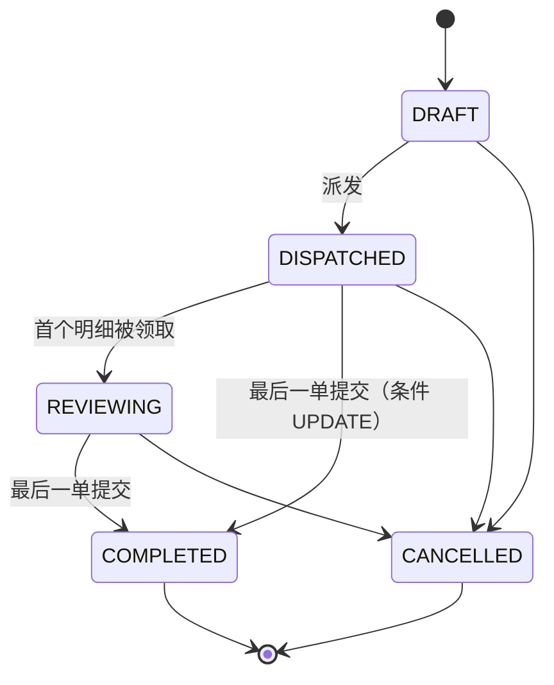
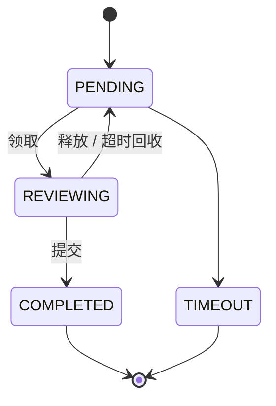

# 状态机与并发控制说明

> 本文回答两个问题：**项目里的状态机（TRANSITIONS）是怎么组织的**、**质检大批量派发与领取/提交的并发控制（乐观锁）是怎么实现的**，并在第三部分列出**面试可能问到的全部问题及答案**（答案均指向本项目真实代码，可对照阅读）。
>
> 事实来源：`backend/app/services/**/_state.py`、`backend/app/repositories/qc/task_repository.py`、`backend/app/repositories/qc/item_repository.py`、`backend/app/services/qc/task_service.py`、`backend/app/services/qc/review_service.py`、`backend/tests/unit/test_*_state.py`、`backend/tests/api/test_qc_dispatch.py`、`backend/tests/api/test_qc_review_flow.py`、`backend/app/core/config.py`。
>
> 相关文档：`docs/数据模型与RBAC权限说明.md`（表结构与约束）、`docs/项目说明.md`（3W2H 总览）、`docs/系统主要流程说明.md`（外呼全量细节）。

---

## 0. 一分钟速览

| 项目 | 结论 |
|---|---|
| 状态机数量 | **5 个**：外呼任务 / 坐席 / 回呼，质检任务 / 质检明细 |
| 状态机位置 | `app/services/outbound/*_state.py`、`app/services/qc/*_state.py`（**纯内存、零依赖、不碰数据库**） |
| 核心数据 | `XXX_TRANSITIONS: dict[状态, frozenset[状态]]` —— 一张邻接表就是唯一事实来源 |
| 语义守卫 | `can_transition` / `ensure_transition`（非法抛 **40902**）/ `allowed_targets` / `label` |
| 集合守卫 | `EDITABLE_STATUSES` / `DELETABLE_STATUSES` / `FINISHED_STATUSES` 等，回答"这个状态下能不能做那件事" |
| 单测 | 4 个纯内存单测文件，正反两面逐条列举 + 守卫按状态全遍历 + 流转表覆盖性断言 |
| 派发并发 | **一条 `INSERT ... SELECT`**（`row_number()` 取模轮询均分）+ `ON CONFLICT DO NOTHING` 幂等，按批提交 |
| 领取/提交并发 | **带状态条件的原子 `UPDATE`**，以 `rowcount == 1` 判定成功（乐观锁，无显式加锁） |
| 超时回收并发 | `SELECT ... FOR UPDATE` 行锁 + **锁内复核**（"先读后判"型操作才用悲观锁） |
| 最后一道防线 | 数据库的部分唯一索引（应用层判断可被竞态绕过，约束不会） |

---

# 第一部分：状态机

## 1.1 为什么要"集中"

散落的 `status == "RUNNING"` 判断有三个必然后果：**流转规则不可见**（要看完全项目才知道 A 能不能到 B）、**改一处漏三处**、**测试无从下手**。

本项目的做法是：**每个业务对象一张邻接表 + 一组语义函数**，业务代码里禁止出现孤儿判断。每个状态机文件的 docstring 都写着同一句话：

> 状态与流转集中在此，业务代码禁止散落 `status == xxx` 判断；新增/调整流转只改这一处。

## 1.2 五个状态机一览

| # | 业务对象 | 文件 | 状态数 | 状态集合 |
|---|---|---|---|---|
| 1 | 外呼任务 | [task_state.py](file:///e:/company%20project/backend/app/services/outbound/task_state.py) | 6 | DRAFT / READY / RUNNING / PAUSED / COMPLETED / CANCELLED |
| 2 | 坐席 | [agent_state.py](file:///e:/company%20project/backend/app/services/outbound/agent_state.py) | 5 | OFFLINE / IDLE / RESERVED / BUSY / PAUSED |
| 3 | 回呼任务 | [callback_state.py](file:///e:/company%20project/backend/app/services/outbound/callback_state.py) | 6 | PENDING / ASSIGNED / CALLING / SUCCESS / FAILED / CANCELLED |
| 4 | 质检任务 | [task_state.py](file:///e:/company%20project/backend/app/services/qc/task_state.py) | 5 | DRAFT / DISPATCHED / REVIEWING / COMPLETED / CANCELLED |
| 5 | 质检明细 | [item_state.py](file:///e:/company%20project/backend/app/services/qc/item_state.py) | 4 | PENDING / REVIEWING / COMPLETED / TIMEOUT |

## 1.3 流转表（邻接表全量）

### （1）外呼任务 `TASK_TRANSITIONS`（§18 / §77）

| 当前状态 | 可流转到 |
|---|---|
| DRAFT 草稿 | READY、CANCELLED |
| READY 就绪 | RUNNING、PAUSED、DRAFT、CANCELLED |
| RUNNING 运行中 | PAUSED、COMPLETED、CANCELLED |
| PAUSED 已暂停 | RUNNING、CANCELLED |
| COMPLETED 已完成 | （终态，无） |
| CANCELLED 已取消 | （终态，无） |

> 源码注明 `ASSUMPTION-020`：需求只给了状态集合、未定义流转，此表按业务常识收敛。

### （2）坐席 `AGENT_TRANSITIONS`（§11 / §77）

| 当前状态 | 可流转到 |
|---|---|
| OFFLINE 离线 | IDLE |
| IDLE 空闲 | RESERVED、BUSY、PAUSED、OFFLINE |
| RESERVED 预占 | BUSY、IDLE、OFFLINE |
| BUSY 忙碌 | IDLE、PAUSED |
| PAUSED 小休 | IDLE |

> §11 只给了主链路，此处补齐「释放预占」「直接人工呼叫」两条必需边（`ASSUMPTION-041`），否则坐席回不到空闲。§11 明确要求 **OFFLINE → BUSY 必须被拒绝**，单测专门断言了这条。

### （3）回呼任务 `CALLBACK_TRANSITIONS`（§46 / §77）

| 当前状态 | 可流转到 |
|---|---|
| PENDING 待回呼 | ASSIGNED、CANCELLED |
| ASSIGNED 已分配 | CALLING、SUCCESS、FAILED、PENDING、CANCELLED |
| CALLING 呼叫中 | SUCCESS、FAILED、PENDING、CANCELLED |
| FAILED 已失败 | PENDING（重呼退回队列） |
| SUCCESS 已成功 | （终态，无） |
| CANCELLED 已取消 | （终态，无） |

> `ASSIGNED → SUCCESS/FAILED` 是为"人工回呼线下联系客户后直接登记结果"留的边。注意 `FAILED` 出现在 `FINAL_STATUSES` 里但**不是**流转终态——它允许退回 PENDING，这是本项目一个有意为之的细节。

### （4）质检任务 `QC_TASK_TRANSITIONS`



**这条表里最容易被质疑的是 `DISPATCHED → COMPLETED`。** 源码注释解释得很清楚：

> 明细提交完最后一单时由条件 UPDATE 把任务从 DISPATCHED / REVIEWING 直接置为 COMPLETED（原子更新，不做「先查后改」），因此 DISPATCHED 也必须允许流转到 COMPLETED。

也就是说：任务**不保证**先经过 REVIEWING（如果专家一口气把全部明细提交完，任务可能从未进入 REVIEWING）。如果状态机里没有这条边，收尾逻辑的合法性检查就会自己把自己拦住。

### （5）质检明细 `QC_ITEM_TRANSITIONS`



## 1.4 统一接口约定

五个文件对外暴露的函数签名高度一致（可对照 [task_state.py](file:///e:/company%20project/backend/app/services/qc/task_state.py#L55-L89) 阅读）：

| 函数 | 作用 | 备注 |
|---|---|---|
| `can_transition(current, target) -> bool` | 纯判断，不抛错 | 供调用方自行分支 |
| `ensure_transition(current, target) -> None` | 校验，非法抛 `StateNotAllowed` | 业务代码统一入口 |
| `allowed_targets(current) -> list` | 返回可流转目标（按 value 排序） | 用于拼装提示、给前端 |
| `label(status) -> str` | `"已派发（DISPATCHED）"` | **中英文都给**，前端展示与排障两用 |
| `labels(frozenset) -> str` | 把集合拼成「草稿（DRAFT）、已取消（CANCELLED）」 | 用于错误提示 |

`ensure_transition` 内部是**两段式**判断，顺序不能反：

```python
if current == target:
    raise StateNotAllowed(f"任务已处于{label(current)}状态")   # ① 先单独处理"原地不动"
if not can_transition(current, target):
    targets = labels(...) or "无"
    raise StateNotAllowed(f"不允许从{label(current)}流转到{label(target)}，当前可流转：{targets}")  # ② 再处理非法边
```

- ① 单独处理是为了给用户**准确的提示**："任务已处于草稿状态"比"不允许从草稿流转到草稿"更好懂。
- ② 的报错里**带上了当前可流转目标**，出问题时看日志就知道下一步该怎么走，不用去翻代码。
- 非法流转统一抛 `StateNotAllowed` → HTTP **409 / 业务码 40902**（`40902 状态不允许`）。

## 1.5 "能不能做这件事"的集合守卫

流转表回答"状态怎么走"，还有一类问题是"**在这个状态下能不能执行某个动作**"。这类判断用**集合**表达，而不是散落的 if：

| 集合 | 含义 | 文件 |
|---|---|---|
| `EDITABLE_STATUSES` | 允许改配置的状态（外呼：DRAFT/READY/PAUSED；质检：仅 DRAFT） | 两个 `task_state.py` |
| `DELETABLE_STATUSES` | 允许删除的状态（外呼：DRAFT/CANCELLED；质检：DRAFT/CANCELLED） | 两个 `task_state.py` |
| `FINISHED_STATUSES` | 进入即写 `finished_at` 的状态 | 两个 `task_state.py` |
| `FINAL_STATUSES` | 回呼的终态集合（SUCCESS/FAILED/CANCELLED） | `callback_state.py` |
| `ASSIGNABLE_STATUSES` / `CALLABLE_STATUSES` / `CANCELLABLE_STATUSES` | 回呼的派单/呼叫/取消前置状态 | `callback_state.py` |

配套的 `ensure_editable` / `ensure_deletable` / `ensure_assignable`… 与 `ensure_transition` 同构：不满足就抛 40902。

> 质检任务"派发后配置冻结"就是靠 `EDITABLE_STATUSES = {DRAFT}` 实现的——派发后改任务名会返回 40902，避免"明细是按旧时间区间派的、配置却被改了"的不一致。真实用例见 [test_qc_dispatch.py](file:///e:/company%20project/backend/tests/api/test_qc_dispatch.py#L259-L274) 的 `test_edit_frozen_after_dispatch`。

## 1.6 单测是怎么"穷举"的

四个纯内存单测文件（**不依赖数据库**，毫秒级）：

- [test_task_state.py](file:///e:/company%20project/backend/tests/unit/test_task_state.py)（外呼任务）
- [test_agent_state.py](file:///e:/company%20project/backend/tests/unit/test_agent_state.py)
- [test_callback_state.py](file:///e:/company%20project/backend/tests/unit/test_callback_state.py)
- [test_qc_state.py](file:///e:/company%20project/backend/tests/unit/test_qc_state.py)

它们用四个手段把状态机"焊死"：

1. **合法边逐条列举**：`@pytest.mark.parametrize` 把每一条允许的边写成一条用例，断言 `can_transition is True` 且 `ensure_transition` 不抛错。
2. **非法边逐条列举反面用例**：断言 `can_transition is False`，且 `ensure_transition` 抛 `StateNotAllowed`、错误信息里**同时包含当前状态与目标状态的枚举值**（这样断言能验证提示文案确实拼装正确）。
3. **守卫按状态全遍历**：例如 `ensure_deletable` 对可删的几个状态全跑一遍不抛错、对不可删的每个状态都跑一遍必须抛错——**遍历枚举而非挑几个写**。
4. **覆盖性断言**：`test_every_status_has_transition_entry` 遍历全部枚举值，断言"每个状态都在流转表里有条目"。这条是为了防止**新增状态后忘了加边**——新增状态若漏了，那道边会静默不可达，这条用例会直接失败。

> 如实说明：上述是"合法边 + 非法反例 + 守卫全遍历 + 覆盖性断言"的组合，**不是 N×N 全量笛卡尔积**（例如外呼任务 6 个状态理论上有 30 条非同态边，用例逐条列了 21 条）。取舍理由是用例可读性优于数量；若需要"数学完备"，可以再加一条 `itertools.product` 全遍历用例，逐对断言 `can_transition` 与流转表一致。

---

# 第二部分：并发控制（乐观锁）

## 2.1 三条并发路径总览

质检模块有**三个**并发风险点，三处用了**三种不同的**处理方式，这是一个很好的对照样本：

| 场景 | 风险 | 手法 | 位置 |
|---|---|---|---|
| 10 万条对话派发 | 重复派发产生重复明细、超大事务 | 一条 `INSERT ... SELECT` + `ON CONFLICT DO NOTHING` + 分批提交 | [task_repository.py#L244-L319](file:///e:/company%20project/backend/app/repositories/qc/task_repository.py#L244-L319) |
| 领取 / 释放 / 提交 | 多人同时抢同一条明细 | **乐观锁**：带状态条件的原子 `UPDATE` + `rowcount` | [item_repository.py#L99-L170](file:///e:/company%20project/backend/app/repositories/qc/item_repository.py#L99-L170) |
| 领取后不提交（僵死） | 明细被永久占住 | **悲观锁**：`SELECT ... FOR UPDATE` + 锁内复核 | [item_repository.py#L202-L221](file:///e:/company%20project/backend/app/repositories/qc/item_repository.py#L202-L221) |

## 2.2 派发：一条 `INSERT ... SELECT` 打穿 10 万条

### 为什么不用 ORM 逐条 insert

10 万条明细如果走 `session.add(obj)` 循环：**10 万次 Python 对象构造 + 10 万次 SQL 往返 + 一个巨长事务**（锁持有时间长、undo 膨胀、失败全丢）。本项目的做法是把"选数据 + 算分片 + 落库"压成**一条 SQL**，让数据库自己干：

```sql
-- 等价 SQL 骨架（实际由 SQLAlchemy Core 构造，见 task_repository.py）
INSERT INTO qc_task_items
    (tenant_id, task_id, conversation_id, reviewer_id, status, is_deleted, created_at, updated_at)
SELECT
    :tenant_id,
    :task_id,
    r.conversation_id,
    CASE (r.rn - 1) % :reviewer_count          -- ① 分片下标 → 专家 id
        WHEN 0 THEN :reviewer_0
        WHEN 1 THEN :reviewer_1
        ELSE :reviewer_last
    END,
    'PENDING', false, now(), now()
FROM (
    SELECT id AS conversation_id,
           row_number() OVER (ORDER BY id ASC) AS rn     -- ② 稳定序号
    FROM qc_conversations
    WHERE tenant_id = :tenant_id AND is_deleted = false
      AND started_at >= :time_from AND started_at <= :time_to
) r
WHERE NOT EXISTS (                                        -- ③ 已插入的排除
    SELECT 1 FROM qc_task_items i
    WHERE i.task_id = :task_id AND i.conversation_id = r.conversation_id
      AND i.is_deleted = false
)
ORDER BY r.rn ASC
LIMIT :batch_size
ON CONFLICT (task_id, conversation_id) WHERE is_deleted = false DO NOTHING   -- ④ 幂等
RETURNING id;                                             -- ⑤ 真实插入行数
```

### 关键点逐个拆

**① 分片：`row_number()` 取模轮询均分**

- `row_number() OVER (ORDER BY id ASC)` 给每个对话一个**从 1 开始、稳定**的序号 `rn`。
- 轮询模式（`ROUND_ROBIN`）：`reviewer_idx = (rn - 1) % reviewer_count` —— 天然均分，差值不超过 1。
- 均分模式（`AVERAGE`）：`chunk = ceil(total / reviewer_count)`，`reviewer_idx = least(floor((rn - 1) / chunk), reviewer_count - 1)` —— 连续分块，每块 `chunk` 条。

源码里留了一条**踩坑注释**，很值得记：

> 注意必须 `floor`：SQLAlchemy 会把除法结果类型标记为 NUMERIC，直接比较会落到 ELSE。

**② 下标 → 专家 id 的映射用 `CASE` 而不是数组下标**

`_reviewer_case()` 把 `(下标, 专家 id)` 列表拼成 `CASE idx WHEN 0 THEN 101 WHEN 1 THEN 102 ELSE 105 END`。用 `CASE` 而不是 `JOIN` 一张临时表，是为了让**生成的 SQL 稳定可读、可解释**。

**③ `NOT EXISTS` 排除已插入**

让**同一批语句可以重复执行而不重复插入**：批间中断后续跑时，已落库的对话会被子查询排除掉。

**④ `ON CONFLICT DO NOTHING` 幂等**

```python
.on_conflict_do_nothing(
    index_elements=["task_id", "conversation_id"],
    index_where=text("is_deleted = false"),   # 与模型部分唯一索引条件"字面一致"
)
```

`index_where` 必须和模型里 `uq_qc_task_items_task_conversation` 的部分唯一索引条件**字面一致**，否则 PostgreSQL 匹配不到该索引，`ON CONFLICT` 会报错。这是那个 24 个部分唯一索引设计在并发路径上的直接体现。

> `NOT EXISTS` 和 `ON CONFLICT` 看起来重复，实际是**两层防线**：前者在**同一条语句内**排除已插入（让 `LIMIT batch_size` 的语义正确），后者防**并发/竞态**下两个请求同时看到"未插入"。

**⑤ 为什么用 `RETURNING` 而不是 `rowcount`**

源码注释写得很直白：

> `INSERT ... SELECT` 的 `rowcount` 在 psycopg 下不可靠（返回 -1），故用 `RETURNING` 取回真实插入行数（冲突未插入的行不会出现在结果中）。

这是本项目一个**真实踩过的坑**：`UPDATE` 的 `rowcount` 在 psycopg3 下正常，但 `INSERT` 返回 `-1`。所以凡是"需要知道插了几行"的地方（`dispatch_batch`、`insert_result`）一律 `RETURNING id` 再 `len(...)`。同一文件里 `soft_delete_items`（UPDATE）就照常用 `rowcount`。

### 分批与服务层编排

[task_service.py#L198-L218](file:///e:/company%20project/backend/app/services/qc/task_service.py#L198-L218) 的编排：

```python
while True:
    inserted = self.repo.dispatch_batch(..., batch_size=settings.QC_DISPATCH_BATCH_SIZE)
    if inserted <= 0:
        break
    self.db.commit()          # 每批一个事务
```

- **批次提交**：避免 10 万行单事务长时间持锁；中断后重跑，已提交的部分不会丢。
- **`inserted <= 0` 作为终止条件**：所有对话都插完了，`NOT EXISTS` 让 SELECT 返回空集，自然退出。
- **`total_items` 用 `count(*)` 回填**，不累加每批的插入行数：`task.total_items = self.repo.count_task_items(task.id)`。理由见 `count_task_items` 的 docstring——**"不用 rowcount 累加"**，避免任何计数误差被写进任务主表。
- 派发期间任务**仍为 DRAFT**（最后才置 DISPATCHED），所以中断后可以再调一次派发续跑；这也解释了"续跑"用例为何在 DRAFT 状态下直接调仓储层。

### 容量校验（提前拦截）

```python
capacity = reviewer_count * settings.QC_MAX_PER_REVIEWER   # 默认 20000/人
if total > capacity:
    raise ParamError(f"时间区间内共 {total} 条对话，超过 {reviewer_count} 位专家单任务上限 {capacity} 条，请拆批派发或缩小时间区间")
```

## 2.3 领取 / 提交：`UPDATE ... WHERE status = ...` 就是乐观锁

### 核心思想

**不做"先查后改"**，而是把"当前状态必须是什么"直接写进 `UPDATE` 的 `WHERE` 里，然后用**受影响行数**判断"我有没有抢到"：

```sql
UPDATE qc_task_items
SET status = 'REVIEWING', reviewer_id = :me, locked_at = now(), timeout_at = :now_plus_lease
WHERE id = :item_id AND is_deleted = false AND status = 'PENDING';
```

- 数据库保证**单条 UPDATE 的原子性**：两个并发请求同时执行，PostgreSQL 会在行锁上排队，**后到者看到的 `status` 已经是 `REVIEWING`**，`WHERE` 不匹配 → 影响 0 行。
- 于是：`rowcount == 1` = **我抢到了**；`rowcount == 0` = **别人抢到了 / 状态已变**。

### 四条语句的真实条件

| 操作 | 位置 | `WHERE` 里的状态条件 | 置为 |
|---|---|---|---|
| 领取 `claim` | [item_repository.py#L99](file:///e:/company%20project/backend/app/repositories/qc/item_repository.py#L99-L123) | `status = PENDING` | REVIEWING + `reviewer_id=me` + `locked_at` + `timeout_at` |
| 释放 `release` | [item_repository.py#L125](file:///e:/company%20project/backend/app/repositories/qc/item_repository.py#L125-L142) | `status = REVIEWING AND reviewer_id = me` | PENDING（清空 `locked_at`/`timeout_at`） |
| 提交 `submit_item` | [item_repository.py#L144](file:///e:/company%20project/backend/app/repositories/qc/item_repository.py#L144-L170) | `status = REVIEWING AND reviewer_id = me` | COMPLETED + `grade` + `submitted_at` |
| 落结果 `insert_result` | [item_repository.py#L172](file:///e:/company%20project/backend/app/repositories/qc/item_repository.py#L172-L183) | `ON CONFLICT (item_id) WHERE is_deleted=false DO NOTHING` | —— |

注意 `release` 与 `submit_item` 的 `WHERE` 里都带了 **`reviewer_id = me`**：这就是"只能操作自己的明细"从**应用层检查**下沉为**数据库层条件**。`A` 想释放 `B` 的明细，`WHERE` 不匹配 → `rowcount = 0` → 40902。真实用例：[test_release_by_other_reviewer_rejected](file:///e:/company%20project/backend/tests/api/test_qc_review_flow.py#L119-L130)。

### 为什么不用"先 SELECT 再判断"

```python
# 反面写法（本项目禁止）
item = repo.get_by_id(item_id)
if item.status == PENDING:      # ← 检查
    item.status = REVIEWING     # ← 这两行之间，别人可能已经改了
    db.commit()
```

`检查` 与 `修改` 之间存在时间窗口（TOCTOU，Time-of-Check to Time-of-Use），并发下必然重复领取。把条件写进 `WHERE` 就是**把检查与修改合并成一条原子语句**，窗口消失。

### 提交的幂等顺序

[review_service.py#L102-L124](file:///e:/company%20project/backend/app/services/qc/review_service.py#L102-L124) 的顺序是**先插结果、再改明细状态**：

```python
created = self.repo.insert_result(...)        # ① 唯一索引占位
if not created:
    raise StateNotAllowed("该明细已提交过质检结果，请勿重复提交")
submitted = self.repo.submit_item(...)        # ② 条件 UPDATE 改状态
if not submitted:
    raise StateNotAllowed("任务已被领取或状态已变更")
self.task_repo.increment_completed(task_id, now=now)        # ③ 完成数原子 +1
task_completed = self.task_repo.complete_if_done(task_id, now=now)   # ④ 条件 UPDATE 收尾
```

① 的 `ON CONFLICT (item_id)` 由 `uq_qc_review_results_item` 部分唯一索引兜底——**这是防重复提交的最后一道防线**（即使 ② 出了问题，结果也不会写两份）。顺序不能反：先改明细状态再插结果，一旦插结果失败，明细已是 COMPLETED、却没有结果，数据就自相矛盾了。

### 任务收尾：原子自增 + 条件推进

```python
# ③ 原子自增，避免"读出来 +1 再写回"的丢失更新
update(QcTask).where(id == task_id).values(completed_items=QcTask.completed_items + 1)

# ④ 仅当追平总数且仍在进行态时推进为 COMPLETED
update(QcTask).where(
    id == task_id,
    status.in_([DISPATCHED, REVIEWING]),
    total_items > 0,
    completed_items >= total_items,
).values(status=COMPLETED, finished_at=now)
```

`complete_if_done` 返回 `rowcount == 1` 表示"**本次调用就是压垮骆驼的那一根**"，直接作为响应里的 `task_completed` 给前端("这是最后一单")。即使两个专家同时提交最后两单，也只有一条 UPDATE 能命中（另一条的 `completed_items >= total_items` 可能已成立但仍会命中……**但两单是两条明细、各自触发一次**，`completed_items` 恰好从 N-2 到 N-1、N-1 到 N，只有后一次满足 `>= total_items`）——条件 UPDATE 让判定与更新原子完成，不需要"先查后改"。

## 2.4 超时回收：这里为什么反而用悲观锁

`claim` 写入 `timeout_at = now + QC_ITEM_LOCK_TIMEOUT_SECONDS`（默认 **1800 秒**）就是一条**租约**。定时任务（间隔 `QC_ITEM_RECYCLE_INTERVAL_SECONDS = 300`）扫描过期明细退回 PENDING。

但回收的实现**没有**用乐观锁，而是：

```python
select(QcTaskItem).where(...).with_for_update()   # 行锁
# —— 锁内复核（拿到锁之后重新判断一次）——
if item is None: return False
if item.status != REVIEWING: return False
if item.timeout_at is None or item.timeout_at >= now: return False
item.status = PENDING; item.locked_at = None; item.timeout_at = None
```

原因：回收的判定条件是**复合的、需要先读后判**（"状态是 REVIEWING **且** 已超时 **且** 还没被提交"），单纯写 `WHERE status='REVIEWING' AND timeout_at < now` 也能做，但这里还需要保留 `reviewer_id`（退回时不改归属）并逐条提交。`FOR UPDATE` 把"读 + 判 + 写"锁成一个临界区，**锁内复核**是关键——拿到锁后必须重新判断状态，否则仍会误伤刚刚被别人提交的明细。

> 与 `claim/submit` 的对照，是本项目最有价值的一处设计判断：**单条"条件写"用乐观锁；"先读后判"的复合操作用悲观锁 + 锁内复核**。回收是后台批量任务，锁竞争压力小，悲观锁的代价可以接受。

返回值 `{"scanned", "recycled", "skipped"}` 让幂等可验证——第二次扫描 `recycled == 0`，见 [test_recycle_is_idempotent](file:///e:/company%20project/backend/tests/api/test_qc_review_flow.py#L281-L296)。

## 2.5 数据库约束是最后一道防线

应用层的 `rowcount` 判断在**正常路径**下足够，但"两个人同一毫秒到达"的极端竞态、或将来有人绕过 service 直接写库时，只有**数据库约束**不会说谎：

| 场景 | 兜底约束 |
|---|---|
| 同一任务重复派发同一对话 | `uq_qc_task_items_task_conversation`（部分唯一 `(task_id, conversation_id) WHERE is_deleted=false`） |
| 同一明细写两份结果 | `uq_qc_review_results_item`（部分唯一 `(item_id) WHERE is_deleted=false`） |
| 一个坐席被两个任务预占 | `agent_assignments` 部分唯一 `(agent_id) WHERE is_deleted=false AND status IN ('RESERVED','ACCEPTED')` |

所以完整的分层是：**应用层条件（可读性好、给用户友好报错）→ `ON CONFLICT`/`rowcount`（正常并发路径）→ 唯一索引（最终防线）**。

## 2.6 真实测试断言

| 用例 | 断言 | 文件 |
|---|---|---|
| 轮询均分误差 | `max(counts) - min(counts) <= 1`，且覆盖全部专家 | [test_qc_dispatch.py#L72-L96](file:///e:/company%20project/backend/tests/api/test_qc_dispatch.py#L72-L96) |
| 均分模式分块 | 10 条 / 3 人 → `[4, 4, 2]` | [test_qc_dispatch.py#L98-L112](file:///e:/company%20project/backend/tests/api/test_qc_dispatch.py#L98-L112) |
| 仓储层幂等 | 第一次插 7 行，**第二次插 0 行** | [test_qc_dispatch.py#L130-L155](file:///e:/company%20project/backend/tests/api/test_qc_dispatch.py#L130-L155) |
| 分批计数一致 | 批大小改成 3，`total_items` 仍等于 `count(*)` = 11 | [test_qc_dispatch.py#L157-L177](file:///e:/company%20project/backend/tests/api/test_qc_dispatch.py#L157-L177) |
| 重复派发被拒 | 第二次派发 409 / 40902 | [test_qc_dispatch.py#L114-L127](file:///e:/company%20project/backend/tests/api/test_qc_dispatch.py#L114-L127) |
| 重复领取被拒 | 第二次 claim 409 / 40902 | [test_qc_review_flow.py#L93-L104](file:///e:/company%20project/backend/tests/api/test_qc_review_flow.py#L93-L104) |
| 未领取就提交 | 409 / 40902（`rowcount=0`） | [test_qc_review_flow.py#L163-L175](file:///e:/company%20project/backend/tests/api/test_qc_review_flow.py#L163-L175) |
| 重复提交 | 409 / 40902 | [test_qc_review_flow.py#L177-L193](file:///e:/company%20project/backend/tests/api/test_qc_review_flow.py#L177-L193) |
| 越权释放 | 409（`rowcount=0`：非本人持有） | [test_qc_review_flow.py#L119-L130](file:///e:/company%20project/backend/tests/api/test_qc_review_flow.py#L119-L130) |
| 任务收尾时机 | 两单提交依次返回 `task_completed = [False, True]` | [test_qc_review_flow.py#L195-L210](file:///e:/company%20project/backend/tests/api/test_qc_review_flow.py#L195-L210) |

> 说明：上表中质检相关的用例是 `TestClient` **同步串行**调用，验证的是 `rowcount` 语义与状态条件是否正确，**而不是真的并发**。
>
> 本项目**确实有一处真并发用例**，但不在质检路径上：`tests/integration/test_outbound_number_concurrency.py` 用 `ThreadPoolExecutor`（8 线程 × 24 次）对**同一个外呼号码**做并发扣减（`consume_atomically`，与 `claim` 同一套"带条件原子 UPDATE + rowcount"手法），断言**成功次数恰好等于上限 5**。也就是说：同一套并发机制在号码扣减上做过真并发验证，在质检明细上用的是串行 + 语义断言（机制相同，但质检明细不存在号码那样的全员共享热点行）。

---

# 第三部分：面试问答

> 答案里的路径与行为都能在仓库中找到，建议打开对应文件对照回答。

## A. 状态机（10 题）

**A1. 为什么要把状态流转集中到一张 TRANSITIONS 表？散落 `status == xxx` 有什么问题？**

散落的判断有三个后果：规则不可见（读完全项目才知道 A 能不能到 B）、改一处漏三处、无法测试。集中成一张邻接表 `dict[状态, frozenset[状态]]` 后，流转规则是**可读的数据**而不是**分散的逻辑**，新增/调整只改一处，并且可以用纯内存单测覆盖。

**A2. 状态机放在哪一层？为什么不放到数据库（CHECK/触发器）或前端？**

放在 **service 层**（`app/services/*/*_state.py`）。不放数据库：CHECK 约束表达不了"A→B 且 B→C"这种图结构，触发器调试困难、报错信息不友好、迁移麻烦。不放前端：前端只是展示与提前拦截，**后端必须自己校验**（前端可被绕过）。所以真正的判定在后端，前端拿 `allowed_targets()` 的产物做按钮禁用。

**A3. 为什么状态机文件是"纯内存、零依赖、不碰数据库"？**

这样才能做成毫秒级单测（`pytest tests/unit/test_*_state.py` 不需要 PostgreSQL），并且可以在任何地方复用——服务层、定时任务、测试里都能直接调。状态机是**纯粹的规则**，一旦掺进 DB 查询就变成"集成测试"，成本高一个量级。

**A4. `can_transition` / `ensure_transition` / `allowed_targets` 三个函数分工是什么？**

- `can_transition`：**纯查询**，返回 bool，给调用方自己分支（前端拼 UI、内部条件判断）。
- `ensure_transition`：**校验**，不合法直接抛 `StateNotAllowed`，是业务代码的统一入口（"守卫"语义）。
- `allowed_targets`：**反向查询**，列出当前状态能去哪，用于拼错误提示和给前端做按钮状态。

**A5. 非法流转为什么返回 40902 而不是 400？**

400 的语义是"请求参数本身不合法"（比如 id 是负数）；而这里是**请求格式完全正确、但当前资源状态不允许这个操作**，属于冲突类语义。项目的错误码表里 `40902 = 状态不允许`，与 `40901 = 冲突`、`40904 = 被引用` 并列。用专门的码，前端/日志能一眼区分"参数写错了"和"来晚了、状态变了"。

**A6. `ensure_transition` 为什么先单独判断 `current == target`？**

为了给出准确的提示。"任务已处于草稿状态"比"不允许从草稿流转到草稿"更好懂，也更符合用户心智（用户其实是重复点了按钮）。这是一个"错误信息产品化"的细节。

**A7. DISPATCHED → COMPLETED 这条边为什么必须存在？**

因为收尾用的是**条件 UPDATE**（`complete_if_done`），它可能把任务从 DISPATCHED **直接**置为 COMPLETED——如果专家一口气把该任务的所有明细都提交完，任务可能从未进入 REVIEWING。如果流转表里没这条边，收尾逻辑的合法性检查就会拦住自己。**状态机的表必须覆盖代码真实会走的所有路径**，不能只按"理论上的正常流程"画。

**A8. 单测怎么保证状态机没漏？"穷举"到什么程度？**

四层手段：合法边逐条列举、非法边逐条列举（并断言错误信息含两个枚举值）、守卫按状态**全遍历**、以及覆盖性断言 `test_every_status_has_transition_entry`（每个枚举值都必须出现在流转表里，防"新增状态忘了加边"）。需要说明的是这**不是 N×N 全量笛卡尔积**（外呼任务 30 条非同态边，用例列了 21 条），这是可读性优先的取舍；要数学完备可以再加 `itertools.product` 全遍历。

**A9. 新增一个状态要改哪些地方？**

① 枚举（`models/*/enums.py`）加值 → ② 流转表加一行（本状态的可达边）+ 给其他状态补指向它的边 → ③ 相关集合（`EDITABLE/DELETABLE/FINISHED`）按需加入 → ④ `_STATUS_LABELS` 加中文名（否则 `label()` 会退回枚举值）→ ⑤ 单测补用例。第 ④ 步漏了不会报错、只会提示变丑，第 ⑤ 步的覆盖性断言会兜住 ② 的遗漏。

**A10. 状态机的"能不能流转"和 RBAC 的"有没有权限"是什么关系？**

**正交的两条线**。RBAC 回答"这个用户能不能调这个接口"（`require_permission` → 403/40301）；状态机回答"这个资源当前状态能不能做这个动作"（`ensure_transition` → 409/40902）。一个用户完全可能有 `qc:task:dispatch` 权限，但对一个已 COMPLETED 的任务派发仍然应该失败。两者不能互相替代。

## B. 并发与乐观锁（14 题）

**B1. 什么是乐观锁？和悲观锁的区别是什么？**

- **乐观锁**：假设冲突少，**不加锁**，在写入时**校验数据没被别人改过**（本项目用"状态条件 + rowcount"），冲突则失败返回、由调用方决定重试还是报错。
- **悲观锁**：假设冲突多，**先加锁**（`SELECT ... FOR UPDATE`）再操作，把临界区串行化。

本项目两种都用：领取/提交用乐观锁（单条条件写，最轻）；超时回收用悲观锁（先读后判的复合操作）。

**B2. 只用 `UPDATE ... WHERE status='PENDING'` 为什么就能防重复领取？为什么不用先 SELECT？**

因为**单条 UPDATE 是原子的**。两个请求同时执行，PostgreSQL 在行锁上排队，后到者执行时 `status` 已是 `REVIEWING`，`WHERE` 不匹配 → 影响 0 行。而"先 SELECT 再判断再改"在**检查与修改之间有窗口**（TOCTOU），并发下两个请求都会看到 PENDING、都以为自己能领。把条件写进 `WHERE` 就是把检查与修改合并为一条原子语句。

**B3. `rowcount` 的语义是什么？为什么用它判定成功而不是再查一次？**

`rowcount` 是"这条语句实际影响的行数"。`== 1` 表示"我确实改变了这行"（既有权限、状态也匹配）；`== 0` 表示条件不满足。用它判定成功，**省掉了"再查一次确认"的往返**，而且判定的依据就是写操作本身的结果，不存在二次查询与写操作之间的窗口。

**B4. 这个坑要特别注意：`INSERT` 的 `rowcount` 可靠吗？**

**不可靠**。本项目实测（psycopg3）`INSERT ... SELECT` 的 `rowcount` 返回 **-1**（`UPDATE` 正常）。所以凡需要知道插入行数的地方，一律改成 `RETURNING id` 再 `len(result.scalars().all())`——冲突未插入的行不会出现在 RETURNING 结果里，计数准确。这条坑在 `dispatch_batch` 与 `insert_result` 两处都有注释。

**B5. 10 万条派发为什么不用 ORM 逐条 `insert`？**

10 万次 Python 对象构造 + 10 万次 SQL 往返 + 一个超长事务（锁持有久、undo 膨胀、失败全丢）。改成一条 `INSERT ... SELECT` 后：**数据不出库**，选、算、插都在数据库内完成，往返次数从 10 万降到"批数"（默认批 2000 条 → 约 50 次）。这是"把计算推到数据所在的地方"的典型应用。

**B6. `row_number()` 取模是怎么回事？为什么要在"全量集合上"算 rn？**

`row_number() OVER (ORDER BY id ASC)` 给每个对话一个从 1 开始、**确定性**的序号；轮询分片就是 `(rn - 1) % 专家数`。关键点：rn **必须在对全量对话计算**（子查询里先算好），而不是"每批重新算"——否则每批都从 1 开始编号，分片结果会在批与批之间漂移，同一个专家拿到的量不再均分。

**B7. 两种派发模式的公式是什么？AVERAGE 模式有什么坑？**

- 轮询：`idx = (rn - 1) % n`。
- 均分：`chunk = ceil(total / n)`，`idx = least(floor((rn - 1) / chunk), n - 1)`。

坑在**必须显式 `floor`**：SQLAlchemy 会把除法结果标记为 NUMERIC 类型，不取整直接比较会落到 `ELSE` 分支（全部落到最后一个专家）。这个坑在源码里有注释，也有 `[4, 4, 2]` 的用例把它锁住。

**B8. `NOT EXISTS` 和 `ON CONFLICT DO NOTHING` 是不是重复了？为什么两个都要？**

不重复，是两层防线。`NOT EXISTS` 是**语句内**逻辑：让"已插入的对话不参与 `LIMIT` 计数"，否则续跑时 `LIMIT 2000` 可能全被已插入的行占满、`inserted` 恒为 0 提前退出。`ON CONFLICT` 是**并发防线**：两个请求同时看到"未插入"时，唯一索引让后来者静默跳过。前者保证语义正确，后者保证竞态安全。

**B9. `ON CONFLICT` 的 `index_where` 为什么必须写？不写会怎样？**

因为目标索引是**部分唯一索引**（`WHERE is_deleted = false`）。PostgreSQL 的 `ON CONFLICT` 需要**能推断出**用哪个唯一索引，条件必须与索引定义**字面一致**才能匹配。不写或写得不一致，会报"no unique or exclusion constraint matching the ON CONFLICT specification"。这也是为什么代码注释强调"与模型里部分唯一索引条件字面一致"。

**B10. 10 万条为什么不放一个事务里？中断了怎么办？**

不放一个事务：避免长事务持有大量行锁、undo 膨胀、以及"失败全回滚"重来 10 万行。分批提交后，**中断只影响当前未提交的那一批**。中断后续跑：`NOT EXISTS` 排除已插入 + `ON CONFLICT` 兜底，重复调用不会产生重复明细（用例断言"第二次插入 0 行"）。而且派发期间任务**仍是 DRAFT**（最后才置 DISPATCHED），所以状态机允许再次派发续跑。

**B11. 为什么 `total_items` 用 `count(*)` 回填，而不是累加每批的插入行数？**

累加 = 把"每批返回值都正确"当成前提，一旦某次返回值有问题（比如早期用 `rowcount` 拿到 -1），错误会被**永久写进任务主表**且很难发现。用 `count(*)` 回填是**以真实行数为准**，与任何返回值无关——这是"最终一致性度量"的稳健做法。

**B12. 领取之后一直不提交，明细被永久占住怎么办？**

用**租约 + 超时回收**：`claim` 时写入 `timeout_at = now + 1800s`，定时任务（每 300s）扫描 `status='REVIEWING' AND timeout_at < now` 的明细，退回 PENDING（保留 `reviewer_id` 不改归属）。这就是分布式系统里的 lease 思想：**锁不是永久的，超时自动释放**。

**B13. 超时回收为什么用 `SELECT ... FOR UPDATE` 而不是乐观锁？**

因为回收的判定是**复合的、需要先读后判**：状态是 REVIEWING **且** 已超时 **且** 期间没被提交。用 `FOR UPDATE` 把"读 + 判 + 写"锁成临界区，并在**锁内复核**（拿到锁后重新判断状态与超时）——这一步是必须的，否则会误伤"刚好在同一瞬间被别人提交"的明细。回收是后台批量任务、锁竞争压力小，悲观锁的代价可以接受。**判断依据是操作形态：单条条件写 → 乐观锁；先读后判的复合操作 → 悲观锁 + 锁内复核。**

**B14. 提交时为什么"先插结果、再改明细状态"？顺序反了会怎样？**

顺序反了会**数据自相矛盾**：先改明细为 COMPLETED，再插结果时如果命中唯一索引冲突或报错，就会出现"明细已完成但没有任何评分结果"的状态。当前顺序是：① `insert_result` 用唯一索引占位（冲突则直接 40902，不往下走）→ ② `submit_item` 条件 UPDATE 改状态。任何一步失败，事务整体回滚，不会留下半成品。

## C. 综合与进阶（6 题）

**C1. 这套方案支持多实例部署吗？**

**支持**，因为并发控制的判定全部落在**数据库一侧**（条件 UPDATE、唯一索引、`ON CONFLICT`、`FOR UPDATE`），与进程数无关。唯一要注意的是**定时任务**：APScheduler 是单机调度，多实例会重复触发超时回收——但回收本身是幂等的（行锁 + 锁内复核 + 每条的 `rowcount` 判定），重复触发只会得到 `recycled = 0`，不会产生错误数据。要彻底避免，需要引入分布式锁或选主（项目当前未做，如实说明）。

**C2. 数据库约束和应用层判断，为什么两个都要？**

应用层判断**可读性好、能给用户友好报错**（"任务已被领取或状态已变更"），而且能基于业务语义（比如 `reviewer_id = me`）；约束**在极端竞态下仍然正确**，且能拦住绕过 service 的写入（脚本、其他服务）。所以完整分层是：应用层条件 → `ON CONFLICT`/`rowcount` → 唯一索引。**只靠应用层，极端竞态会漏；只靠约束，报错信息无法友好。**

**C3. 你的"乐观锁"实现和传统版本号（version 字段）乐观锁有什么区别？**

传统版本号乐观锁是 `UPDATE ... SET version = version + 1 WHERE id = ? AND version = :expected`，需要额外列、需要客户端持有版本号、且重试策略要自己写。本项目用的是**"状态即版本"**：`status` 列本身就是状态机的状态，天然携带"当前处于哪个阶段"的语义，`WHERE status = 'PENDING'` 既是状态校验也是并发校验。**省了一列，且报错能直接告诉用户"状态已变更"而不是"版本冲突"。** 代价是：只适用于"状态驱动的互斥"，如果两个操作不改变状态、只改内容，就需要另想办法（比如加 `updated_at` 或版本列）。

**C4. 如果让你做压测验证"多人同时抢同一条"，你会怎么做？**

质检这条路径的用例是 `TestClient` **同步串行**调用，验证的是 `rowcount` 语义**而非真并发**（如实说明）。**项目里已有真并发用例**：`tests/integration/test_outbound_number_concurrency.py` 用 `ThreadPoolExecutor` + 每线程独立连接，对同一号码并发扣减 24 次、断言恰好成功 5 次——那是号码扣减路径（§13/§73）。若要把质检 `claim` 也做成真并发，照它的写法即可：起 N 个线程、各自独立 Session/连接，用 `threading.Barrier` 对齐起跑时刻，同时对同一 `item_id` 调 `claim`，统计"成功恰好 1 次、其余 409"；再用 `pg_stat_activity` 观察行锁等待。

**C5. 这套设计的瓶颈在哪里？**

三个候选：① **派发的 `INSERT ... SELECT` 在单租户下会全表扫 `qc_conversations`**，靠 `(tenant_id, started_at)` 索引；对话量上千万时应改成按 id 游标分批（`WHERE id > :last_id`）以缩小每次子查询扫描范围。② **`completed_items` 自增是热行更新**，同一任务的并发提交会在同一行上排队；但单任务并发度通常不高，可接受。③ **回收是逐条提交**（每条一个事务），10 万条过期明细需要 10 万次提交，量大时应改为批量 `UPDATE ... WHERE id = ANY(...)` 并配合 `FOR UPDATE`。

**C6. 这套方案里你最想强调的一条经验是什么？**

**"把并发控制交给数据库的原子操作，而不是靠应用层的时序假设。"** 具体三条：条件写进 `WHERE` 而不是写在 Python 里；需要知道影响行数时注意方言差异（psycopg 的 `INSERT rowcount = -1`，改用 `RETURNING`）；原子上限与幂等（唯一索引）要同时具备。另外一条工程经验：**并发路径一定要有专门的用例**——本项目的 `TestDispatchIdempotency` 与 `TestClaimRelease` 都是在写代码时就为"重复调用"设计的，不是事后补的。

---

# 附：自行复核（命令清单）

```bash
# ① 五个状态机与流转表（唯一事实来源）
ls backend/app/services/outbound/*_state.py backend/app/services/qc/*_state.py

# ② 状态机单测（纯内存，无需数据库，毫秒级）
cd backend && python -m pytest tests/unit/test_task_state.py tests/unit/test_agent_state.py \
  tests/unit/test_callback_state.py tests/unit/test_qc_state.py -v

# ③ 派发与领取/提交的并发行为（需要测试库 PostgreSQL）
cd backend && python -m pytest tests/api/test_qc_dispatch.py tests/api/test_qc_review_flow.py -v

# ④ 派发生成的真实 SQL（含 row_number / ON CONFLICT / RETURNING）
#    在 QcTaskRepository.dispatch_batch 里对 stmt 执行 str(stmt.compile(dialect=postgresql.dialect()))

# ⑤ 部分唯一索引（ON CONFLICT 的匹配目标）
docker exec outbound-pg psql -U app -d app -c \
  "select indexname, indexdef from pg_indexes where tablename like 'qc_%' and indexdef like '%WHERE%';"

# ⑥ 相关配置项（容量/批大小/租约/回收间隔）
grep -n "QC_MAX_PER_REVIEWER\|QC_DISPATCH_BATCH_SIZE\|QC_ITEM_LOCK_TIMEOUT_SECONDS\|QC_ITEM_RECYCLE_INTERVAL_SECONDS" \
  backend/app/core/config.py
```