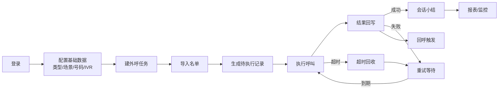
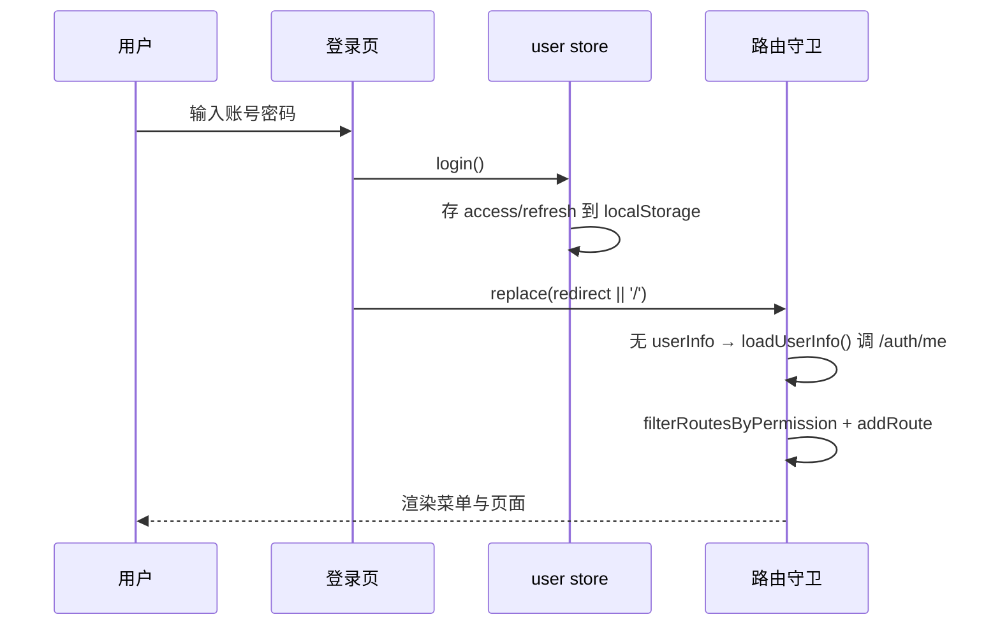
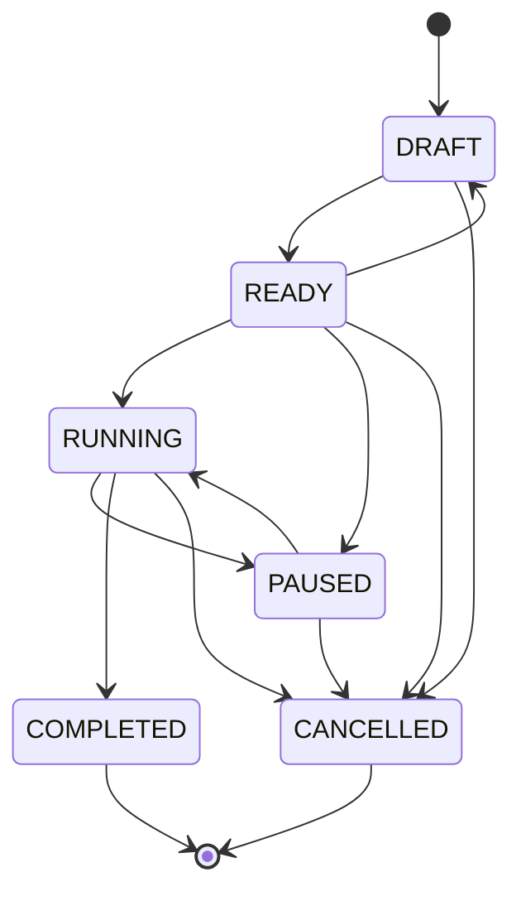
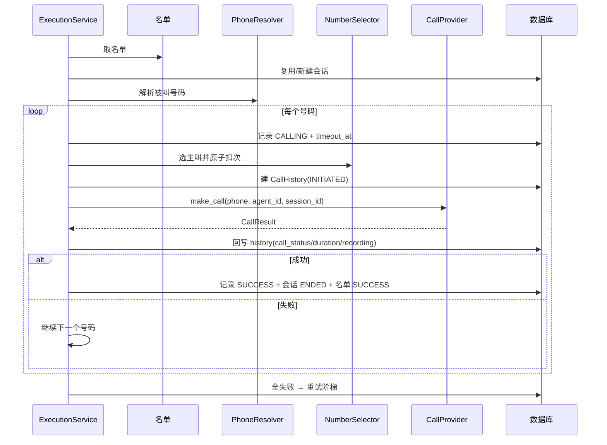

# 智能外呼系统 · 主要流程与全量内容说明

> 本文档描述「企业管理平台 / 智能外呼」系统的完整实现：主要业务流程、状态机、数据模型、接口清单、定时任务、配置项与前端页面地图。
> 内容基于对仓库源码的逐文件通读整理，代码位置以 `文件:行号` 标注，可直接跳转核对。

---

## 目录

1. [系统概览](#1-系统概览)
2. [技术栈与工程结构](#2-技术栈与工程结构)
3. [全局约定](#3-全局约定)
4. [流程一：认证与权限](#流程一认证与权限)
5. [流程二：外呼任务生命周期](#流程二外呼任务生命周期)
6. [流程三：名单导入](#流程三名单导入)
7. [流程四：主叫号码管理与选取](#流程四主叫号码管理与选取)
8. [流程五：外呼执行引擎](#流程五外呼执行引擎)
9. [流程六：呼叫结果回写（回调签名）](#流程六呼叫结果回写回调签名)
10. [流程七：重试与超时回收](#流程七重试与超时回收)
11. [流程八：坐席与派单/预占](#流程八坐席与派单预占)
12. [流程九：会话与服务小结](#流程九会话与服务小结)
13. [流程十：IVR 配置与推演](#流程十ivr-配置与推演)
14. [流程十一：回呼流程](#流程十一回呼流程)
15. [流程十二：报表与实时监控](#流程十二报表与实时监控)
16. [前端页面地图](#16-前端页面地图)
17. [定时任务总表](#17-定时任务总表)
18. [配置项总表](#18-配置项总表)
19. [数据模型总表](#19-数据模型总表)
20. [接口总表](#20-接口总表)
21. [已知边界与未完成项](#21-已知边界与未完成项)

---

## 1. 系统概览

面向企业外呼场景的一体化平台：**名单导入 → 建任务 → 选号码 → 派单/执行呼叫 → 结果回写 → 重试/超时回收 → 会话小结 → IVR / 回呼 → 报表监控**。

- 后端：FastAPI + SQLAlchemy 2.0 + PostgreSQL + Redis(可选) + APScheduler
- 前端：Vue 3 + Element Plus + Pinia + Vue Router + ECharts + Axios
- 统一前缀：`/api/v1`（`backend/app/core/config.py:24`，挂载于 `backend/app/main.py:180`）
- 统一响应体：`{code, message, data}`，成功码 `0`（`backend/app/core/response.py:26-31`）
- 多租户：所有领域表带 `tenant_id`，查询与写入均做租户校验
- 权限：RBAC（用户 → 角色 → 权限码），端点级 + 按钮级双层控制

### 业务主链路（端到端）



---

## 2. 技术栈与工程结构

### 2.1 后端依赖（`backend/requirements.txt`）

| 类别 | 依赖 |
|---|---|
| 运行时 | fastapi、uvicorn、pydantic、pydantic-settings、email-validator、python-multipart |
| 数据库 | SQLAlchemy 2.0、psycopg3、alembic |
| 认证 | PyJWT、bcrypt |
| 缓存/队列 | redis（可选，缺失自动降级） |
| 定时任务 | APScheduler |
| 文件解析 | openpyxl（xlsx） |
| 开发测试 | pytest、httpx、ruff |

### 2.2 前端依赖（`frontend/package.json`）

vue 3.5、vue-router 4.5、pinia 2.3、element-plus 2.9、@element-plus/icons-vue、axios 1.7、echarts 5.6；构建 vite 6；类型检查 vue-tsc。

### 2.3 目录结构

```
backend/
  app/
    api/            # HTTP 层：deps.py（依赖）、v1/auth.py、v1/router.py、v1/outbound/*
    core/           # config / security / permissions / response / exceptions / cache / callback_signature / openapi_examples
    db/             # base / session（session_scope）
    models/         # user / log + outbound/{enums,task,name_list,execution,config,ivr,callback}
    repositories/   # 数据访问层（user + outbound/*）
    schemas/        # Pydantic 入出参（auth + outbound/*）
    services/       # 业务层（auth_service + outbound/* 共 27 个文件）
    providers/      # 外部系统适配（asr/call/ivr/phone/tts + factory）
    tasks/          # APScheduler 定时任务
    utils/          # async_bridge / masking / storage / validators
  alembic/          # 迁移（7 个版本）
  scripts/init_db.py
  tests/            # api / unit / integration
frontend/
  src/
    api/            # request.ts + outbound/* 接口封装
    stores/         # user / menu（Pinia）
    router/         # index.ts（守卫）+ routes.ts（路由表）
    directives/     # permission.ts（按钮级权限）
    views/          # dashboard / login / 404 / outbound/*
    layout/         # index + components/{SidebarMenu,MenuItem,HeaderBar}
    utils/          # echarts / useEcharts
    types / styles / components(StatusTag)
docker-compose.yml  # 仅 PostgreSQL + Redis
```

---

## 3. 全局约定

### 3.1 统一响应与错误码

所有接口返回 `{code, message, data}`。异常经全局处理器转换（`backend/app/main.py:74-110`）：

| HTTP | code | 含义 |
|---|---|---|
| 400 | 40001 | 参数错误（含字段定位列表） |
| 401 | 40101 | 未认证 / 登录失效 |
| 403 | 40301 | 无权限 |
| 404 | 40401 | 资源不存在 |
| 409 | 40901 / 40902 / 40904 | 冲突（重名）/ 状态不允许 / 资源被引用 |
| 500 | 50001 | 系统异常 |

业务码常量集中在 `backend/app/core/response.py` 的 `BizCode`。

### 3.2 分页

`PageParams`（`DEFAULT_PAGE_SIZE=20`、`MAX_PAGE_SIZE=200`），响应含 `items / total / page / page_size`。

### 3.3 权限码

定义于 `backend/app/core/permissions.py:26-78`（`OUTBOUND_PERMISSIONS`），由 `scripts/init_db.py:36-56` 幂等写入并授予内置 `admin` 角色。命名规范 `outbound:<模块>:<动作>`，前端路由 `meta.permission` 与 `v-permission` 一一对应。

覆盖的模块：`type / scene / number / task / list / agent / assignment / session / ivr / callback / report / monitor / options`。

### 3.4 多租户与软删除

- 领域表均含 `tenant_id`；查询通过 `tenant_scope_required / tenant_scope_optional` 注入。
- 软删除：`is_deleted` + 部分唯一索引（仅未删除行参与唯一约束）。
- 时间统一 UTC（`timestamptz`）。

### 3.5 枚举集中管理

全部业务枚举在 `backend/app/models/outbound/enums.py`，数据库用 `VARCHAR(32)` + Python 校验（`enum_type`，`enums.py:220-228`），避免 PG 原生 ENUM 迁移负担。

### 3.6 操作日志

非安全方法（非 GET/HEAD/OPTIONS）在中间件中异步落 `operation_logs`（`backend/app/main.py:155-175`），记录用户、模块、动作、路径、IP、UA、状态码、耗时。

---

## 流程一：认证与权限

### 1.1 登录 `POST /api/v1/auth/login`

端点 `backend/app/api/v1/auth.py:18-32` → `AuthService.login`（`backend/app/services/auth_service.py:45-69`）：

1. `get_by_username` 查用户（过滤软删）。
2. `verify_password`（bcrypt，取前 72 字节）。
3. 失败：写 `LoginLog(success=False)` → **先 commit**（保证失败日志独立落库）→ 抛 401。
4. 账号停用：写日志 → commit → 抛 403。
5. 成功：签发 `access_token`（30 分钟）与 `refresh_token`（7 天）。
6. 更新 `last_login_at`，写成功日志，commit。
7. 返回 `{access_token, refresh_token, token_type="bearer", expires_in}`。

> 登录只返回 token，**不返回用户信息与权限**；前端随后调 `/auth/me`。

JWT 载荷：`sub`(用户ID) / `type`(access|refresh) / `jti` / `iat` / `exp`，HS256。

### 1.2 令牌校验依赖链（`backend/app/api/deps.py`）

```
get_token_payload  → 解码 + 校验 type + 检查黑名单(jti)
get_current_user   → 按 sub 取用户 + 校验 is_active
require_permission → 超管放行，否则校验权限码集合
require_superuser  → 仅超管
```

### 1.3 权限强制方式（`backend/app/api/deps.py:68-89`）

- 声明式：`dependencies=[Depends(require_permission("outbound:task:list"))]`
- 参数式：`current_user: User = Depends(require_permission("outbound:list:import"))`
- 超管（`is_superuser=True`）直接放行（§59）。
- 权限码来源：`User.permission_codes()`（`backend/app/models/user.py:87-93`）遍历 角色 → 权限。

### 1.4 刷新与登出

- `POST /auth/refresh`（`auth_service.py:73-90`）：校验 refresh token 类型 → 查黑名单 → 查用户 → 重新签发 access + refresh。
- `POST /auth/logout`（`auth_service.py:94-105`）：把 access 的 `jti` 写入 Redis 黑名单（TTL 7 天），可选同时拉黑 refresh。**Redis 不可用时降级放行**（`backend/app/core/cache.py:17-41`）。

### 1.5 前端登录态流程



- axios 拦截器（`frontend/src/api/request.ts`）：注入 `Authorization: Bearer`；`code!==0` 统一弹错并 reject；401（非登录请求）清 token 并跳 `/login`，用模块级 `redirecting` 防重复跳转。
- 动态路由：`frontend/src/router/index.ts:60-89` 的 `beforeEach`，登录后按权限过滤异步路由并 `addRoute`，随后 `replace` 重新匹配（不能返回 `{...to}`，否则会落到兜底路由）。
- 按钮级：`frontend/src/directives/permission.ts`，`v-permission="'code'"`，无权限移除 DOM（仅前端隐藏入口，真正鉴权在后端）。

---

## 流程二：外呼任务生命周期

### 2.1 状态枚举与流转表

`TaskStatus`：`DRAFT / READY / RUNNING / PAUSED / COMPLETED / CANCELLED`。
流转表 `TASK_TRANSITIONS`（`backend/app/services/outbound/task_state.py:11-22`）：

| 当前 | 允许流转到 |
|---|---|
| DRAFT | READY、CANCELLED |
| READY | RUNNING、PAUSED、DRAFT、CANCELLED |
| RUNNING | PAUSED、COMPLETED、CANCELLED |
| PAUSED | RUNNING、CANCELLED |
| COMPLETED | 终态 |
| CANCELLED | 终态 |

配套集合（`task_state.py:25-37`）：

- `DELETABLE_STATUSES = {DRAFT, CANCELLED}`：仅这两者可删除
- `EDITABLE_STATUSES = {DRAFT, READY, PAUSED}`：仅这三者可改配置
- `FINISHED_STATUSES = {COMPLETED, CANCELLED}`：进入即写 `finished_at`



### 2.2 操作规则（`backend/app/services/outbound/task_service.py`）

| 操作 | 关键规则 | 位置 |
|---|---|---|
| create_task | 租户启用；同租户任务名唯一；校验 site/queue/type/scene/ivr 归属与一致性；号码去重；**初始状态恒为 DRAFT** | `:107-128` |
| update_task | `ensure_editable`；改名冲突；引用校验 | `:132-149` |
| replace_numbers | `ensure_editable`；全量软删旧配置后逐条新增 | `:151-167` |
| change_status | `ensure_transition`；进 READY 前必须至少有 1 个启用号码；进 RUNNING 写 `started_at`；进终态写 `finished_at` | `:171-187` |
| copy_task | **幂等**（同源同名副本直接返回）；只复制配置字段，**不复制名单/记录/会话/历史/小结**；副本为 DRAFT、`copied_from_id=源` | `:191-238` |
| delete_task | 仅 DRAFT/CANCELLED；有执行记录 → 40904「禁止删除，请改为取消」；软删并联动软删号码配置 | `:242-257` |

### 2.3 自动完成

`maybe_complete_task`（`backend/app/services/outbound/task_progress.py:27-45`）：仅当任务为 `RUNNING`、记录数 > 0、且无「未终态」记录时，置 `COMPLETED` 并写 `finished_at`。由执行、回调、超时回收三处调用。

### 2.4 模型字段（`backend/app/models/outbound/task.py`）

`OutboundTask`（表 `outbound_tasks`）：

- 归属/引用：`tenant_id`、`site_id`、`skill_queue_id`、`type_id`、`scene_id`、`ivr_flow_id`、`copied_from_id`
- 状态与策略：`status`(默认 DRAFT)、`dispatch_mode`(默认 MANUAL)、`number_select_strategy`(默认 ORDER)
- 重试/超时/并发：`retry_interval`(60s)、`max_retry_count`(3)、`call_timeout_seconds`(60)、`max_concurrency`(10)、`adjustment_factor`(1.00)
- 其他：`priority`(越小越先)、`started_at`、`finished_at`、`description`
- 唯一约束：`uq_outbound_tasks_tenant_name`（tenant_id+task_name，部分唯一）

`OutboundTaskNumber`（表 `outbound_task_numbers`）：

- 主叫绑定：`number_id`
- 被叫来源顺序（NULL 表示不启用）：`order_id`、`user_id`、`recipient_number`
- 排序/开关：`sort_order`、`priority`、`enabled`

---

## 流程三：名单导入

### 3.1 端点

`POST /api/v1/outbound/lists/import`（`backend/app/api/v1/outbound/lists.py:28-51`，权限 `outbound:list:import`）。

### 3.2 导入步骤（`backend/app/services/outbound/list_service.py:48-128`）

1. 取任务；**终态守卫**：`COMPLETED/CANCELLED` 不允许再导入。
2. 文件校验：非空、≤ `MAX_IMPORT_FILE_SIZE_MB=10`。
3. 格式识别：仅 `.xlsx / .csv`。
4. 读取：xlsx 用 openpyxl（只读）；csv 依次尝试 `utf-8-sig / utf-8 / gbk`。
5. 表头解析（`import_parser.py:129-172`）：
   - 核心列别名：`user_id / order_id / recipient_name`
   - 号码列别名（可多列）、收件人号码别名
   - 其余非空表头 → 动态字段
   - 无任何可识别列 → 参数错误
   - 表头归一化：去空白/下划线/横线/括号并转小写
6. 逐行校验（`import_parser.py:175-245`，行号从 2 起）：
   - 每个号码做 `is_valid_phone`，非法 → 失败行（丢弃整行）
   - 无号码且无 user_id/order_id → 失败行「缺少 UserID / OrderID / 号码」
   - `recipient_phone` 缺省回落为第一个号码
   - 动态字段仅在取值非空时保留
7. 去重（`list_service.py:205-227`）：判重键 `(user_id, order_id)`；与任务已有名单及批内互斥。
8. 落盘：`save_bytes(subdir="imports", ...)`。
9. 建批次：`status=IMPORTING`，先 commit（审计）。
10. `bulk_insert` 写入名单行（`status=PENDING`、`priority=0`、`attempt_count=0`）；异常 → 批次置 `FAILED`。
11. 回写批次统计与最终状态，commit。
12. 返回 `{batch_id, total_rows, success_rows, failed_rows, failures}`。

### 3.3 批次状态机

`ImportBatchStatus`：`PENDING / PARSING / VALIDATING / IMPORTING / SUCCESS / PARTIAL_FAILED / FAILED`。

| 结果 | 最终状态 |
|---|---|
| 无失败行 | `SUCCESS` |
| 全部失败 | `FAILED` |
| 部分失败 | `PARTIAL_FAILED` |

> 精确事实：同步实现中批次创建即置 `IMPORTING`，最终落到 `SUCCESS/PARTIAL_FAILED/FAILED`；`PENDING/PARSING/VALIDATING` 仅在枚举中定义，未落库。

### 3.4 失败明细与变量替换

- 失败明细导出：`GET /outbound/import-batches/{id}/failures/download`，CSV（BOM）表头 `行号/字段/失败原因/原始值`；入库明细按 `MAX_IMPORT_FAILURE_DETAIL=500` 截断（计数仍为真实值）。
- 变量替换（OB-012）：`GET /outbound/lists/{id}/variables` → `OutboundVariableResolver.resolve`（`backend/app/services/outbound/variable_resolver.py:29-75`）。
  - 先写系统保留键：`list_id / user_id / order_id / recipient_name / customer_name / phone / phone_numbers / tenant_id` 及 task/type/scene/site 信息
  - 末尾对动态字段逐项「`if key not in variables` 才平铺」，即**保留字段不被名单同名列覆盖**

### 3.5 名单模型

`OutboundImportBatch`：文件信息、总数/成功/失败、状态、`failed_detail`(JSONB)、导入人、起止时间。
`OutboundList`：`user_id`(业务字符串)、`order_id`、`recipient_name`、`recipient_phone`、`phone_numbers`(JSONB)、`dynamic_fields`(JSONB)、`status`、`priority`、`attempt_count`、`last_call_at`、`remark`。

---

## 流程四：主叫号码管理与选取

### 4.1 号码管理

- CRUD + 状态（启用/停用）：`/outbound/numbers*`。
- **原子扣减次数** `POST /outbound/numbers/{id}/consume`：`UPDATE ... SET used_count = used_count + step WHERE ... AND status='ENABLED' AND (usage_limit IS NULL OR used_count+step <= usage_limit)`，返回 rowcount（§13 禁止读改写）。实现 `backend/app/repositories/outbound/number_repository.py:151-171`。
- 前端「使用次数」列以进度条展示（`frontend/src/views/outbound/number/index.vue`）。

### 4.2 选取策略（`backend/app/services/outbound/number_selector.py`）

`NumberSelectStrategy`：`ORDER / ROUND_ROBIN / AVAILABLE_FIRST / CUSTOM`。

| 策略 | 排序规则 |
|---|---|
| AVAILABLE_FIRST | 剩余次数多者优先；不限次数排最前 |
| ROUND_ROBIN | `used_count` 最小者优先 |
| ORDER / CUSTOM | 按任务绑定行的 `(sort_order, priority, id)` |

> `CUSTOM` 暂与 `ORDER` 一致（`number_selector.py:91-93`，ASSUMPTION-014）。

候选来源：优先任务绑定的号码，否则同租户可用号码。

### 4.3 执行期取号

`_pick_calling_number`（`backend/app/services/outbound/execution_service.py:512-523`）对候选依次 `consume_atomically`，成功（rowcount=1）即选中并刷新。

---

## 流程五：外呼执行引擎

核心文件：`backend/app/services/outbound/execution_service.py`（每条记录一个事务）。

### 5.1 生成待执行记录 `POST /outbound/tasks/{id}/records/build`

1. 任务非终态。
2. 取 `PENDING` 名单行，排除已有记录的 list_id（幂等）。
3. `bulk_insert` 记录（`status=PENDING`，`current_attempt=0`，`retry_count=0`）。
4. 返回 `{task_id, created, skipped}`。

### 5.2 批量执行 `POST /outbound/tasks/{id}/execute`

1. 任务必须 `RUNNING`。
2. 取可执行记录：`PENDING` 或「`RETRY_WAITING` 且 `next_retry_at <= now`」。
3. 逐条 `_execute_record`，每条 commit；累计 success / retry_waiting / exhausted / failed。
4. 批次结束 `maybe_complete_task`。

### 5.3 单条即时呼叫 `POST /outbound/records/{id}/call`

取记录 → 任务须 RUNNING → 传坐席时 `accept_for_call` → `_execute_record` → `release_for_record` → `maybe_complete_task`。

### 5.4 `_execute_record` 核心步骤（`:316-397`）



关键点：

- **被叫号码解析**（`phone_resolver.py`）：先加名单自带号码，再按 `order_id → user_id → recipient_number`（可被任务配置覆盖顺序）取值；`is_valid_phone` 过滤 + 去重。
- **主叫选取**：按策略排序后原子扣次。
- **每次尝试**：`record.current_attempt = index+1`；会话同步 `CALLING`；写 `timeout_at`；建 `CallHistory(INITIATED)`；调 provider。
- 同步调用经 `run_sync` 桥接异步（`backend/app/utils/async_bridge.py`）。

### 5.5 收尾

- `_finalize_success`（`:399-427`）：记录/会话置终态，名单 `SUCCESS`。
- `_finalize`（`:429-466`）：`retry_count += 1`，会话 `ENDED`，名单 `attempt_count += 1`，走重试阶梯。

### 5.6 批处理配置

- 单任务重试上限：`max_retry_count`（默认 3），间隔 `retry_interval`（默认 60s）。
- 单次批量上限：`EXECUTE_BATCH_SIZE`（默认 20）。

### 5.7 Provider 抽象（`backend/app/providers/`）

| 域 | 可选实现 | 说明 |
|---|---|---|
| call | `mock` / `gateway` | gateway 真实 HTTP：`POST {CALL_GATEWAY_URL}/calls`，头 `X-Api-Key`，带超时/重试 |
| phone | `mock` / `third_party` | third_party 真实 HTTP：`POST {PHONE_PROVIDER_URL}/phones`，头 `X-Api-Key` |
| ivr | 仅 `mock` | 无业务调用方 |
| asr | 仅 `mock` | 无业务调用方 |
| tts | 仅 `mock` | 无业务调用方 |

Mock 呼叫结果规则（确定性，`backend/app/providers/call/mock.py`）：`0000` 前缀→FAILED；`1111` 结尾→NO_ANSWER；`2222`→BUSY；`3333`→REJECTED；其他→CONNECTED。

---

## 流程六：呼叫结果回写（回调签名）

### 6.1 端点

`POST /api/v1/outbound/call-result/callback`（`backend/app/api/v1/outbound/records.py:130-152`）。
**不使用 JWT**，改用共享密钥签名（真实网关不持有登录态）。

### 6.2 HMAC-SHA256 校验（`backend/app/core/callback_signature.py:34-50`）

```
X-Callback-Timestamp: <unix 秒>
X-Callback-Signature: <hex(HMAC-SHA256)>
签名原文 = f"{timestamp}." + 请求体原文
密钥     = settings.CALL_GATEWAY_CALLBACK_SECRET
```

1. 密钥为空 → 回调接口不可用（拒绝）。
2. 时间戳非数字 / 签名缺失 → 401。
3. 时间戳超出 `CALL_GATEWAY_CALLBACK_TOLERANCE_SECONDS`（默认 300s）→ 视为重放，拒绝。
4. `hmac.compare_digest` 常数时间比对失败 → 401。

### 6.3 处理逻辑 `handle_call_result`（`execution_service.py:237-312`）

1. 按 `provider_call_id` 找 `CallHistory`；不存在 → 404。
2. **幂等**：`history.ended_at` 非空 → 返回 `{updated: false, reason: "已有最终结果，忽略重复回调"}`。
3. 写终态：`call_status / duration / failure_reason / recording_path / ended_at`；`CONNECTED` 时写 `connected_at`。
4. 更新记录：成功 → `SUCCESS`；失败 → `retry_count += 1` 后走重试阶梯。
5. 会话 `ENDED`；commit。

> 说明：**呼叫结果回写**与**回呼触发**是两条独立链路，`handle_call_result` 不调用 `callback_trigger`。

---

## 流程七：重试与超时回收

### 7.1 重试阶梯（`backend/app/services/outbound/retry_policy.py`）

终态集合 `TERMINAL_STATUSES = {SUCCESS, FAILED, EXHAUSTED, TIMEOUT}`。

`apply_failure_ladder(record, task, now, permanent=False)`（`:44-54`）：

| 条件 | 结果 |
|---|---|
| `permanent=True` 或 `max_retry_count <= 0` | `FAILED` |
| 仍可重试（`retry_count < max_retry_count`） | `RETRY_WAITING` + `next_retry_at = now + retry_interval` |
| 否则 | `EXHAUSTED` |

名单状态同步 `sync_name_list_status`（`:57-70`）：SUCCESS→SUCCESS；终态失败→EXHAUSTED；ASSIGNED/CALLING→PROCESSING；其余→PENDING。

`RecordStatus`：`PENDING / ASSIGNED / CALLING / RETRY_WAITING / SUCCESS / FAILED / EXHAUSTED / TIMEOUT`。

### 7.2 超时回收（`backend/app/services/outbound/timeout_service.py`）

`POST /outbound/timeout/recycle` 或定时任务调用。

`_recycle_one`（`:82-153`）**幂等关键**：

1. `SELECT ... FOR UPDATE` 行锁。
2. 锁内复核状态与 `timeout_at`，不满足则跳过。
3. 置 `TIMEOUT`，写 `failure_reason`。
4. 写 `CallHistory(TIMEOUT, provider="timeout-recycler", duration=0)`。
5. 释放坐席预占（`RELEASED`）。
6. 会话置 `TIMEOUT`。
7. 重试阶梯：仍可重试 → `RETRY_WAITING`，否则 `TIMEOUT`。

### 7.3 触发点汇总

| 触发场景 | 位置 |
|---|---|
| 同步执行失败收尾 | `execution_service.py:455`（`_finalize`） |
| 异步回调失败 | `execution_service.py:294`（`handle_call_result`） |
| 超时回收 | `timeout_service.py:136-143` |

---

## 流程八：坐席与派单/预占

### 8.1 坐席状态机（`backend/app/services/outbound/agent_state.py:12-22`）

`AgentStatus`：`OFFLINE / IDLE / BUSY / RESERVED / PAUSED`（离线/空闲/忙碌/预占/小休）。

| 当前 | 允许流转到 |
|---|---|
| OFFLINE | IDLE |
| IDLE | RESERVED、BUSY、PAUSED、OFFLINE |
| RESERVED | BUSY、IDLE、OFFLINE |
| BUSY | IDLE、PAUSED |
| PAUSED | IDLE |

### 8.2 坐席 CRUD 规则（`agent_service.py`）

- 创建：租户启用；关联用户存在且启用；一用户一坐席；site/queue 归属校验；初始 `OFFLINE`。
- 删除：有未释放预占或活动会话 → 40904。
- 状态变更：`ensure_transition` → 更新 `last_idle_at / last_busy_at` → 写 `AgentStatusLog` → **置为 IDLE 且 `auto_assign=True` 时自动派单**（§34）。

`AssignmentStatus`：`RESERVED / ACCEPTED / RELEASED / EXPIRED`。

### 8.3 派单/预占（`backend/app/services/outbound/assignment_service.py`）

`assign_for_agent`（`:44-80`）：

1. 坐席必须 `IDLE`，且当前无活跃预占（一坐席一预占，DB 部分唯一索引兜底）。
2. 选任务与记录 `_pick_task_and_record`（`:221-232`）——**排序规则**：
   - 技能队列匹配（或任务队列为空）
   - 任务 `priority ASC`
   - 名单 `priority DESC`
   - 仅 `status=RUNNING` 且 `dispatch_mode ∈ {AUTO, PREDICTIVE}`
3. 建预占 `RESERVED`，`expires_at = now + RESERVATION_TIMEOUT_SECONDS`(60s)。
4. 派单：记录 `ASSIGNED` + `timeout_at`；建/复用会话 `ASSIGNED`；坐席 `RESERVED`。

其他动作：

- `dispatch_pending`：遍历空闲坐席逐个派单。
- `accept`：`RESERVED → ACCEPTED`，坐席 `BUSY`。
- `release` / `expire_reservations`：释放（`RELEASED` / `EXPIRED`），坐席回 `IDLE`；超时释放幂等。
- `accept_for_call` / `release_for_record`：人工呼叫前后占用/释放坐席。

### 8.4 预测外呼（`backend/app/services/outbound/prediction_service.py`）

- 接通率 `answer_rate`：近 60 分钟窗口 `answered / total`。
- 建议并发 `target_concurrency = min(ceil(空闲坐席 × 接通率 × adjustment_factor), max_concurrency)`。
- 端点 `GET /outbound/tasks/{id}/prediction`，仅输出**建议值**。

---

## 流程九：会话与服务小结

### 9.1 状态与实际流转

`SessionStatus`：`CREATED / ASSIGNED / CALLING / CONNECTED / ENDED / TIMEOUT / RELEASED`。

| 流转 | 触发位置 |
|---|---|
| 新建 → CREATED | 执行时建会话（`execution_service.py:494-502`） |
| 新建 → ASSIGNED | 派单时建会话（`assignment_service.py:280-288`） |
| → CALLING | 每次尝试号码（`execution_service.py:345`） |
| → ENDED | 成功收尾 / 失败收尾 / 回调 |
| → TIMEOUT | 超时回收（`timeout_service.py:130`） |

> 精确事实：`CONNECTED` 与 `RELEASED` 已定义但**无写入点**，当前实际生命周期为 `CREATED/ASSIGNED → CALLING → ENDED | TIMEOUT`。

### 9.2 核心实体（`backend/app/models/outbound/execution.py`）

- `OutboundSession`：`task_id / list_id / agent_id / status / current_phone / current_attempt / started_at / finished_at / timeout_at / end_reason`
- `CallHistory`（append-only）：`session_id / record_id / task_id / list_id / agent_id / callback_task_id / phone / call_status / failure_reason / started_at / connected_at / ended_at / duration / recording_path / provider / provider_call_id`
- `ServiceSummary`：`session_id / agent_id / summary / result / tags`(JSONB)，一会话一条

### 9.3 业务能力

| 能力 | 端点 | 说明 |
|---|---|---|
| 会话列表/详情 | `GET /outbound/sessions`、`/sessions/{id}` | 详情聚合会话 + 名单 + 号码 + 历史 + 小结 |
| 服务小结 | `GET/POST/PUT /outbound/sessions/{id}/summary` | POST 新建、PUT 更新（不存在则报错） |
| 坐席工作台 | `GET /outbound/agents/{id}/worklist` | 未完成/已完成记录 + 号码来源 + 是否已接通 |
| 名单号码解析 | `GET /outbound/lists/{id}/phones` | 号码/来源/重试信息 |
| 任务看板 | `GET /outbound/lists/{id}/board` | 名单 + 号码 + 外部接口信息 + 历史 + 会话 + 小结 |

---

## 流程十：IVR 配置与推演

### 10.1 实体与枚举

| 项 | 取值 |
|---|---|
| 节点类型 `IvrNodeType` | PLAY / COLLECT_DTMF / TRANSFER_AGENT / HANGUP / CALLBACK / REPLAY |
| 条件类型 `IvrConditionType` | KEY / ASR_RESULT / TIME_RANGE / QUEUE_AVAILABLE |
| 无坐席动作 `NoAgentAction` | QUEUE / CALLBACK / REPLAY / HANGUP |

- `IvrFlow`：`code`(租户内唯一)、`name`、`entry_node_key`、`status`、`description`
- `IvrNode`：`node_key`(流程内唯一)、`node_type`、`content`、`config`(JSONB)、`max_replay`、`no_agent_action`、`sort_order`
- `IvrTransition`：`from_node_id`、`to_node_id`(空=结束)、`condition_type`、`condition_value`、`priority`(升序命中)
- 终结型节点：`{HANGUP, CALLBACK, TRANSFER_AGENT}`

### 10.2 配置与约束（`backend/app/services/outbound/ivr_service.py`）

- 入口节点必须存在；停用/删除被任务或回呼流程引用时拒绝；删除流程联动软删节点与流转。
- 节点：`node_key` 不可改；`TRANSFER_AGENT` 必须配置 `no_agent_action`（§32）；`config.skill_queue_id` 同租户。
- 流转：源/目标须同流程；`TIME_RANGE` 格式校验；`QUEUE_AVAILABLE` 取值校验；同源同条件不可重复。

### 10.3 结构校验 `GET /outbound/ivr/flows/{id}/validate`

`valid = (error_count == 0)`。问题项形如 `{level, code, target, message}`。

| 级别 | 问题码示例 |
|---|---|
| ERROR | NO_NODE、ENTRY_MISSING、ENTRY_NOT_FOUND、NO_AGENT_ACTION_MISSING、FROM/TO_NODE_NOT_IN_FLOW、TIME_RANGE_INVALID、QUEUE_CONDITION_INVALID |
| WARNING | UNREACHABLE_NODE、TERMINAL_HAS_TRANSITION、COLLECT_WITHOUT_TRANSITION、SELF_LOOP |

### 10.4 模拟推演 `POST /outbound/ivr/flows/{id}/simulate`

纯逻辑引擎（`backend/app/services/outbound/ivr_strategy.py`，不访问 DB）：

1. 从入口节点开始，按 `(priority, id)` 升序取**首个命中**的流转；步数超 `max_steps`(50) → `ABORT`。
2. 节点行为：PLAY 播报后按流转前进；COLLECT_DTMF 采集按键，无命中重播（超 `max_replay` 挂断）；REPLAY 重播；TRANSFER_AGENT 按坐席可用性路由（§32）；HANGUP/CALLBACK 结束。
3. 条件匹配：`KEY`（兜底值恒命中，否则需输入类型为 KEY 且相等）、`ASR_RESULT`（子串包含）、`TIME_RANGE`（支持多段与跨零点）、`QUEUE_AVAILABLE`。
4. 队列可用性：显式传入优先，否则按该技能队列**空闲坐席数 > 0** 推断。

返回推演轨迹 `steps[]`（节点/动作/命中条件/重播次数等）与结束原因。

---

## 流程十一：回呼流程

### 11.1 实体与枚举

- `CallbackSource`：IVR / MANUAL
- `CallbackTriggerType`：NO_AGENT / NO_ANSWER / KEY / OUT_OF_HOURS
- `CallbackStatus`：PENDING / ASSIGNED / CALLING / SUCCESS / FAILED / CANCELLED
- `CallbackFlow`：`code`(租户内唯一)、`trigger_condition`(JSONB)、`ivr_flow_id`、`status`
- `CallbackTask`：`flow_id / source / task_id / list_id / origin_session_id(幂等键) / agent_id / phone / status / trigger_type / scheduled_at / attempt_count / assigned_at / last_call_at / finished_at / remark`

`trigger_condition` JSONB 结构：`triggers[] / keys[] / business_hours[] / delay_seconds / max_attempts / priority`。

### 11.2 状态机（`backend/app/services/outbound/callback_state.py:10-36`）

| 当前 | 允许流转到 |
|---|---|
| PENDING | ASSIGNED、CANCELLED |
| ASSIGNED | CALLING、SUCCESS、FAILED、PENDING、CANCELLED |
| CALLING | SUCCESS、FAILED、PENDING、CANCELLED |
| FAILED | PENDING |
| SUCCESS | 终态 |
| CANCELLED | 终态 |

### 11.3 触发匹配算法（`backend/app/services/outbound/callback_trigger.py:150-221`）

判定顺序：

1. 尝试次数达上限 → 不触发。
2. 未配置触发条件 → 不触发。
3. 业务时段门禁：非业务时段且触发集不含 `OUT_OF_HOURS` → 不触发。
4. 按 `TRIGGER_ORDER = (NO_AGENT, NO_ANSWER, KEY, OUT_OF_HOURS)` 取首个命中。
5. 均未命中 → 不触发。

### 11.4 任务来源与动作（`backend/app/services/outbound/callback_service.py`）

- **IVR 自动生成** `create_from_ivr`：按 `origin_session_id` **幂等**；匹配流程后建 `PENDING` 任务，按 `delay_seconds` 设 `scheduled_at`。
- **人工创建** `create_task`：`source=MANUAL`；指定坐席则直接 `ASSIGNED`。
- 动作：`dispatch_due`（到期自动派单，定时任务）、`assign`、`call`（原子取号 + 写 CallHistory）、`finish`、`cancel`、`requeue`。

---

## 流程十二：报表与实时监控

### 12.1 话务流水报表 `GET /outbound/reports/call-flow`

- 事实表 `CallHistory`，左连 任务 → 场景 → 类型 → 坐席 → 名单（保留历史归属名称）。
- 筛选：时间段、场景、任务、类型（一级含子类型）、子类型、站点、技能队列、坐席、呼叫结果、来源(`ALL/OUTBOUND/CALLBACK`)、号码模糊。
- 汇总：总量、接通量、接通率、总时长、平均时长、结果分布（按 `call_status` 分组）。
- 分页明细：呼叫时间、来源、被叫、任务/场景/类型、坐席、UserID/OrderID、结果、时长、失败原因、录音。

### 12.2 实时监控 `GET /outbound/reports/monitor`

- 参数 `window_minutes`（默认 30，范围 1-240），趋势固定 1 分钟分桶并补零。
- 快照：窗口呼叫统计（发起/接通/接通率/总时长/平均时长）、坐席状态分布、任务状态分布、执行记录状态分布、回呼任务状态（含 `DUE` 到期待回呼）、进行中会话数。
- 趋势：`{bucket, initiated, connected}`。
- 排行：窗口内按呼叫量 Top 5 任务。
- 前端每 30 秒自动刷新（`frontend/src/views/outbound/monitor/index.vue`）。

---

## 16. 前端页面地图

统一模式：顶部筛选表单 + 表格（含分页 `[10,20,50,100]`）+ 弹窗表单，按钮由 `v-permission` 控制。

| 页面 | 文件 | 主要能力 |
|---|---|---|
| 首页 | `views/dashboard/index.vue` | 用户信息卡 + 模块进度表（**静态硬编码**，未接接口） |
| 登录 | `views/login/index.vue` | 账号密码登录，支持 redirect 回跳 |
| 外呼类型 | `views/outbound/type/index.vue` | 两级类型 CRUD + 启停 |
| 外呼场景 | `views/outbound/scene/index.vue` | 两级场景 CRUD + 批量删除 |
| 外呼号码 | `views/outbound/number/index.vue` | 号码 CRUD + 扣减次数 + 使用率进度条 |
| 外呼任务 | `views/outbound/task/index.vue` | **三 Tab 表单**（基础/策略/号码配置）+ 状态流转 + 复制 + 预测 |
| 外呼名单 | `views/outbound/list/index.vue` | 双 Tab（名单数据/导入批次）+ Excel/CSV 导入 + 失败明细下载 + 变量查看 |
| 执行记录 | `views/outbound/record/index.vue` | 生成记录 / 执行一批 / 超时回收 / 单条即时呼叫 |
| 坐席与分配 | `views/outbound/agent/index.vue` | 双 Tab（坐席管理/预占与派单）+ 状态变更留痕 + 自动派单 |
| 外呼会话 | `views/outbound/session/index.vue` | 三 Tab（会话/坐席工作台/任务看板）+ 服务小结 |
| IVR 策略 | `views/outbound/ivr/index.vue` | **配置抽屉**（节点/流转双 Tab）+ 结构校验 + 模拟运行推演 |
| 回呼流程 | `views/outbound/callback/index.vue` | 双 Tab（流程/任务）+ 人工回呼 + 派单/呼出/登记/重呼 + IVR 试算 |
| 实时监控 | `views/outbound/monitor/index.vue` | 快照卡 + 趋势折线图 + 30s 自动刷新 |
| 话务报表 | `views/outbound/report/index.vue` | 多条件筛选 + 汇总卡 + 结果分布饼图 + 分页明细 |

导航：`layout/index.vue`（侧边栏 220px + 头部 + 主体）；菜单由 `menuStore.routes` 渲染，`MenuItem.vue` 支持单子路由折叠与递归子菜单。

---

## 17. 定时任务总表

APScheduler（`backend/app/tasks/scheduler.py:58-113`），单机运行，`max_instances=1`、`coalesce=True`，受 `SCHEDULER_ENABLED` 开关控制；应用 lifespan 启停（`backend/app/main.py:44-51`）。

| job id | 间隔（配置项，默认） | 行为 |
|---|---|---|
| `timeout_recycle` | `TIMEOUT_RECYCLE_INTERVAL_SECONDS` = 30s | 超时记录回收 |
| `retry_dispatch` | `RETRY_DISPATCH_INTERVAL_SECONDS` = 60s | 到期重试记录重新执行 |
| `reservation_expire` | `RESERVATION_EXPIRE_INTERVAL_SECONDS` = 30s | 释放过期坐席预占 |
| `callback_dispatch` | `CALLBACK_DISPATCH_INTERVAL_SECONDS` = 60s | 到期回呼任务派单 |

---

## 18. 配置项总表

配置在 `backend/app/core/config.py`，通过 `.env` 覆盖（模板见 `backend/.env.example`）。

| 分组 | 关键项（默认） |
|---|---|
| 应用 | `APP_NAME`、`APP_VERSION`、`DEBUG`、`API_V1_PREFIX=/api/v1` |
| 认证 | `SECRET_KEY`、`JWT_ALGORITHM=HS256`、`ACCESS_TOKEN_EXPIRE_MINUTES=30`、`REFRESH_TOKEN_EXPIRE_DAYS=7`、`BCRYPT_ROUNDS=12` |
| 数据库 | `DATABASE_URL`、`TEST_DATABASE_URL`、`DB_ECHO` |
| 缓存 | `REDIS_URL`（留空降级） |
| CORS | `CORS_ORIGINS` |
| 分页 | `DEFAULT_PAGE_SIZE=20`、`MAX_PAGE_SIZE=200` |
| 名单 | `MAX_IMPORT_FILE_SIZE_MB=10`、`MAX_IMPORT_FAILURE_DETAIL=500` |
| 回调 | `CALL_GATEWAY_CALLBACK_SECRET`、`CALL_GATEWAY_CALLBACK_TOLERANCE_SECONDS=300` |
| Provider | `CALL_GATEWAY_PROVIDER=mock`、`CALL_GATEWAY_URL/API_KEY`、`PHONE_PROVIDER=mock`、`PHONE_PROVIDER_URL/API_KEY`、`IVR/ASR/TTS_PROVIDER=mock`、`PROVIDER_TIMEOUT_SECONDS=10`、`PROVIDER_MAX_RETRIES=2`、`MOCK_CALL_CONNECT_DURATION=30` |
| 调度/执行 | `SCHEDULER_ENABLED=true`、各 interval 项、`EXECUTE_BATCH_SIZE=20`、`RESERVATION_TIMEOUT_SECONDS=60`、`CALLBACK_DISPATCH_BATCH_SIZE=50` |
| 初始化 | `FIRST_SUPERUSER=admin`、`FIRST_SUPERUSER_PASSWORD`、`FIRST_SUPERUSER_NICKNAME` |

---

## 19. 数据模型总表

| 分组 | 表 | 说明 |
|---|---|---|
| 用户与权限 | `users`、`roles`、`permissions`、`user_roles`、`role_permissions` | RBAC 基线 |
| 日志 | `operation_logs`、`login_logs`(LoginLog) | 操作与登录审计 |
| 基础配置 | `outbound_types`、`outbound_scenes`、`outbound_numbers`、`agents`、`agent_status_logs` | 类型/场景/号码/坐席 |
| 任务 | `outbound_tasks`、`outbound_task_numbers` | 任务与号码配置 |
| 名单 | `outbound_import_batches`、`outbound_lists` | 导入批次与名单行 |
| 执行 | `outbound_records`、`outbound_sessions`、`call_histories`、`agent_assignments`、`service_summaries` | 记录/会话/通话历史/预占/小结 |
| IVR | `ivr_flows`、`ivr_nodes`、`ivr_transitions` | 流程/节点/流转 |
| 回呼 | `callback_flows`、`callback_tasks` | 回呼流程与任务 |

迁移：`backend/alembic/versions/`（7 个版本，含 RBAC 基线、P1 领域模型、P9 回调触发、P10 租户归属、任务优先级、重试字段、任务复制唯一名）。

---

## 20. 接口总表

统一前缀 `/api/v1`，共 **92 个业务端点** + `GET /health`。

### 认证（4）

| 方法 | 路径 | 权限 |
|---|---|---|
| POST | `/auth/login` | — |
| POST | `/auth/refresh` | — |
| POST | `/auth/logout` | 需登录 |
| GET | `/auth/me` | 需登录 |

### 外呼类型（6）`outbound:type:*`
`GET/POST /outbound/types`、`GET/PUT/DELETE /outbound/types/{id}`、`PUT /outbound/types/{id}/status`

### 外呼场景（8）`outbound:scene:*`
`GET /outbound/scenes`、`GET /outbound/scenes/tree`、`POST /outbound/scenes`、`POST /outbound/scenes/batch-delete`、`GET/PUT/DELETE /outbound/scenes/{id}`、`PUT /outbound/scenes/{id}/status`

### 外呼号码（7）`outbound:number:*`
`GET/POST /outbound/numbers`、`GET/PUT/DELETE /outbound/numbers/{id}`、`PUT /outbound/numbers/{id}/status`、`POST /outbound/numbers/{id}/consume`

### 外呼任务（8）`outbound:task:*`
`GET/POST /outbound/tasks`、`GET/PUT/DELETE /outbound/tasks/{id}`、`PUT /outbound/tasks/{id}/numbers`、`PUT /outbound/tasks/{id}/status`、`POST /outbound/tasks/{id}/copy`

### 名单（7）`outbound:list:*`
`POST /outbound/lists/import`、`GET /outbound/lists`、`GET /outbound/lists/{id}`、`GET /outbound/lists/{id}/variables`、`GET /outbound/import-batches`、`GET /outbound/import-batches/{id}`、`GET /outbound/import-batches/{id}/failures/download`

### 执行记录（6）
`POST /outbound/tasks/{id}/records/build`、`POST /outbound/tasks/{id}/execute`、`GET /outbound/records`、`POST /outbound/records/{id}/call`、`POST /outbound/timeout/recycle`、`POST /outbound/call-result/callback`(签名)

### 坐席与派单（14）`outbound:agent:*` / `outbound:assignment:*`
`GET/POST /outbound/agents`、`PUT/DELETE /outbound/agents/{id}`、`GET /outbound/agents/status-summary`、`GET /outbound/agents/{id}`、`GET /outbound/agents/{id}/status-logs`、`PUT /outbound/agents/{id}/status`、`GET /outbound/assignments`、`POST /outbound/assignments/dispatch`、`POST /outbound/assignments/expire`、`POST /outbound/assignments/{id}/accept`、`POST /outbound/assignments/{id}/release`、`GET /outbound/tasks/{id}/prediction`

### 会话（9）`outbound:session:*`
`GET /outbound/sessions`、`GET /outbound/sessions/{id}`、`GET/POST/PUT /outbound/sessions/{id}/summary`、`GET /outbound/agents/{id}/worklist`、`GET /outbound/lists/{id}/phones`、`GET /outbound/lists/{id}/histories`、`GET /outbound/lists/{id}/board`

### IVR（14）`outbound:ivr:*`
流程：`GET/POST /outbound/ivr/flows`、`GET/PUT/DELETE /outbound/ivr/flows/{id}`、`PUT /outbound/ivr/flows/{id}/status`、`GET /outbound/ivr/flows/{id}/validate`、`POST /outbound/ivr/flows/{id}/simulate`
节点：`POST /outbound/ivr/flows/{id}/nodes`、`PUT /outbound/ivr/nodes/{id}`、`DELETE /outbound/ivr/nodes/{id}`
流转：`POST /outbound/ivr/flows/{id}/transitions`、`PUT /outbound/ivr/transitions/{id}`、`DELETE /outbound/ivr/transitions/{id}`

### 回呼（15）`outbound:callback:*`
流程：`GET/POST /outbound/callback/flows`、`PUT/DELETE /outbound/callback/flows/{id}`、`PUT /outbound/callback/flows/{id}/status`
任务：`GET/POST /outbound/callback/tasks`、`POST /outbound/callback/tasks/from-ivr`、`GET /outbound/callback/tasks/{id}`、`POST /outbound/callback/tasks/dispatch`、`POST /outbound/callback/tasks/{id}/assign`、`POST /outbound/callback/tasks/{id}/call`、`POST /outbound/callback/tasks/{id}/finish`、`POST /outbound/callback/tasks/{id}/cancel`、`POST /outbound/callback/tasks/{id}/requeue`

### 报表与选项
`GET /outbound/reports/call-flow`、`GET /outbound/reports/monitor`
选项（仅需登录）：`GET /outbound/options/{tenants,sites,skill-queues,agents,ivr-flows,tasks,users}`

### 系统
`GET /health`

---

## 21. 已知边界与未完成项

以下为源码层面可核实的边界（非推测），供后续排期参考：

| 编号 | 事项 | 位置 |
|---|---|---|
| 1 | `ivr / asr / tts` Provider 仅 mock，且**无任何业务调用方** | `backend/app/providers/factory.py:61-70` |
| 2 | 录音仅存 `recording_path`，**无下载/试听端点**，也未落盘；**附件/图片能力不存在** | `backend/app/utils/storage.py`（唯一写入点为名单导入） |
| 3 | 任务 `max_concurrency` 在执行层**未强制**（执行用 `EXECUTE_BATCH_SIZE`） | `execution_service.py:115,150` |
| 4 | 预测外呼（PREDICTIVE）仅输出并发建议，**无自动并发拨号闭环** | `prediction_service.py` |
| 5 | `NumberSelectStrategy.CUSTOM` 与 ORDER 相同 | `number_selector.py:91-93` |
| 6 | 会话 `CONNECTED` / `RELEASED` 已定义但无写入点 | `enums.py:127-136` |
| 7 | 前端未接入 refresh token，过期只能重登 | `frontend/src/api/request.ts` |
| 8 | 首页「模块进度」表为**静态硬编码且已过期**（把已实现模块标为"待开发"） | `frontend/src/views/dashboard/index.vue:73-82` |
| 9 | 无 README / 接口文档；无应用 Dockerfile（compose 仅 PG+Redis） | 仓库根 |
| 10 | 调度为单机 APScheduler，**无分布式锁**；Redis 缺失时登出黑名单降级放行 | `backend/app/tasks/scheduler.py`、`core/cache.py` |
| 11 | `.env` 中 `SECRET_KEY`、回调密钥、超管密码均为**开发默认值**，上线前必须替换 | `backend/.env` |

### 验证建议（本地）

```bash
# 后端
cd backend
docker compose -f ../docker-compose.yml up -d db redis   # 或使用已有 PG/Redis
pip install -r requirements.txt
python scripts/init_db.py
pytest -q
ruff check .

# 前端
cd frontend
npm install
npm run type-check
npm run dev
```

> 注意：测试依赖真实 PostgreSQL（含 `SELECT FOR UPDATE`、部分唯一索引、JSONB），不使用 SQLite 替代（`backend/tests/conftest.py:1-5`）。
