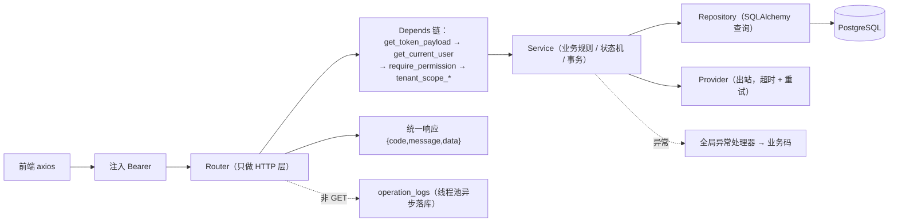

# 企业管理平台 · 项目说明（3W2H）

> 本文档回答五个问题：**做什么（What）**、**为什么这么做（Why）**、**给谁用（Who）**、**跑在哪里（Where）**、**怎么运转与怎么开发（How）**，最后给出**做到什么程度（How much / How well）**与后续演进建议。
>
> 事实来源：仓库源码逐文件核对 + 实际运行验证（`ruff check`、`pytest`、`vue-tsc`、`vite build`、浏览器冒烟）。所有"为什么"都尽量落到代码位置或既有文档条目，推断性内容会显式标注。
>
> 相关文档：
> - `docs/系统主要流程说明.md`：外呼域 **全量细节**（流程 / 状态机 / 接口 / 数据模型 / 定时任务 / 配置项），本文不重复其内容。
> - `.trae/documents/质检模块落地方案.md`：对话质检模块的**一期方案与决策依据**。

---

## 一、What：这是什么

一套面向企业的**呼叫中心一体化平台**，当前包含两个业务域：

| 业务域 | 解决的问题 | 交付形态 |
|---|---|---|
| **智能外呼**（既有） | 名单导入 → 建任务 → 选号 → 派单/执行呼叫 → 结果回写 → 重试/超时回收 → 会话小结 → IVR/回呼 → 报表监控 | 12 个前端页面 + 103 个接口 |
| **对话质检**（一期已交付） | 客服对话数据 → 专家领取评分分级 → 任务批量派发（10 万条级）→ 完成率/每日完成量报表 → 优秀案例库 | 6 个前端页面 + 37 个接口 |

### 1.1 规模盘点（可核对）

| 指标 | 数量 | 核对方式 |
|---|---|---|
| 业务数据表 | **38** 张（+ `alembic_version`） | `\dt` |
| 数据库迁移 | **8** 个版本 | `backend/alembic/versions/` |
| HTTP 端点 | **144**（认证 4 / 外呼 103 / 质检 37） | `app/api/v1/**` 中 `@router.*` 计数 |
| RBAC 权限码 | **63**（外呼 40 / 质检 23） | `scripts/init_db.py` 输出 |
| 后端 Python 文件 | 162（其中 service 层 42） | `app/` 递归计数 |
| 前端页面 | **21**（外呼 12 / 质检 6 / 首页·登录·404） | `frontend/src/views/**/*.vue` |
| 自动化测试 | 38 个测试文件；本次全量 **756 passed**（其中质检 87 条） | `pytest` |
| 定时任务 | **5** 个（超时回收 / 重试派发 / 预占释放 / 回呼派单 / 质检明细回收） | 启动日志 |

### 1.2 数据模型分组（38 张表）

| 分组 | 表 |
|---|---|
| RBAC 基线（5） | `users`、`roles`、`permissions`、`user_roles`、`role_permissions` |
| 审计（2） | `operation_logs`、`login_logs` |
| 租户与资源（3） | `tenants`、`sites`、`skill_queues` |
| 外呼配置（5） | `outbound_types`、`outbound_scenes`、`outbound_numbers`、`agents`、`agent_status_logs` |
| 任务与名单（4） | `outbound_tasks`、`outbound_task_numbers`、`outbound_lists`、`outbound_import_batches` |
| 执行与会话（5） | `outbound_records`、`outbound_sessions`、`call_histories`、`agent_assignments`、`service_summaries` |
| IVR（3） | `ivr_flows`、`ivr_nodes`、`ivr_transitions` |
| 回呼（2） | `callback_flows`、`callback_tasks` |
| 对话质检（9） | `qc_conversations`、`qc_messages`、`qc_import_batches`、`qc_reviewer_groups`、`qc_reviewer_group_members`、`qc_tasks`、`qc_task_items`、`qc_review_results`、`qc_case_library` |

---

## 二、Why：为什么是这些技术

### 2.1 业务侧为什么需要它

- **外呼域**：名单靠人工拨号无法规模化，且需要"号码限额、失败重试、超时回收、坐席预占"这类必须由系统兜底的规则；通话结果必须可审计。
- **质检域**：客服对话量大、人工全检不现实，需要"抽检 + 分级 + 报表 + 典型案例沉淀"的闭环。质检与外呼是**不同的限界上下文**（外呼关注"打出去"，质检关注"说得怎么样"），所以质检单独成包 `app/models/qc/`、`app/services/qc/`、`app/repositories/qc/`，只在基础设施层复用，避免把 22 张外呼表的语义搅浑。

### 2.2 后端选型：选了什么、为什么、代价是什么

| 选型 | 为什么 | 不选它的替代方案会付出什么 |
|---|---|---|
| **FastAPI** | 一是 Router 层极薄、与 Pydantic 天然一体；二是**自动生成 OpenAPI**，`core/openapi_examples.py` 能统一注入 `summary/description/response_model/examples/security`（代码注释标为 §58），前端与联调方直接读文档；三是依赖注入体系让"认证 → 权限 → 租户范围"三段式校验收敛为 `Depends` 链，业务代码里看不到鉴权 if | 换 Flask/Django 要自己拼校验链与文档，§58 的文档要求会退化成人工维护 |
| **uvicorn[standard]** | ASGI 标准实现，`[standard]` 附带 uvloop/httptools；生产由进程管理器多 worker 扩展 | 用 `gunicorn` 同步 worker 会浪费 Provider 调用的等待时间 |
| **SQLAlchemy 2.0（同步）** | 事务边界清晰（`db/session.py` 明确"事务由 Service 层控制、Router 不碰事务"）；服务层是同步实现，配合 `utils/async_bridge.py` 调用 async Provider，**既满足 §29 定义的 async Provider 接口，又不阻塞 HTTP**（§102-14） | 全面 async SQLAlchemy 会让 Service 层所有函数变 async，事务与异常处理复杂度显著上升；纯同步又会阻塞事件循环 |
| **psycopg3** | SQLAlchemy 2.0 官方推荐的 PG 驱动，二进制包安装无编译依赖 | psycopg2 在新版本 PG 与 2.0 方言上支持更旧 |
| **PostgreSQL 16** | 用到了只有 PG 才有的能力：**部分唯一索引**（`WHERE is_deleted = false` 实现"软删后名字可复用"）、`INSERT ... SELECT ... ON CONFLICT DO NOTHING`（10 万条派发幂等）、`JSONB`（导入失败明细、评分明细）、`timestamptz` | 换 MySQL 后 `ON CONFLICT`、部分唯一索引、JSONB 全部要改写成应用层逻辑，并发正确性下降 |
| **Alembic** | 8 个版本线性可追溯；模型集中在 `models/__init__.py` re-export，autogenerate 能发现新表 | 手写 DDL 无法在多环境保持一致 |
| **Pydantic v2 + pydantic-settings** | 入参校验即文档；配置从 `.env` 读取（`core/config.py`），**代码中禁止硬编码敏感信息与外部地址**（§68） | 手工解析环境变量易漏、无类型提示 |
| **PyJWT + bcrypt** | HS256 自签自验，无外部依赖；`jti` + Redis 黑名单实现登出即失效；bcrypt 成本因子可配置（测试降到 4 让用例快 10 倍以上） | 引入 OAuth2 授权服务器对当前"内部平台 + 账号密码"的场景是过度设计 |
| **Redis 7（可选）** | 只承担**登出黑名单**一件事；`core/cache.py` 在缺失/不可用时**自动降级放行并打日志** | 若把 Redis 设为强依赖，本地开发与单机部署都多一个必须维护的组件；代价是"Redis 挂了登出不是即时生效" |
| **APScheduler（单机）** | 超时回收这类任务必须**在应用内**周期性跑（§22）；单机 `max_instances=1` + `coalesce=True` 足够，且通过 `SCHEDULER_ENABLED` 开关在测试进程内关闭，保证用例可复现（§76 明确不做分布式调度） | 上 Celery 需要 broker + worker + 结果后端，对当前规模是纯增运维成本；代价是**多实例部署会重复执行**，需后续叠加分布式锁 |
| **openpyxl** | 名单与对话导入都要吃 `.xlsx`；纯 Python 无需 Office 环境 | pandas 会引入重量级依赖，而导入只需逐行解析 |
| **pytest + httpx + 真实 PostgreSQL** | 测试库与开发库同为 PG（`TEST_DATABASE_URL=...app_test`），**禁止用 SQLite 替代**——因为要验证的正是 SELECT FOR UPDATE、部分唯一索引、JSONB 这些 PG 特性，用 SQLite 会得到"假通过"（§98 禁止假测试） | 内存数据库跑得快，但测不出并发与约束行为 |
| **ruff** | 单一工具同时承担 lint 与格式检查，零配置即可用，`ruff check app tests` 作为提交前门槛 | flake8+isort+black 三件套配置成本更高 |

### 2.3 后端关键设计决策（每条都有明确理由）

| 决策 | 理由 | 位置 |
|---|---|---|
| 枚举一律 `VARCHAR(32)` + Python 校验，**不用 PG 原生 ENUM** | 原生 ENUM 增删值要走迁移、跨库不通用；本项目枚举会频繁迭代 | `models/outbound/enums.py` 的 `enum_type()` |
| 软删除 `is_deleted` + **部分唯一索引** | 既要保留历史行，又要让"删除后同名可重建"，普通唯一索引做不到 | `db/base.py:33`；质检表同样沿用（§50） |
| **状态机集中管理**：`TRANSITIONS: dict[状态, set[状态]]` + `ensure_transition()` | 状态流转是外呼与质检最容易写错的地方，集中一处即可被单测穷举；禁止在 service 里散落 `if status == ...` | `services/outbound/task_state.py`、`services/qc/{task_state,item_state}.py` |
| 质检 **`grade` 落在窄表 `qc_task_items` 上** | 10 万行的报表聚合只扫短列，不触碰 `qc_review_results` 的 `Text`/`JSONB` | 质检方案 §二 |
| 质检提交**不接受前端直传 grade**，只收 `score`，由服务端按阈值（默认 ≥90 优秀 / ≥60 及格）判定 | 防止绕过阈值伪造等级 | `services/qc/grading.py` |
| 10 万条派发用**单条 `INSERT ... SELECT` + `row_number()` 取模做轮询均分**，而不是逐行 ORM insert | 逐行插入 10 万行会产生 10 万次往返；SQL 内一次性完成，且均分误差 ≤1 | `repositories/qc/task_repository.py` |
| 派发幂等交给数据库：`ON CONFLICT (task_id, conversation_id) WHERE is_deleted = false DO NOTHING`，**冲突条件的 WHERE 必须与索引字面一致** | 重复触发派发不产生重复明细，无需应用层加锁 | 同上 |
| 计数一律用 `RETURNING` 而不是 `rowcount` | 实测本环境 psycopg 对 `INSERT` 返回 `rowcount = -1`，会导致"派发中断/误判已提交"两个真实缺陷；`UPDATE` 的 rowcount 正常，故领取/提交仍用它做乐观锁判定 | `task_repository.dispatch_batch`、`item_repository.insert_result` |
| 领取/提交用**带状态条件的原子 UPDATE + rowcount 判定**实现乐观锁 | 多人抢同一条明细时，只有一条能改成功，天然互斥 | `services/qc/review_service.py` |
| 外部系统一律走 **Provider 抽象 + 工厂 + `.env` 选择**（`mock` / 真实实现） | 开发与测试无需真实网关；上线只改配置不改代码（§28/§29/§30/§68）；真实实现缺地址时**直接报错而非静默降级** | `providers/factory.py` |
| Provider 调用有**统一超时与重试上限** | 禁止无限等待（§69） | `config.py` 的 `PROVIDER_TIMEOUT_SECONDS` / `PROVIDER_MAX_RETRIES` |
| 原始文件**只落盘不入库**，库里只存相对路径 | 数据库不做文件仓库；将来换 MinIO/S3 只需替换 `utils/storage.py` | `utils/storage.py`（§102-26 / §66） |
| 呼叫网关回调**带签名 + 时间戳容差 + 幂等** | 回调接口暴露在公网，必须可鉴权且可重放安全（§78）；密钥留空则一律拒绝 | `core/callback_signature.py` |
| 日志**禁止出现完整手机号/身份证号** | 合规要求（§67），统一走 `utils/masking.py` | 同上 |
| 非 GET 请求**异步落 `operation_logs`**，超管操作同样记录 | 审计需要，且不能拖慢响应（写库放到线程池） | `main.py:155-175`（§70） |

### 2.4 前端选型

| 选型 | 为什么 | 代价 |
|---|---|---|
| **Vue 3 + TypeScript + Vite** | 组合式 API 让"列表页 = 查询对象 + 表格 + 弹窗"这种高度同构的页面能保持一致的写法；`vue-tsc --noEmit` 能在 CI/提交前拦住多数低级错误；Vite 冷启动秒级、HMR 快 | 强类型需要为每个接口写 TS 类型（`src/api/**` 已按域组织，共 32 个 ts 文件） |
| **Element Plus** | 后台管理所需的表格/分页/表单校验/抽屉/对话框开箱即用，`v-permission` 指令与消息提示直接可用 | 打包体积偏大（生产 JS 主包 1.2MB，gzip 411KB） |
| **Pinia** | 只有 `user`（登录态与权限集合）与 `menu`（按权限过滤后的路由）两个 store，轻量且类型友好 | — |
| **Vue Router 动态路由** | 登录后按 `meta.permission` 过滤路由再 `addRoute`，菜单与页面权限一处定义两处生效 | 需注意 `beforeEach` 里重新 `replace` 而非返回 `{...to}`，否则会落到兜底路由（已在 `router/index.ts` 处理） |
| **Axios 拦截器** | 统一注入 `Authorization: Bearer`、统一弹错、401 时清 token 跳登录（用模块级 `redirecting` 防重复跳转）；业务码 `code !== 0` 一律 reject，避免各页面重复判错 | 目前**未接入 refresh token**，过期只能重登（已知边界） |
| **ECharts** | 报表与监控需要饼图/柱状图/折线图，`utils/useEcharts.ts` 统一封装挂载、更新与销毁，避免内存泄漏 | 图表库单独成 chunk（536KB） |

---

## 三、Who：谁在用、谁在维护

### 3.1 使用角色（RBAC：用户 → 角色 → 权限码）

| 角色 | 典型职责 | 依赖的权限前缀 |
|---|---|---|
| 超级管理员 | 初始化、跨租户排障；`is_superuser` 直接放行所有权限校验（§59） | — |
| 运营/管理员 | 维护类型、场景、号码、IVR、回呼流程，建任务、导名单、派单 | `outbound:{type,scene,number,ivr,callback,task,list,assignment}:*` |
| 坐席 | 处理派单、执行呼叫、登记服务小结 | `outbound:agent:*`、`outbound:session:*` |
| 质检专家 | 领取质检明细、评分提交、沉淀优秀案例 | `qc:review:work`、`qc:review:submit`、`qc:case:*` |
| 质检管理员 | 建专家组、建质检任务并派发、导入对话、看质检报表 | `qc:conversation:*`、`qc:reviewer:*`、`qc:task:*`、`qc:report:list` |
| 总监/管理者 | 看完成率与每日完成量、看话务报表与实时监控 | `outbound:report:list`、`outbound:monitor:view`、`qc:report:list` |

权限码命名规范 `模块:对象:动作`，共 63 条，集中在 `core/permissions.py` 定义、由 `scripts/init_db.py` **幂等**写入并授予内置 `admin` 角色；前端路由 `meta.permission` 与 `v-permission` 指令使用同一批码，做到"一处定义、三处生效"。

> 安全提示：前端的 `v-permission` 只是隐藏入口，**真正的鉴权始终在后端** `require_permission`。

### 3.2 维护者需要知道的约定

- 分层职责：`repositories/` **只写查询**，`services/` 承载业务规则/事务/状态机，`api/` 只做 HTTP 层（§54）。
- `app/models/user.py` 头部标注"**基线冻结**"：可以引用 `users.id`，但不要改这个文件（质检的"专家"就是普通用户 + 组成员关系，因此没有独立的专家表）。
- 时间统一 UTC 存储（`timestamptz`），仅在报表层按 `QC_REPORT_TIMEZONE`（默认 `Asia/Shanghai`）换算分桶。

---

## 四、Where：跑在哪里

### 4.1 部署形态

```
┌──────────────────┐   /api/v1 (HTTP)   ┌─────────────────────┐
│ 前端 Vue3 静态资源 │ ─────────────────▶ │ FastAPI (uvicorn)   │
│ Nginx / 静态托管  │                    │  ├ Router / Service │
└──────────────────┘                    │  ├ APScheduler(进程内)│
        ▲ 开发期：Vite dev server        │  └ Provider(mock/真实)│
        │ :5173 代理 /api → :8000        └─────────┬───────────┘
        │                                          │
        │                             ┌────────────▼────────────┐
        │                             │ PostgreSQL 16 (:5432)   │
        │                             │ Redis 7 (:6379, 可选)    │
        │                             └─────────────────────────┘
```

- `docker-compose.yml` **只含 PG + Redis**（均带 healthcheck、数据卷、UTC 时区）；后端本身尚无 Dockerfile（已知边界）。
- 本地开发前端通过 Vite 代理 `/api → http://127.0.0.1:8000`，避免跨域配置分叉；CORS 由 `CORS_ORIGINS` 控制。
- 健康检查：`GET /health` 返回服务与 Redis 可用状态，供部署探活。

### 4.2 目录地图

```
backend/
  app/
    api/          # HTTP 层：deps.py（认证/权限/租户范围）、v1/{auth,router}.py、v1/outbound/*、v1/qc/*
    core/         # config / security / permissions / response / exceptions / cache / logging / callback_signature / openapi_examples
    db/           # base.py（唯一 Base + 软删除/时间戳 Mixin）、session.py（事务由 Service 控制）
    models/       # user / log + outbound/*（22 表语义）+ qc/*（9 表）
    repositories/ # 数据访问：user + outbound/* + qc/*
    schemas/      # Pydantic 入出参：auth + outbound/* + qc/*
    services/     # 业务层（42 个文件）：auth + outbound/* + qc/*
    providers/    # 外部适配：call / phone / ivr / asr / tts + factory
    tasks/        # APScheduler 定时任务
    utils/        # async_bridge / masking / storage / validators
  alembic/        # 8 个迁移版本
  scripts/        # init_db.py（迁移 + 权限码 + 超管，幂等）
  tests/          # unit / api / integration
frontend/
  src/{api,stores,router,directives,layout,views,utils,types,styles,components}
```

### 4.3 本地跑起来（四步）

```bash
# 1) 基础设施
docker compose up -d db redis

# 2) 后端
cd backend
pip install -r requirements.txt
python -m scripts.init_db          # 迁移至 head + 同步权限码 + 建初始超管
python -m uvicorn app.main:app --host 127.0.0.1 --port 8000

# 3) 前端
cd frontend
npm install
npm run dev                        # http://localhost:5173

# 4) 登录：admin / Admin@123456（来自 .env 的 FIRST_SUPERUSER*）
```

---

## 五、How：怎么运转、怎么开发

### 5.1 一次请求的完整链路



### 5.2 三条必须理解的流程

**① 认证与权限**：登录只返回 token → 前端存 localStorage → 后续每次请求由拦截器带 `Authorization` → 后端 `decode_token` 校验类型与**黑名单 jti** → `get_current_user` 校验 `is_active` → `require_permission` 校验权限码（超管直接放行）→ `tenant_scope_*` 把入参 `tenant_id` 收敛为"该用户实际可访问的租户"（普通用户传别人租户直接 403）。

**② 质检批量派发（性能与幂等）**：任务创建时 `DRAFT` → 派发时按 `time_from ~ time_to` 圈定对话区间 → `INSERT ... SELECT` 分批（`QC_DISPATCH_BATCH_SIZE=2000`）写入 `qc_task_items`，`row_number()` 取模实现轮询/连续分片 → `ON CONFLICT DO NOTHING` 保证重复触发不重复派发 → 超过 `QC_MAX_PER_REVIEWER`（默认 2 万/人）直接拒绝并提示拆批 → 任务转 `DISPATCHED`，此后配置冻结不可编辑。

**③ 质检领取/提交/超时回收**：领取 = 带状态条件的原子 UPDATE（成功才写 `locked_at`/`timeout_at`）→ 提交 = 只收 `score`，服务端按阈值判定 `grade` 并写 `qc_review_results`（`item_id` 部分唯一索引防重复提交）→ 最后一个明细完成时整单转 `COMPLETED` → 超时未提交由 `qc_item_recycle` 定时任务（默认 300s 扫描、锁 1800s）回收为 `PENDING`，**幂等可重复执行**。

### 5.3 开发流程（改代码时的固定动作）

| 动作 | 命令 / 位置 |
|---|---|
| 改表结构 | 新增模型 → 确认在 `models/__init__.py` re-export → `alembic revision --autogenerate` → 检查生成的迁移（尤其部分唯一索引的 `postgresql_where`） |
| 改业务规则 | 只改 `services/`；状态流转只在 `*_state.py` 的 `TRANSITIONS` 里改 |
| 加权限码 | 在 `core/permissions.py` 追加 → `python -m scripts.init_db` 幂等同步 → 前端 `routes.ts` 的 `meta.permission` 与 `v-permission` 使用同一码 |
| 后端自检 | `ruff check app tests` → `pytest`（需要 PG 在跑；测试库 `app_test` 自动创建并迁移） |
| 前端自检 | `npm run type-check`（vue-tsc）→ `npm run build` |
| 接口文档 | 新增端点必须写 `summary/description/response_model`，示例统一由 `core/openapi_examples.py` 注入（§58） |

---

## 六、How much / How well：做到什么程度

### 6.1 质量现状（本次实测）

| 检查项 | 结果 |
|---|---|
| 后端 lint | `ruff check app tests` → **All checks passed** |
| 后端测试 | 全量 `pytest` → **756 passed**（外呼既有用例无回归），耗时 33s |
| 质检模块用例 | **87 条**，覆盖状态机、评分分级边界、对话 CRUD、三格式导入、派发均分与幂等、领取/提交并发与超时回收、报表时区分桶与补零、案例库、权限拦截 |
| 前端类型与构建 | `vue-tsc --noEmit` 通过；`vite build` 通过（2328 modules） |
| 前端页面冒烟 | 6 个质检页面在真实库数据下逐页核对：列表/明细抽屉、对话消息与导入弹窗、报表卡片与三个图表、工作台领取 + 提交 95 分落库为 `COMPLETED/EXCELLENT`；无控制台 error、无 4xx/5xx |

本轮验证顺带修掉的 **5 个问题**（3 个后端真实缺陷 + 2 处前端类型错误，均已回归）：

| 缺陷 | 根因 | 修复 |
|---|---|---|
| XLSX 导入恒报"表头需含 started_at" | 表头做了归一化（去 `_`），但查找键没归一化，永远匹配不到 | `services/qc/conversation_import.py` |
| 派发多批次只写入 3 行 | `INSERT` 的 `rowcount` 在本环境 psycopg 下返回 `-1`，被当成"0 行插入"提前中断 | `repositories/qc/task_repository.py` 改用 `RETURNING` 计数 |
| 首次提交质检结果被误判"已提交过" | 同上，`insert_result` 用 `rowcount` 判定冲突 | `repositories/qc/item_repository.py` 改用 `RETURNING` |
| 前端类型检查 2 处报错 | 必填接口对象断言到 `Record<string, unknown>` 不成立；两个类型导入未使用 | `frontend/src/api/qc/report.ts`、`views/qc/tasks/index.vue` |

### 6.2 已知边界与未完成项（诚实清单）

**平台级**（详见 `docs/系统主要流程说明.md` §21）：
1. IVR / ASR / TTS Provider 仅 mock，无真实实现调用方。
2. 录音只存路径，**无下载/试听端点**，附件能力不存在。
3. 任务 `max_concurrency` 在执行层未强制（实际用 `EXECUTE_BATCH_SIZE`）。
4. 预测外呼只输出并发建议，无自动并发拨号闭环。
5. 前端未接 refresh token，过期只能重登。
6. 首页"模块进度"表为静态硬编码且已过期。
7. 无应用 Dockerfile（compose 只含 PG+Redis）。
8. 调度为单机 APScheduler，**多实例部署会重复执行**，需补分布式锁。
9. `.env` 中的 `SECRET_KEY`、回调密钥、超管密码均为**开发默认值**，上线前必须替换。

**质检模块一期明确不做**（质检方案 §一）：真实 ASR 引擎接入、专家排班（9/16 班次）、客户赋能/培训包、AI 自动质检、录音在线播放器与波形、评分模板自定义、对话全文检索、异步任务队列。

---

## 七、后续演进建议（按性价比排序）

1. **上线前必做**：替换 `.env` 中的密钥与超管密码；确认 `CORS_ORIGINS`、`SCHEDULER_ENABLED` 与多实例调度策略；给应用补 Dockerfile。
2. **前端补 refresh token 静默续期**，消除 30 分钟被踢体验问题。
3. **接真实 ASR**：Provider 接口与 Mock 已就位，只需实现 `providers/asr/*` 并在 `.env` 切换；同时补录音播放所需的上传/下载端点。
4. **多实例部署时**给 5 个定时任务加分布式锁（Redis 已具备条件）。
5. 质检二期：排班、评分模板、AI 预筛（先机器评分再由专家复核），届时 `grade` 与 `score_detail` 的结构已能承载。